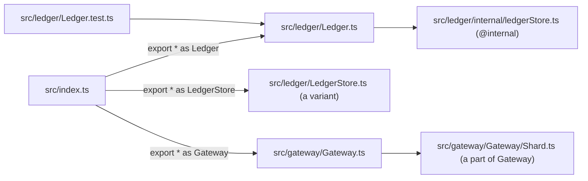

# 0032: next/'s libraries take Effect's file layout, PascalCase files with prefixed variants, internal/ for private parts and a namespace index, a flat src/ except libfabrika's one folder per module, and no folders by kind

**What this decides:** `libfabrika` and every other library package in `next/` lays out its files
the way Effect and its core team's own libraries do: one PascalCase file per concept, and an
`index.ts` that re-exports each one as a namespace. A library's `src/` is flat, except
`libfabrika`'s, which has one folder per module, a folder with one subject
([0043](0043-rooms-on-floors.md), [0091](0091-modules-and-layers.md)); each of those folders holds
its own files and its own `internal/`.



```ts
// src/index.ts, as clanka's and Effect's are written (libfabrika's adds the module folder, and
// leaves out their `@since` tag until the first release, 0118)
export * as Ledger from "./ledger/Ledger.ts"

// a caller
import { Ledger } from "@kampus/libfabrika"
const ledger = yield* Ledger.Ledger
```

## Context

[0023](0023-next-follows-effects-code-style.md) said `next/` follows Effect's style and listed
"PascalCase module files plus `internal/` and the namespace barrel" as items to follow, each in its
own sweep. This record settles how. It reads the code itself, not a summary:

- `effect/packages/effect/src` at `effect@4.1.2`: flat PascalCase modules (`Deferred.ts`,
  `Schedule.ts`), private code in `src/internal/` in camelCase with `/** @internal */`, and
  `index.ts` as `export * as X from "./X.ts"` with a doc block on each.
- clanka (a library by an Effect core maintainer): flat `src/` of PascalCase files, tests beside
  them (`Compaction.test.ts`, `CompactionTokens.test.ts`), variants as prefixed siblings
  (`Codex.ts`, `CodexAuth.ts`), a folder only beside its same-name file (`SemanticSearch.ts` +
  `SemanticSearch/`), and a namespace `index.ts` with `@since` tags.
- dfx (the same maintainer): the same, with a concept's parts in a folder beside its file (a gateway
  module and its shard folder). dfx also has `utils/` and `Helpers/` folders; that is the part we do
  not copy.
- cheffect (the same maintainer, an app): feature folders, each beside its same-name module
  (`Recipes.ts` + `Recipes/`), plus `components/`, `lib/` and `services/`.

[0029](0029-format-and-names-follow-effect.md) already allows `Module.of(...)` read through a
namespace import, which this layout makes the normal way in.

The same day, [0034](0034-libfabrika-folders-are-bounded-contexts.md) wanted one folder per bounded
context in `libfabrika` instead of the one flat `src/`, and [0043](0043-rooms-on-floors.md)
replaced that before any file moved with one folder per subject, a module
([0091](0091-modules-and-layers.md) renamed what 0043 called a room). 0043 also makes `internal/`
private to its module, not to the whole package. [0051](0051-gateway-connection-and-node-by-job.md)
named the Cloudflare prefix and the `dev` word. The Decision says what holds after all three.

## Decision

**A library in `next/` has PascalCase files, one concept each, and an `index.ts` that re-exports
each public file as a namespace. Its `src/` is flat, except `libfabrika`'s, which has one folder per
module, each with its own files and `internal/`.**

- **One concept per file, PascalCase:** `Ledger.ts`, `Mailbox.ts`. The test sits beside it:
  `Ledger.test.ts`. A second test file for the same file is a prefixed sibling:
  `LedgerSpans.test.ts`. The repo's test infixes stay: `.laws.test.ts`, `.types.test.ts`,
  `.test-support.ts`, `.fixture.ts`.
- **A variant is a prefixed sibling, not a folder:** `LedgerStore.ts`, `LedgerTransaction.ts`. A
  platform's version of a piece is a variant too: `CloudflareGateway.ts`, as Effect's platform
  packages name `NodeFileSystem` and `BrowserHttpClient`. The prefix for Cloudflare code is
  `Cloudflare`, not `Workers` ([0051](0051-gateway-connection-and-node-by-job.md)).
- **A folder only for a concept's parts,** beside the file of the same name: `Gateway.ts` +
  `Gateway/Shard.ts`.
- **`libfabrika`'s `src/` has one folder per module** ([0043](0043-rooms-on-floors.md),
  [0091](0091-modules-and-layers.md)): a folder is one subject, and a module's layer is a line in
  `layer-rules.json`, never a folder. Every other library keeps a flat `src/`.
- **Private code goes in `internal/`,** camelCase, with every export marked `/** @internal */`.
  In `libfabrika` each module has its own `internal/`, private to that module. In another library,
  `src/internal/` is private to the package. Nothing outside imports it, and `package.json` exports
  none of it.
- **No folders by kind:** no `services/`, `types/`, `utils/` or `helpers/`. Folders by area are
  gone too, apart from `libfabrika`'s module folders.
- **`index.ts` re-exports each public file as a namespace:**
  `export * as Ledger from "./ledger/Ledger.ts"`. A doc comment carries no `@since` until
  `libfabrika` has a released version ([0118](0118-no-since-tag-before-a-release.md)). Callers write
  `Ledger.make(...)` and `Ledger.Ledger`. `package.json` exports each module's files by subpath, as
  Effect's does, so a caller can also import one file by its path.
- **The top level still names no platform** (AGENTS.md): `index.ts` re-exports no `Node*` or
  `Cloudflare*` file. Those are reached only by their own path.

**Before** (libfabrika on main, 2026-11-09; lowercase folders by area):

```text
next/packages/libfabrika/src/
  index.ts  id.ts  testing.ts
  app/           brain-event.ts  brain-life.ts  entry.ts  execution.ts  patch.ts
                 program.ts  runner.ts  state.ts  supervisor.ts
  coordination/  index.ts  client-manager.ts  mailbox.ts  members.ts  process.ts
                 process-manager.ts  process-store.ts  recovery.ts  session-manager.ts  ...
  data/          index.ts  ledger.ts  ledger-store.ts  ledger-transaction.ts  log.ts
                 records.ts  referee.ts  sink.ts  sqlite.ts  trace.ts  ...
  door/          index.ts  door.ts  nonce.ts  store.ts
  transport/     index.ts  binary.ts  gateway.ts  hello.ts  sshsig.ts  webauthn.ts  wire.ts  ...
  workers/       index.ts  box.ts  gateway.ts  runtime.ts  platform.ts  ...
  node/          build.ts  local-stage.ts  stage.ts  stage-recording.ts
```

**After** (PascalCase files in one folder per subject; a sketch, and 0043's table says which files
sit in which module):

```text
next/packages/libfabrika/src/
  index.ts                     export * as Ledger from "./ledger/Ledger.ts", one per public file
  Id.ts  Testing.ts  ProcessId.ts  Rev.ts  Sql.ts    the shared names, beside it
  ledger/      Ledger.ts  LedgerTransaction.ts  Log.ts  Referee.ts  ...
               internal/  ledgerStore.ts  ...                      each export @internal
               Ledger.test.ts  ...                           each test beside its file
  gateway/     Gateway.ts  ...
  processes/   Mailbox.ts  Process.ts  ProcessManager.ts  ...
```

The folders by area are gone, replaced by one folder per subject; the layer each file belongs to
lives only in `layer-rules.json`. The move plan holds the full old-to-new table.

**Apps are not decided here.** The lean for `next/apps/fabrika` is cheffect's shape: feature
folders, each beside a same-name file (`Gateway.ts` + `Gateway/`). The owner has not decided it.

Binding constraints:

- A new file in a `next/` library follows this layout.
- A move of files is `git mv` only, with import lines rewritten, and changes no law:
  `layer-rules.json` lists each module's layer, so `pnpm lint:layers` checks exactly what it checked
  before.

## Consequences

- One move, split into small pull requests that each land whole, per its plan. It touches every
  file in `libfabrika`, every import of it in `next/apps/fabrika` and `next/programs/counter`, the
  path-bearing configs (`layer-rules.json`, `exam-paths.json`, `fixtures/next/p10`) and the lint
  rules that name a libfabrika path.
- Callers move from named imports (`import {Ledger} from "@kampus/libfabrika/data"`) to namespaces
  (`Ledger.Ledger`). Longer at each use; one way in for every file.
- The path shows a file's subject and not its layer. A reader learns the layer from
  `layer-rules.json` or the lint error. That is the cost.
- 0023's "PascalCase module files plus `internal/` and the namespace barrel" item is closed by this
  record. No doc comment carries `@since` until the first release
  ([0118](0118-no-since-tag-before-a-release.md)).
- Not decided here: the app's layout (a lean above), and better names than the mechanical ones the
  move picks (`State.ts` holds `Saved`): a rename after the move is its own change.
