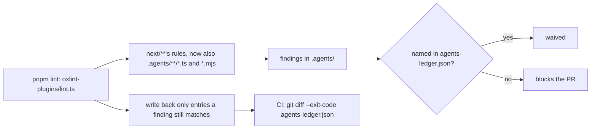

# 0033: Lead tooling under .agents/ follows next/'s code rules, and the ledger of its old breaks only shrinks, takes no new entry and goes when empty

**What this decides:** the code in `.agents/` is linted with the same rules as `next/`, and what
already breaks them is listed in a ledger that can only get shorter, never gains an entry and is
deleted when it is empty.



```json
{
	"entries": [
		{
			"file": ".agents/skills/lead/scripts/botpush.mjs",
			"rule": "fabrika(no-node-imports)",
			"code": "import {execFileSync} from \"node:child_process\";"
		}
	]
}
```

## Context

Agents read `.agents/` (the lead scripts, `drive.ts`, `chain.ts`) and copy its habits into the code
they write. On 2026-11-09 the owner decided that lead tooling follows `next/`'s code conventions for
that reason: tooling that breaks them teaches every agent that reads it to break them too.

The fast track in [AGENTS.md](../AGENTS.md#how-a-change-lands) stays: lead tooling skips the
plan, tests, mutation and review steps. This decision is about how the code reads, not how it lands.
It builds on [0023](0023-next-follows-effects-code-style.md) (next/ follows Effect's code style),
[no Promises](../docs/direction/no-promises.md), and [0031](0031-lane-tooling-dogfoods-fabrikas-primitives.md),
whose move of `chain.ts` onto `Program.make` is where most of the ledger goes (that move waits, by
[0070](0070-flow-runner-stays-a-machine.md)). The ledger began as a list like
`unreachable-ledger.json` ([0006](0006-no-unused-exports.md)).

At the start, `.agents/` held about 17k lines: 21 `.ts` files, 1 `.mjs`, 12 `.sh` and 3 `.py`.

Later changes shaped what holds now. On 2026-11-10 the owner let in 12 `agents-ledger.json`
entries, once, for `fabrika/no-why-key` (tracker ticket 535, [PR 664](https://github.com/usirin/tea-fabrika/pull/664)):
12 lines under `.agents/` keep the key `why` because they read or write a shape today's version
owns, and today's code keeps `why` until it is deleted
([AGENTS.md](../AGENTS.md#before-you-design-anything), "Data keys are short everyday words"). An
inline ignore would not do, since oxlint reads those files a second time through the skills links
and reports the comment as unused (finding `2026-11-10-f01`). [0113](0113-no-shell-or-python-scripts.md)
replaced the "moves when next touched" rule for shell and Python on 2026-11-11, and
[0168](0168-old-lint-breaks-are-fixed.md) closed the ledger to new entries on 2026-11-13.

## Decision

**Code under `.agents/` is held to `next/`'s lint rules from today; what already breaks them is in a
ledger that only shrinks and takes no new entry, and new code passes from day one.**

- **Same rules.** `.oxlintrc.json`'s `next/**` override also covers `.agents/**/*.ts` and
  `.agents/**/*.mjs`, and its test override `.agents/**/*.test.ts`. A rule that checks its own path
  checks `.agents/` too.
- **The ledger.** `agents-ledger.json` names each old break by file, rule and the line's code, never
  a line number, so moving code keeps its entry and changing the line drops it. `pnpm lint` waives
  only what it names. A run over the whole repo writes back only the entries a finding still
  matched, and CI fails until that pruned file is committed. The breaks it names are worked down to
  zero, rule by rule, and the file is deleted, with the code that reads it, when it is empty
  ([0168](0168-old-lint-breaks-are-fixed.md)).
- **No new entry, ever.** No pull request adds a row to the ledger. An entry outside `.agents/` is
  refused.
- **Edges** use the same comment as `next/`:
  `// oxlint-disable-next-line <rule> -- edge: <why>`, one line each.
- **No new shell or Python script enters the repo,** and the ones that were there are ported to
  TypeScript and Effect now, one pull request at a time, not left until next touched
  ([0113](0113-no-shell-or-python-scripts.md)).
- **The first big burn-down** is `chain.ts` moving onto `Program.make` under
  [0031](0031-lane-tooling-dogfoods-fabrikas-primitives.md). For now it waits: the runner stays a
  tea machine ([0070](0070-flow-runner-stays-a-machine.md)).

**Binding constraints:**

- No new entry in `agents-ledger.json`.
- No override that turns a `next/` rule off for a non-test `.agents/` file.
- A change that touches a ledgered line fixes it rather than rewriting the entry.

**Rejected:** hiding `.agents/` from agents' searches. It hides the bad habits; it does not fix them,
and the lead's own agents still need to read the scripts.

## Consequences

- On the first day, 112 findings in 7 files went into the ledger (counted in the lint PR).
- Some scripts may need real edges (a `node:` import Effect has no module for, a Promise a platform
  demands); each is one marked line, read at merge.
- Not decided here: lint rules for Python or shell.
