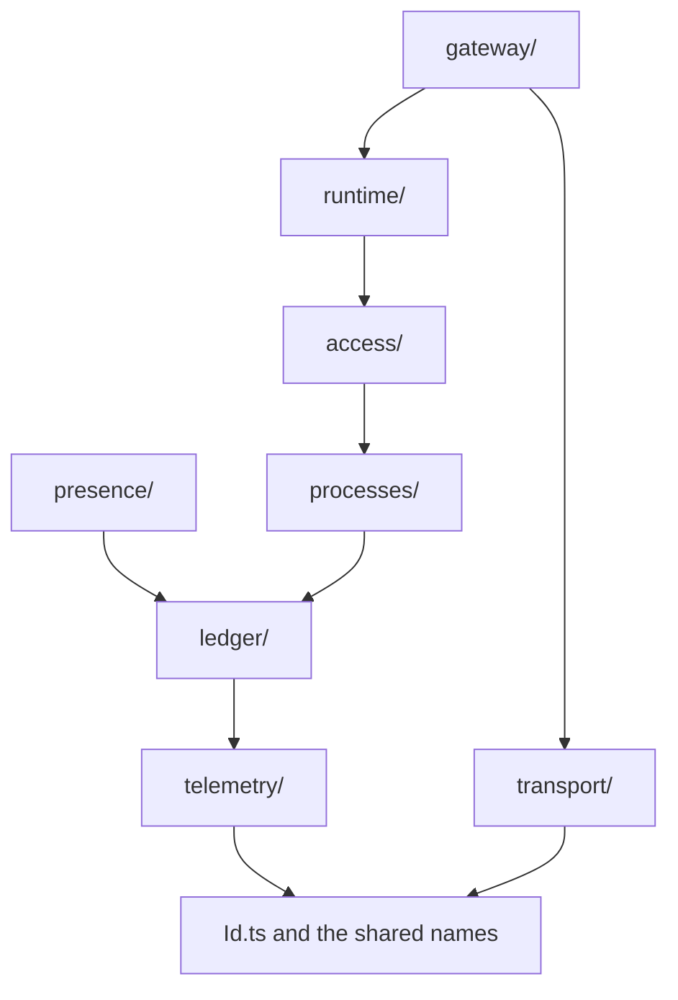

# 0043: libfabrika's src/ has one folder per subject, a module, and a layer is a line in the rule file that says who may import whom, never a folder, and each module offers Effect services in its own types and errors

**What this decides:** in `next/packages/libfabrika/src`, a folder holds one subject and is called a
module, and the order of imports between modules is kept only in the rule file, where each module
sits on a layer.



An arrow points down a layer, from a module to one it imports today. A layer only forbids: no
import goes up, and none goes sideways. Which lower modules a module may import is the exam's
table (rule 3). The gateway is the only module that imports `transport/`, and it imports no
`ledger/` file (rule 11).

```text
next/packages/libfabrika/src/
  gateway/     Gateway.ts + internal/
  runtime/     Runner.ts + internal/         access/
  processes/   (the mailbox lives inside)    presence/
  ledger/                                    telemetry/
  transport/
  Id.ts and the shared names (ProcessId, Sql, Rev, ParentText) beside it
```

All of this is about `next/`. Today's version is not touched.

This record first said room for a module and floor for a layer, and called the gateway the door.
[0091](0091-modules-and-layers.md) renamed the first two and
[0051](0051-gateway-connection-and-node-by-job.md) the door: `door/` is `gateway/`, presence's
`GatewayManager` is `Connections`, and `workers/` is `cloudflare/`, later
`@kampus/libfabrika-cloudflare`. The rules are the same. The Context keeps the words it was
written in.

## Context

Three records came before this one, all on 2026-11-09, and no file has moved for any of them:

- [0032](0032-libraries-take-effects-file-layout.md) gave libraries Effect's file layout: one flat
  `src/` of PascalCase modules.
- [0034](0034-libfabrika-folders-are-bounded-contexts.md) replaced the flat `src/` with three
  folders, `Clients/`, `Ledger/` and `Runtime/`, where the layer picked the folder.
- [Experiment 245](../experiments/245-are-libfabrikas-layers-right.md) then read the imports. The
  order of the layers is right. The folders are not: `coordination/` holds four subjects, `data/`
  holds two, and 0034's `Ledger/` would hold 27 files and five subjects.

The owner settled the layout the same day, "for now": a later tier may add rooms. This record
**replaces 0034** and **changes 0032 in part** (Consequences lists what changes and what is
kept).
[0037](0037-implicit-state-machines-made-explicit.md) said the runner and the door are split first,
riding with this layout, and [0038](0038-span-sink-measurements-and-metrics.md) said the folder for
spans, measurements and metrics would be `telemetry/`. Tracker tickets 507 (this record) and 477
(the move).

The model is OTP's. An OTP application is a subject: "a component that can be started and stopped
as a unit" ([applications](https://www.erlang.org/doc/system/applications.html)). The order between
them is a separate fact. Parnas said the same in 1972: a clean order and a clean split are "two
desirable but independent properties" (quoted in experiment 245).

Every file name below was read on `origin/main` at `d7484976` for this record.

The owner ruled on more of the layout on 2026-11-10, and the Decision below has the result.
Three first readings were wrong and are replaced: that a room may import every room below it (a
floor is a limit, not a grant), that `runtime/` imports `ledger/` and `telemetry/` openly (it does
not import `ledger/`), and that `LedgerError` is a shared name (it is the ledger's own). A lean that
the door keeps its `ledger/` import, as the place where the rooms are put together, was wrong too:
the gateway gets no exemption. The exam's layer row was first called a real loosening that the
owner would rule on; he ruled no, so no row waits on him.

## Decision

**A folder in `libfabrika`'s `src/` is a module, one subject, and a layer is a line in the rule
file that says which modules a module may import.**

**Before** (main on 2026-11-09; 0034's three folders were never built):

```text
next/packages/libfabrika/src/
  index.ts  id.ts  testing.ts
  transport/     index.ts  answer.ts  binary.ts  gateway.ts  hello.ts  sshsig.ts  waiting.ts
                 webauthn.ts  wire.ts
  data/          index.ts  ledger.ts  ledger-store.ts  ledger-transaction.ts  log.ts  referee.ts
                 sqlite.ts  worker-sql.ts
                 archive.ts  health.ts  record-part.ts  records.ts  sink.ts  trace.ts
  coordination/  index.ts  mailbox.ts  process.ts  process-manager.ts  process-mail.ts
                 process-id.ts  gateway-manager.ts
                 members.ts  client-manager.ts  authorization.ts  session-manager.ts  text.ts
                 process-store.ts  recovery.ts  recovery-store.ts
  app/           brain-event.ts  brain-life.ts  entry.ts  execution.ts  patch.ts  program.ts
                 runner.ts  state.ts  supervisor.ts
  door/          index.ts  door.ts  nonce.ts  store.ts
  node/  workers/
```

**After** (this record; the move plan holds the row for every file):

```text
next/packages/libfabrika/src/
  index.ts  Id.ts  Testing.ts  and one file per shared name (ProcessId, Sql, Rev, ParentText)
  transport/   answer, Connection, hello, sshsig, webauthn, wire             internal/ binary
  telemetry/   archive, record-part, records, sink, trace                    internal/ health
  ledger/      ledger, ledger-transaction, log, referee, sqlite, worker-sql  internal/ ledger-store
  processes/   mailbox, process, process-manager, process-id                 internal/ process-mail
  presence/    Connections
  access/      members, client-manager, authorization, session-manager, text
  runtime/     app/'s nine files, process-store, recovery-store              internal/ recovery, supervisor
  gateway/     Gateway                                                       internal/ nonce, store, waiting
  node/  cloudflare/                                                         platform folders, see below
```

The after tree keeps today's file names so the two trees compare, except the names
[0051](0051-gateway-connection-and-node-by-job.md) changed: `door/` is `gateway/`, `GatewayManager`
is `Connections`, `transport/gateway.ts` is `transport/Connection.ts` and `workers/` is
`cloudflare/`. 0032's PascalCase names apply to each front file, and the plan picks them.

The rule file, before and after:

```json
[
  { "name": "next-door", "paths": ["next/packages/libfabrika/src/door"] },
  { "name": "next-app", "paths": ["next/packages/libfabrika/src/app", "next/packages/libfabrika/src/testing.ts"] },
  { "name": "next-coordination", "paths": ["next/packages/libfabrika/src/coordination"] },
  { "name": "next-data", "paths": ["next/packages/libfabrika/src/data"] },
  { "name": "next-transport", "paths": ["next/packages/libfabrika/src/transport"] }
]
```

```json
[
  { "name": "next-door", "layer": 6, "paths": ["next/packages/libfabrika/src/gateway"] },
  { "name": "next-runtime", "layer": 5, "paths": ["next/packages/libfabrika/src/runtime"] },
  { "name": "next-access", "layer": 4, "paths": ["next/packages/libfabrika/src/access"] },
  { "name": "next-processes", "layer": 3, "paths": ["next/packages/libfabrika/src/processes"] },
  { "name": "next-presence", "layer": 3, "paths": ["next/packages/libfabrika/src/presence"] },
  { "name": "next-ledger", "layer": 2, "paths": ["next/packages/libfabrika/src/ledger"] },
  { "name": "next-transport", "layer": 2, "paths": ["next/packages/libfabrika/src/transport"] },
  { "name": "next-telemetry", "layer": 1, "paths": ["next/packages/libfabrika/src/telemetry"] }
]
```

The first block is `layer-rules.json` as it was on 2026-11-09, cut to the five libfabrika rows. The
second is a sketch of the shape: each module names its layer in one `layer` key of its row, and
`layer-rules.json` holds the real rows and ranks. What the reader should see move: a folder used to
be a layer, and now a module names its layer in one line.

The rules:

1. **A folder is a module, a layer is a rule.** A module holds one subject. A layer says who may
   import whom. Which layer a module is on is one line per module in the rule file, so moving a
   module to another layer changes one line and no path.
2. **The five layers stay the design's words.** Transport, data, coordination, app and desktop are
   still how [the five layers](../docs/direction/a-local-first-sync-engine.md) tell the design.
   They are no longer folder names, and "coordination" is no longer a folder at all.
3. **A module imports only from lower layers, and a layer is a limit, not a grant.** Never from a
   higher layer, and never from another module on its own layer (owner, 2026-11-09, the same day).
   If one module needs another on its layer, the needed module moves down a layer in the rule
   file, in the open. `pnpm lint` checks both: no upward import and no same-layer import.
   - **The rule forbids an import that goes up or sideways. It does not allow every import that
     goes down.** The exam's layers law
     (`next/apps/fabrika/src/exam/layers.integration.test.ts`) says which lower modules each module
     may import, written by module, and it keeps every limit it has: only the gateway imports
     `transport/`, for example, though `transport/` is below every module. Replacing that table with
     the layers alone would widen more rows. That is a further loosening and is not decided.
   - *Test files keep this rule too, with database laws as suites a higher module runs
     ([0062](0062-test-files-keep-the-floors.md)).*
4. **The layers, bottom up, as the rule file starts:**

   | Layer | Modules |
   |---|---|
   | 6 | `gateway/` |
   | 5 | `runtime/` |
   | 4 | `access/` |
   | 3 | `processes/`, `presence/` |
   | 2 | `ledger/`, `transport/` |
   | 1 | `telemetry/` |

   `telemetry/` is the lowest layer, alone, and any module may import its front files openly (rule
   14).

   The owner listed five layers, with `ledger/` beside `telemetry/` and `runtime/` beside
   `access/`. Main's imports do not allow those two pairs under rule 3, so rule 3 was applied as
   written and each needed module sits one layer lower:
   - `data/ledger.ts` and `data/ledger-store.ts` import `short` and `errorClass` from
     `data/trace.ts`. The ledger needs telemetry, so `telemetry/` is below `ledger/`.
   - `app/runner.ts` and `app/entry.ts` read seven names of `coordination/session-manager.ts` and
     `coordination/members.ts` through `coordination/index.ts` (`SessionManager`, `SignRequest`,
     `Session`, `Writer`, `NotGranted`, `SigningRefused`, `MemberFact`). The runtime needs access,
     so `access/` is below `runtime/`. It cannot join layer 3, because it imports `processes/`
     (`mailbox.ts`, `process.ts`).
5. **There is no `coordination/` folder.** Its files go to four modules:
   - `processes/`: `mailbox.ts`, `process.ts`, `process-manager.ts`, `process-mail.ts`,
     `process-id.ts`. `mailbox.ts` and `process.ts` import each other, so they are one module, as in
     OTP a process has a mailbox.
   - `presence/`: `Connections` (`gateway-manager.ts` before 0051: join, leave, online or away).
     The industry's word: [Phoenix Presence](https://hexdocs.pm/phoenix/Phoenix.Presence.html).
   - `access/`: `members.ts`, `client-manager.ts`, `authorization.ts`, `session-manager.ts`. The
     session manager records who an input is by and signs on their behalf.
   - `runtime/`: `process-store.ts`, `recovery.ts`, `recovery-store.ts`. Only the runner's files
     and the Cloudflare wiring use them (experiment 245). Two of them read the ledger today, and
     `runtime/` may not: rule 11 says what is cut first.
   - `text.ts` imports only `members.ts`. The plan decides whether it moves to `access/` with it or
     the read is cut.
6. **"Members" becomes "access"** as the name of who is allowed in and what each key may do. It is
   the industry's word for grants (access control), and Tier 3 has a role named member
   ([tiers](../docs/plan/tiers.md#tier-3s-roles-owner-2026-11-07)), which would clash. `grant tree`,
   `device` and the key words keep their names. The rename in code rides with the move.
7. **`data/` splits in two.** `ledger/` holds the ledger only. `telemetry/` holds spans,
   measurements and metrics; [0038](0038-span-sink-measurements-and-metrics.md)'s rename rides with
   the move.
8. **Every module has front files and an `internal/`.** One front file, or a few, in PascalCase as
   0032 says. The rest is in the module's `internal/`.
   - Nobody imports another module's `internal/`. 0032 kept `internal/` private to the package;
     this makes it private to the module.
   - No module re-exports another module's names. Today `coordination/index.ts` re-exports 11
     names that are not its own, 10 from `data/` and `InputId` from `id.ts`, so "the app layer
     never imports data" is true only by the path of the import (experiment 245).
   - `runtime/` does not import `ledger/`, and imports `telemetry/` openly where it needs it (rules
     11 and 14).
9. **The runner and the gateway are split, move-only first.** `app/runner.ts` is 1,721 lines,
   1,492 of them one function. The gateway's front file, `door/door.ts` when this was decided, is
   1,776 lines and does four jobs. Each becomes a front file plus `internal/` files cut along its
   state machines ([0037](0037-implicit-state-machines-made-explicit.md)). A sketch:
   `runtime/Runner.ts` with `internal/supervision.ts`, `holder.ts`, `accept.ts` and `dispatch.ts`.
   The split moves lines and changes none. The machine fixes come after, each its own pull request.
   `transport/waiting.ts`, the gateway's waiting room, moves to `gateway/`: only the gateway uses
   it.
10. **A module that needs "and" to describe it splits.** Modules we expect later, as guesses: a job
    queue (Tier 4), spend and limits (Tier 5), pipes between programs (Tier 2).
11. **`runtime/`, `gateway/` and `access/` import no `ledger/` file** (owner, 2026-11-10). The
    principle: each layer offers Effect services of its own that give the layer above
    higher-level functions, in its own words, and the layer above never sees what is two layers
    down. It holds for every module, with no exemption. Where a module needs something from two
    layers down, the layer between adds a service for it, and that service names none of the lower
    module's types.
    Nothing in the ledger's row of the exam is loosened. What main said, read at `9407cf46`:
    - `app/runner.ts` never uses the `Ledger` service. It names `LedgerError` 19 times: one import
      (`:31`), three types (`:159`, `:1189`, `:1691`) and 15 places where it builds one itself, such
      as `new LedgerError({why: "bad_row"})` for a bad supervision state at `app/runner.ts:379`.
    - It gets that error from below as the services' own: `Mailbox.send`, `receive` and `read`
      (`coordination/mailbox.ts:119-123`) and `ProcessManager`
      (`coordination/process-manager.ts:28`, `:44`, `:62`) fail with `LedgerError`.
    - Two files that rule 5 sends to `runtime/` read the ledger. `coordination/process-store.ts:5`
      takes the `Ledger` service and appends a runtime record with it (`:222`), and
      `coordination/recovery.ts:2` builds a field from the ledger's `Line` (`:62`). Each moves to
      `runtime/` as rule 5 says, and its ledger read is cut in the step that gives `processes/` a
      function for it, before the runtime row is checked by module.
    - `door/door.ts:37-52` and `coordination/session-manager.ts` import `ledger/` today. They get
      the same cut. This answers the folder move plan's open question 3 (ticket 477).
12. **Every module offers its functions as Effect services in its own words.** A service's
    signatures use only the module's own types and errors, plus the shared names beside `Id.ts`.
    - A lower module's error is translated at the service boundary into the module's own tagged
      error, with the original kept as its `cause`, so no detail is lost. This is Effect's own
      shape: in `node_modules/effect/AGENTS.md` (`effect@4.1.2`, "Services") the `Database`
      service's `query` fails with `DatabaseError`, a `Schema.TaggedError` of its own with
      `cause: Schema.Defect()`. Ours already asks for the cause
      ([an error keeps its cause](../.patterns/effect-errors-keep-their-cause.md)).
    - `processes/` gets an error of its own for a fault from below. `ProcessError`
      (`coordination/process.ts:160`), its refusal, stays.
      [0055](0055-errors-named-by-their-service.md) reads "an error of its own" as one per service:
      `Mailbox` fails with `MailboxError` and `ProcessManager` with `ProcessManagerError`.
    - No module builds another module's error. The runner's 15 `new LedgerError` become the
      runtime's own error.
    - `LedgerError` is the ledger's own and is not a shared name: a shared error would let every
      module go on returning it. `door/store.ts`, `door/nonce.ts` and
      `coordination/recovery-store.ts` use it today for their own SQLite faults and get their
      module's error.
13. **Plain values that several modules need are shared names** beside `Id.ts`. Read on main:
    `Sql` and `SqlValue` (`data/referee.ts:7-10`, the storage handle), `ProcessId`
    (`data/trace.ts:12`), `Rev` (`data/log.ts:12`, a place in the log) and `ParentText`
    (`data/log.ts:20`). The runtime reads them at `app/runner.ts:50`, `app/state.ts:5` and
    `app/program.ts:6`. These stay the ledger's own: its services (`Ledger`, `LedgerTransaction`,
    `Referee`, `Doorbell`), `LedgerError`, `Line`, `Entry` and `Waited`. `Appended`
    (`data/log.ts:90`), what `append` answers, stays the ledger's too: `app/entry.ts:151-162` and
    `app/runner.ts:1189` name it today, and by rule 12 the modules between answer in their own
    words.
14. **`telemetry/` is the lowest layer, and any module may import its front openly.** The runtime
    reads `SpanSink`, `SinkError`, `RecordManager` and `Archive` (`app/entry.ts:8-16`) and `sha256`
    (`app/runner.ts:46`) from it directly. `transport/` sits beside `ledger/` on layer 2, so
    `telemetry/` is alone at the bottom; the layers are still six. The exam counted these files as
    data, which transport and the app layer may not import. So this rule widens those rows for
    telemetry's front, by the owner's own ruling.

**The exam's layer row keeps its limit** (owner, 2026-11-10). Rule 8 changes what the exam's layers
law reads, and loosens nothing in the ledger's row.

- The check reads real imports. A name passed through another module no longer counts, and another
  module's `internal/` is refused. These are new laws.
- The runtime row has no `ledger` in it. The planted break "app may not import data" stays, now
  checked on a real import of `ledger/`.
- So no row waits on the owner.

**Binding constraints:**

- A new file in `libfabrika` goes in its module from today, even before the move lands.
- The move is `git mv` with import lines rewritten. A pull request that moves files changes no
  line of logic.
- No module is added to a layer that holds a module it imports.
- The move still starts only after the Effect format sweep (0029, ticket 466) has merged.

## Consequences

- **0034 is superseded.** Its three folders are gone before they were built, and so is its rule
  that the layer picks the folder.
- **0032 is changed in part.** Replaced: "one flat `src/`", "no folders by area" for the modules
  named here, and "`internal/` is private to the package" (now to the module). Kept, inside each
  module: PascalCase front files, tests beside them, a variant as a prefixed sibling, a folder only
  for a concept's parts, `internal/` in camelCase with `@internal`, the namespace `index.ts` and no
  platform at the top level. No folders by kind is kept too: no `services/`, `types/`, `utils/` or
  `helpers/`.
- **0034's binding constraint on the exam is kept.** It said the exam's table keeps "the app layer
  imports coordination, not data". The runtime row has no ledger in it, and after the pass-through
  is gone that is true of what the runtime knows, not only of an import's path.
- **The path shows the subject and not the order.** A reader learns a module's layer from the rule
  file or the lint error.
- **The move plan is rewritten** for this layout. It was written for 0034 and no file had moved.
- **The notes that cite a path keep it until the move.** `docs/direction/follows/otp.md`,
  `.patterns/` and the plan rows cite files as they are on main; the pull request that moves a
  file fixes its citations ([0017](0017-each-model-we-follow-has-one-table.md)).
- **The cost** is six layers where the notes say five layers, and eight small folders, two of them
  thin (`presence/` is one 144-line file).
- Not decided here:
  - **Whether `presence/` stays its own module.** It is one file today and could live in
    `gateway/` until Tier 3. The owner accepted its own module for now.
  - **Where the platform files go.** `cloudflare/` and `node/` would move to platform packages
    (`@kampus/libfabrika-cloudflare`, `@kampus/libfabrika-node`), as 0034 already leaned. Until
    then they stay where they are, above every module.
  - **Which way supervision is fixed.** Its parts now sit in one module, `runtime/`. Whether the
    supervisor learns of a death by letter, as OTP's does, is P34c's
    ([0016](0016-tier-1-supervision-is-otps-top-level-supervisor.md)).
  - **How lint checks rule 12,** that a module's exported signatures name no other module's
    types. The import rules cover re-exports and `internal/`. A signature that names another
    module's type is not an import fact alone. Open, with a lean and no ruling (2026-11-10): an
    existing tool first ([0040](0040-existing-tools-before-hand-written.md)), 70% that code-graph
    can carry it. It reads imports and re-exports; its CLI reference says its API ledger "records
    names, never signatures", and [demlik issue 912](https://github.com/kamp-us/demlik/issues/912)
    asks for a signature rule. [Issue 913](https://github.com/kamp-us/demlik/issues/913) asks for
    the same-layer rule, since `--layers` allows imports inside one layer today. Until they ship, a
    local `pnpm patch` is the way forward. A type-level test per module is the fallback.
  - The app's layout (`next/apps/fabrika`), as in 0032.

## Records

- [`.glossary/TERMS.md`](../.glossary/TERMS.md), new rows: `floor` and `room (library)` (Shared
  names), `access` (Clients), `presence` (Ledger), `telemetry` (Runtime). Changed: the `five layers`
  row's Not column says a layer is no longer a folder. One context map line for `room`. Later,
  0091 renamed the two library rows `module` and `layer (library)`.
- No glossary row changes for `LedgerError`, which has none; `Rev` and `ParentText` are named
  inside other rows and keep their meaning.
- Not changed: `grant tree`, `device`, `person key`, `window key`, `recovery key` and `spent`.
  Their rows still cite `Members`, `foldMembers` and `door/members`, which are code names on main.
  They change with the code rename, in the move.
- [We follow DDD](../docs/direction/we-follow-ddd.md) and
  [the five layers](../docs/direction/a-local-first-sync-engine.md) each get a pointer here.
  AGENTS.md gets one line.
