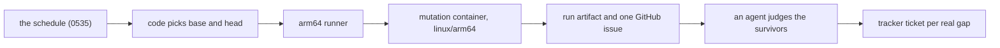

# 0067: The mutation run runs in GitHub CI on an arm64 runner, started by a schedule or by hand, never by a push or a pull request



```sh
# a run by hand, with the same two inputs the schedule fills in
gh workflow run mutation.yaml -f base=<last run's head> -f head=<main's head>
```

**What this decides:** the mutation run from 0066 moves from the laptop to GitHub CI, and the
schedule starts it, with `workflow_dispatch` kept for a run by hand.

## Context

[0066](0066-mutation-runs-on-a-schedule.md) took mutation off the pull request's steps and made it
one scheduled run against main, as a one-week trial. It put that run on the laptop and put CI off.
On 2026-11-10 lanes parked on a busy Docker box several times, and the laptop keeps only one box
([0045](0045-test-steps-run-in-containers.md)).

This amends 0066 in part: where the run happens.

Facts behind it:

- GitHub gives public repos free arm64 Linux runners (`ubuntu-24.04-arm`, 4 vCPU, 16 GB).
- The mutation container is built for `linux/arm64` (`PLATFORM` in
  `.agents/skills/lead/scripts/mutbox.ts`), so it runs there unchanged.
- This repo's CI already runs on Linux x64 (six jobs) and macOS (one).
- On the laptop, a container run took 143 s for 2 mutants and 162 s to 484 s for 150, with about
  2 minutes of fixed start-up. Runner timing is not measured yet.

## Decision

**The mutation run runs in GitHub CI, started by the schedule or by hand with
`workflow_dispatch`, never by a push or a pull request.**

- The workflow is `.github/workflows/mutation.yaml`, on an arm64 runner (its `runs-on` key), with
  two inputs for a run by hand: `base` and `head`.
- Who starts a scheduled run and how often is the rule of
  [0535](0535-pull-requests-stay-fast-the-schedule-carries-the-rest.md); this record states no
  interval of its own.
- A scheduled run picks its own range in code
  ([0123](0123-githubs-schedule-starts-the-mutation-run.md)): `base` is the head of the last
  passing run, `head` is main's head. When they are equal the run ends as a skip.
- The run's results are kept as run artifacts, and its survivors open or update one GitHub issue
  (0535). An agent judges the survivors and files tickets, as 0066 says. It reads the artifacts of
  every run since the last one it judged, so a run made while no agent was awake is not lost.
- This replaces the laptop run inside 0066's trial. The trial is still read after one week,
  around 2026-11-17.

**Binding constraints:**

- `mutation.yaml` has no `push` or `pull_request` trigger. Its triggers are the schedule and
  `workflow_dispatch`.
- The run changes nothing in the repo. It reads, runs the container and uploads its results.

## Consequences

- The laptop's one Docker box is left for lanes. The run uses no laptop box, so it never waits
  behind a lane's test step.
- A run no longer dies when a laptop session closes, and no session has to stay alive to start one.
- Anyone can read a run's results in its artifacts.
- Why a schedule starts it: the range and the skip are code, and only judging the survivors needs
  an agent, which reads the artifacts later. The cost is that GitHub's schedule can start a run 10
  to 60 minutes late when GitHub is busy, which is accepted for a check on main.
- Runner timing is not measured yet. The first runs give it.
- This is about today's trial only. The `next/` mutation queue in
  [the mutation note](../docs/direction/fast-and-daily-mutation.md) still runs on the host's
  alarms, with no GitHub Actions shards.
- Not decided here: whether mutation returns to the pull request's steps, and what happens after
  the trial.
