# 0076: A lane stops and the lead answers redo, cut scope or drop when 3 of its last 5 steps were stuck on the work or sent back, when its review is sent back a second time, or at twice the plan's estimate in steps and dollars, while a stuck on a tool files a finding and drains one tool budget shared by all lanes, as a trial

**What this decides:** a lane stops and waits for an answer when its work keeps failing close
together, when a review sends it back a second time, or when it passes twice its plan's estimate; a
stuck step caused by a tool is charged to the tool, not the lane.

```mermaid
flowchart TD
  plan["plan writes its estimate; the backstop is twice it"] --> step["a step runs"]
  step --> how{"how did it end?"}
  how -- "stuck, fault: tool" --> finding["a finding row against the tool"]
  finding --> tools{"tool budget left?"}
  tools -- "yes" --> step
  tools -- "no" --> hold["no chain starts a step until the tool is fixed"]
  how -- "stuck, fault: work, or send" --> window{"3 of the last 5 steps?"}
  how -- "a review sent it back" --> second{"its second sent-back review?"}
  how -- "done" --> backstop{"past the backstop?"}
  window -- "no" --> backstop
  window -- "yes" --> stop["the chain stops and asks the lead"]
  second -- "no" --> backstop
  second -- "yes" --> stop
  backstop -- "no" --> step
  backstop -- "yes" --> stop
  stop --> answers["redo, cut scope or drop"]
```



```ts
// Sketch, not built. How a step ends, as the chain counts it.
type StepEnd =
  | { _tag: "done" }
  | { _tag: "send"; to: string; reason: string }
  | { _tag: "stuck"; reason: string; fault: "tool" | "work" };

// OTP's restart intensity, counted in steps, never seconds (0065).
const intensity = { count: 3, within: 5 }; // work stucks or sends in the last 5 steps
// A sent-back review is counted apart from the window (0176): the second one stops the lane.
const stop = { sentBackReviews: 2 };

// The plan's own estimate, and the backstop set from it.
const estimate = { steps: 12, dollars: 15 };
const backstop = { steps: 24, dollars: 30 }; // twice the estimate

// What a stop asks. The lead picks one; the chain runs it.
type Answer = "redo" | "cut_scope" | "drop";
```

## Context

**Why now.** A few lanes run far longer than the rest, and nothing stops them early. Counted on
2026-11-10 from the lane state files that `field/runs.jsonl` names: 40 lanes, 654 steps in all, a
median of 12.5 steps a lane. The worst lane ran 61 steps. Another ran 53 steps, with 14 stuck and
19 plan amendments, all on one branch. Most stucks on the worst lanes were tooling faults, not the
change. [0072](0072-a-churning-lane-is-redone.md) has the full table.

**The limit before this.** `chain.ts` parked a lane after a fixed `MaxSteps` for every lane,
whatever its size, and had no limit on dollars. The rows file already records each step's
list-price dollars.

**What labs do.** The labs study (experiment 250, in an open pull request) found teams that cap
rounds: one caps CI rounds at two, another caps review rounds at three. Those are caps on one kind
of round. This budget is a cap on the whole lane.

**How it fits 0072.** 0072 says when a churning lane is redone, and it leaves open what is counted
and the numbers. This decision adds the trigger that forces the question: at a stop, the lead must
choose, and redo is one choice. This decision changes no rule of 0072; it links it.

**A trial.** The owner called this our least thought out area. The rule here is a starting point,
and a study and our own experiments follow under tracker ticket 675:

- how others stop runaway work;
- replaying past lanes from `field/runs.jsonl` at 1.5x, 2x and 3x the estimate;
- whether a tooling fault counts against the lane;
- what stops an endless run of lanes that each stay inside budget.

Tracker ticket 675 is this decision.

**Why the window, and how sure.** The rule was first recorded as the budget at twice the estimate
alone. [Experiment 254](../experiments/254-how-a-lane-should-stop.md) is the study this file asked
for, and it made the count of work stucks and send-backs in a window of recent steps the main
rule, with twice the estimate as the backstop. It counted 84 lanes and 992 steps since
2026-11-01, cut by ticket from the rows, so its numbers do not compare one to one with the 40 lanes
above. The median lane ran 6 steps, the longest 93. On the five longest lanes, 35 of 41 stuck steps
were sorted as tool faults. A flat cap at twice the median lane would have stopped 29 of 84 lanes,
and 24 of those landed later. Twice the plan's estimate, from its hours, fired on 2 of 38 lanes.
"3 stuck in 5 steps" stops 7 lanes, the two worst among them, each at its first burst. One level
up, lead tooling and field logs rose to 56% of merges on 2026-11-09.

About 65% sure. The tool-versus-work sort was one agent's judgment, on five lanes. Two weeks of
stuck rows with a typed fault, then the same replay, settles it. If tool faults stay above about
half, the rule holds; if agents cannot tell tool from work, the lead tags the fault at the stop
instead. It stays a trial.

**Who answers, and what counts.** Two later records changed the stop, and this text says what holds
now:

- [0096](0096-the-lead-fixes-forward-while-the-owner-is-away.md) and
  [0162](0162-no-friction-before-a-merge.md): the lead answers the stop itself, at any time, and
  notes it for the owner. What is the owner's alone is listed in 0096.
- [0176](0176-second-send-back-stops-lane.md): the window could not fire on the usual loop of
  review, tests, build, review, which holds at most 2 send-backs in any 5 steps. So a sent-back
  review is counted apart, and the second one stops the lane. For that stop the lead's default
  answer is cut scope.

## Decision

**A lane whose work gets stuck or sent back 3 times within its last 5 steps, whose review is sent
back a second time, or that passes twice its plan's estimate, stops the chain; the lead answers
redo, cut scope or drop; a stuck step caused by a tool files a finding against the tool and does
not count against the lane (owner, 2026-11-10, still a trial).**

- Every stuck step says its fault: `tool` or `work`.
- 3 work stucks or send-backs within the last 5 steps stop the chain. A sent-back review is
  counted by 0176 instead: the second one stops the lane.
- The plan gives its own estimate of steps and dollars. The budget is twice that. It is the
  backstop, written in steps and dollars in the plan, and no longer the main rule.
- Reaching either number, steps or dollars, stops the chain.
- A stop, from the window, a second sent-back review or the backstop, asks the lead one of three
  things:
  - **redo**, in 0072's sense: close the lane and start again on a fresh branch from the plan as
    amended. Never "restart", which means a new process here.
  - **cut scope**: amend the plan to do less, and go on.
  - **drop**: close the lane without a merge.
- A tool stuck writes a finding row against the tool
  ([0035](0035-outside-work-becomes-finding-rows.md)) and takes one from a tool budget shared by
  all lanes. When it runs out, chains start no new step until the tool is fixed.
- No agent sees any of these numbers in its prompt, so saying "stuck" stays cheap and honest.
- Plumbing and lead tooling lanes get a budget the same way as product lanes.
- Each week the owner sees the share of merges that are lead tooling or field logs. It asks; it
  never blocks.
- The stop is a state of the lane's machine, never the lead's habit or a line in a prompt
  ([0037](0037-implicit-state-machines-made-explicit.md)).

**Binding constraints:**

- No lane starts without a budget in its plan, in steps and dollars.
- No stuck step is written without a fault, `tool` or `work`.
- At a stop, no step of that lane starts until the lead, or the owner for what is the owner's
  alone, answers.
- With the tool budget spent, no chain starts a step until the tool is fixed.
- The stop records which rule fired, the window's steps, the sent-back reviews or the budget, what
  was spent and the answer.

## Consequences

- **Today's version (lead tooling).** The plan's shape gains an estimate and a budget in steps and
  dollars; plans give agent hours today. The step row and the stuck answers in `drive.ts` and the
  step skills gain the fault. `chain.ts` counts the window of 5 steps, the backstop and the shared
  tool budget, in place of the fixed `MaxSteps`; it holds the window and the backstop's multiple as
  `IntensityCount`, `IntensityWithin` and `BackstopTimes`. The weekly share goes in the lead's
  status notes for now, and later inside fabrika, from a metrics program with its own ticket. All of
  it is lead tooling, fast-tracked ([0033](0033-agents-code-follows-next-rules.md)).
- **In `next/`.** The budget is a field of the plan, and the fault a field of a stuck outcome. The
  window and the stop are states of the lane's machine, with the three answers as transitions
  ([0037](0037-implicit-state-machines-made-explicit.md),
  [0046](0046-one-tea-machine-per-file.md)). When the lane becomes a named flow
  ([0064](0064-the-lead-drives-with-flows.md)), they go with it.
- The cost: every stuck step must say its fault, and an agent cannot always tell. A lane that loops
  on send-backs spread out wider than 5 steps runs on to the backstop. The plan step must also give
  an honest estimate in steps and dollars, which it does not do today.
- A lead's answer at the stop may start a redo. [P5 of the pipeline guidelines](../docs/direction/pipeline-guidelines.md#p5-after-a-persons-judgment-the-lane-goes-on-from-the-step-before)
  says a person's answer never restarts a lane; 0072 already named that clash. Settling it is left
  to ticket 675.
- Not decided here:
  - the tool budget's size, and what counts as one tool;
  - whether a send-back counts the same as a stuck; for now each counts as one;
  - the line on the weekly share;
  - the P5 clash above.
- Answered by experiment 254: a tooling fault does not count against the lane; a run of lanes that
  each stay inside budget is caught by the tool budget and the weekly share. Twice the estimate
  stays as the backstop's multiple, unmeasured: plans gave hours, so the replay could not test it in
  steps and dollars.

## Records

- `.glossary/TERMS.md`: a row for **budget (lane)**, in Pipeline.
- `.glossary/TERMS.md`: rows for **fault (stuck)**, **intensity (lane)** and **tool budget**, in
  Pipeline.
