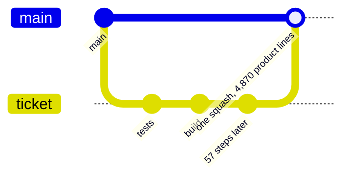
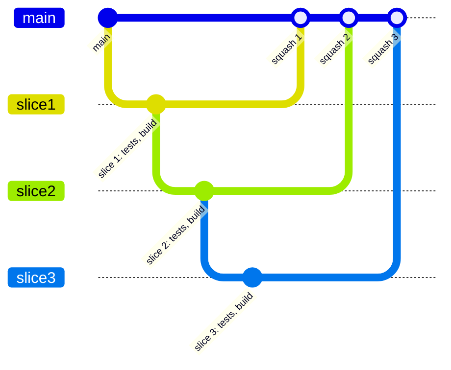

# 0087: Bigger work is a stack of slices cut at plan time, each one a pull request that lands whole, and no line count caps a pull request

**What this decides:** a plan cuts bigger work into a stack of slices, each one a pull request that
lands whole with its tests, and no line count caps, refuses or holds a pull request.

**Before:**

**After:**

One branch that grows until it lands becomes a stack of slices, each its own pull request through
every step, landing bottom up with [0004](0004-squash-merges-and-native-stacks.md)'s `gh stack`.

## Context

**The first case, as a fact.** [PR 810](https://github.com/usirin/tea-fabrika/pull/810) (tracker
ticket 286, Tier 1's row P14) holds 4,870 product lines and 10,655 test lines in 94 files after 57
steps. It is to be restacked. [0072](0072-a-churning-lane-is-redone.md) already counted it as the
lane with the second most steps. [Tier 1's risks](../docs/plan/tier-1.md) say it plainly: a big
landing is a weak review.

**Why size matters.** A person cannot review much more than a few hundred lines well. By
[0079](0079-size-counts-governed-paths-name-who.md), a change's size sets how many people must look
at it, so a huge change costs people's time, agent time and compute at once. Tracker ticket 686
holds this decision.

**The cap this record first set.** On 2026-11-10 it set a cap of 600 product lines, as a trial that
only advised. [0099](0099-no-number-caps-a-pull-request.md) removed the cap, its `review.lines`
setting and the plan check the next day: the number was never measured here, and a slice that was
one whole thing was held for its size. What is kept is the slices, the stacks and "each slice lands
whole".

What the sources say about size, and how well we read them:

- **Google's engineering practices,**
  ["Small CLs"](https://google.github.io/eng-practices/review/developer/small-cls.html) (read
  2026-11-10): "100 lines is usually a reasonable size for a CL", and 1000 lines "is usually too
  large".
- **SmartBear's study of code review at Cisco:** developers "should review no more than 200 to 400
  lines of code (LOC) at a time"
  ([SmartBear's best practices page](https://smartbear.com/learn/code-review/best-practices-for-peer-code-review/),
  read 2026-11-10). Its
  [case study page](https://smartbear.com/resources/case-studies/cisco-systems-collaborator/) gives
  the scale: 2,500 reviews of 3.2 million lines over 10 months. **Secondary:** both are the vendor's
  own summaries, and SmartBear sells a review tool. The primary write-up, the book *Best Kept
  Secrets of Peer Code Review* (SmartBear, 2006), was not read.
- **Our own data, [experiment 252](../experiments/252-risk-tiers-on-phoenix.md),** on 457 merged
  pull requests of one other public repo (phoenix, run through today's fabrika): small changes (50
  lines or fewer) had 1 of 78 (1.3%) later fixed, 51 to 400 lines 17 of 232 (7.3%), and large ones
  (over 400 lines) 17 of 147 (11.6%). Lines there are additions plus deletions, tests included. About
  70% sure, one repo, and some of size's edge may be that a big change shares more files with a
  later fix.

How it relates:

- **[0079](0079-size-counts-governed-paths-name-who.md):** size sets how many people must look,
  never whether a pull request lands.
- **[0076](0076-a-lane-stops-at-its-budget.md):** the plan already gives an estimate in steps and
  dollars. Each slice now gives one in lines too, recorded and never checked against a number.
- **[0072](0072-a-churning-lane-is-redone.md):** restacking PR 810 keeps its old branch and pull
  request as they are, as a redo does; nothing is rewritten.
- **[0004](0004-squash-merges-and-native-stacks.md):** the tooling. A stack is a GitHub stack, run
  with `gh stack`, each slice squash-merged bottom up.
- **[0014](0014-the-lead-merges-when-every-step-passed.md):** each slice is its own pull request,
  so it goes through every step (plan, tests, build, one review) and merges by 0014's rule.
- **[Every pull request goes through the steps](../docs/direction/next-is-a-pipeline-pre-run.md)
  and [how a change lands](../docs/plan/README.md#how-a-change-lands):** no builder starts before
  an approved plan, so the plan is the place to cut. Docs-only decision pull requests and lead
  tooling keep their own paths there.

## Decision

**Bigger work is a stack of slices the plan cuts, each of which lands whole with its tests, and no
line count stops, refuses or holds a pull request (owner, 2026-11-10 and, for the cap,
[0099](0099-no-number-caps-a-pull-request.md), 2026-11-11).**

- **Cut at plan time.** A plan for bigger work lists its slices. Each slice is one pull request
  that lands whole, with its tests, and works on its own (the plan skill's "pull requests that each
  land whole"). The stack runs on 0004's native stacks.
- **No number caps a slice.** There is no `review.lines` setting and no check of a slice's estimate
  against a number. The cut is by what works on its own.
- **Size is recorded.** The plan carries each slice's estimate in product lines, and the merged
  pull request its real product lines.

**Binding constraints:**

- No slice is cut so it cannot land alone: each lands with its tests and leaves main working.

## Consequences

- The plan's shape holds a list of slices, each with an estimate in product lines. Today that is
  lead tooling (`plancheck.sh` in the plan skill), fast-tracked
  ([0033](0033-agents-code-follows-next-rules.md)); in `next/` it is a field of the plan.
- PR 810 is restacked into slices. Its old branch and pull request stay as they are.
- The cost: more pull requests, each through every step, and a stack waits bottom up. A planner
  must estimate lines per slice, which no plan did before.
- To record from day one: each slice's estimated lines in the plan, and on each merged slice its
  real product lines, so estimate and real can be compared.
- Not decided here:
  - **How product lines are counted exactly:** generated files, lockfiles, shots and docs. The
    known way to look at first is `.gitattributes`' `linguist-generated`, which GitHub's own diff
    uses to hide generated files.
  - Whether a stack is one lane or one lane per slice.

## Records

- Glossary: `slice` and `stack (pull requests)` added to the Pipeline section of
  [TERMS](../.glossary/TERMS.md).
- [AGENTS.md](../AGENTS.md): one line beside the pipeline steps rule.
