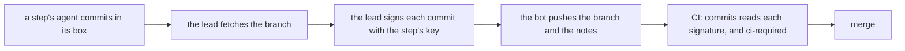
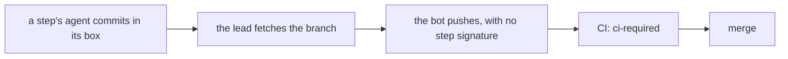

# 0161: Today's hand-run tooling signs no commit with a step key, and the rule that nobody writes their own exam stays as practice, except on a fix round, until next/'s own pipeline holds it

**Before:**



**After:**



```sh
# before
sh .agents/skills/step-commit/scripts/stepcommit.sh build 828 "<subject>" <paths>
node .agents/skills/lead/scripts/botpush.mjs <tree> fabrikalfa/<branch>
# after
git -c user.name='fabrikalfa[bot]' commit -m "T828 build: <subject>" -- <paths>
node .agents/skills/lead/scripts/botpush.mjs <tree> fabrikalfa/<branch>
```

The sign step is gone. Nothing else on the path moves.

**What this decides:** in the hand-run phase no step key signs a commit and no note records a step.
The bot still pushes the branch ([0164](0164-the-bot-stays-without-signing.md)).

## Context

- [Nobody writes their own exam](../docs/direction/nobody-writes-their-own-exam.md) was decided on
  2026-10-22: an agent that writes or fixes code never changes what that code is checked against.
- [A unit of work is a commit](../docs/direction/a-unit-of-work-is-a-commit.md) (2026-11-05) had CI
  hold that rule from signatures. Each step signs its commits with its own key, and the `commits`
  job decides from the signature. It was built for `next/` first. On 2026-11-08 today's hand-run
  tooling took signing on early.
- What it cost by hand: every commit passed through the signer on the lead's laptop, so a step's
  agent could not finish its own work. One odd state stopped a lane: a staged index, a refused
  sign, notes another session had pushed.
- On 2026-11-13, 18 pull requests were open and 7 of them were marked ready. The owner named
  merging as the thing that stops shipping.
- AGENTS.md already says a first slice does not defend against a person's own agents ("The first
  slice works, later slices harden"). The signed chain is that defense, taken on before the
  machinery that carries it.
- The bot: main's rules need it nowhere. Pull requests are already opened with a person's login,
  and no approval is required (rules read on 2026-11-13). Once signing goes, the bot's only job is
  pushing branches, which a person's login does too. The owner allowed dropping it where that
  makes the work easier, and the lead's read is that it does.
  [0164](0164-the-bot-stays-without-signing.md) then kept the bot for pushes and pull requests,
  with no step signature.

## Decision

**Today's hand-run tooling signs no commit with a step key and writes no step note.**

- A step's work is a plain git commit. No step key, no note under `refs/notes/fabrika`, no sign at
  fetch, and no signed merge of main.
- The bot pushes a branch, with a token that lasts one hour, and opens its pull request. A commit of
  agent work is authored by `fabrikalfa[bot]` and names the owner in a `Co-authored-by` trailer
  ([0164](0164-the-bot-stays-without-signing.md)). The `fabrikalfa/` prefix stays, since it still
  says the branch holds agent work.
- A commit's subject keeps naming its ticket and its step, as `T<ticket> <step>: <subject>` does
  today. So which step made a commit stays a recorded fact. Only the proof goes.
- CI's `commits` job stops gating a merge. `ci-required` stays.
- The rule stays, and in this phase practice holds it: tests are written before the build, by a
  different agent; the loosening check is read at the merge; and a change under an exam path still
  waits for the owner's read. Two cases step past that practice. On a fix round, one agent writes
  the law and the fix together ([0177](0177-fix-round-is-one-agent.md)). A pull request that only
  carries out what an accepted decision already owes needs no owner read before it merges: the
  lead merges it on green and shows the owner after ([0166](0166-owed-work-needs-no-owner-read.md)).
- Signing stays the design for `next/`'s own pipeline:
  [a unit of work is a commit](../docs/direction/a-unit-of-work-is-a-commit.md), decided, and
  [code commits and signs each step](../docs/direction/code-commits-and-signs-each-step.md),
  proposed. Nothing leaves the plan.

**Binding constraints**

- No hand-run script refuses a commit, a push or a merge for a missing signature.
- No agent in a box gets a login. The push stays on the host.
- The exam paths stay owner-read, apart from a change that only carries out an accepted decision
  (0166), and the leak grep still runs before every push.
- Old signatures and notes stay where they are. No history is rewritten.

## Consequences

- Owed, each as its own pull request:
  - CI: the `commits` workflow and the exam's commit check come out, or stop gating. They are exam
    paths, and the lead merges that pull request on green because this record owes it (0166).
    Done 2026-11-13: the workflow came out in https://github.com/kamp-us/tea-fabrika/pull/1134.
  - Main's ruleset: `commits` leaves the required checks. Done 2026-11-13, on the owner's word
    ([0162](0162-no-friction-before-a-merge.md), [0163](0163-the-lead-acts-on-the-owners-word.md)).
  - The lead scripts that sign lose the signing and the step notes: `stepcommit.sh`,
    `box.sh fetch --sign`, `botpush.mjs`, `publish.ts`, `land.ts` and `catchup.sh`. The bot's push
    stays ([0164](0164-the-bot-stays-without-signing.md)).
  - The skills that describe signing (lead, step-commit, tests, build) lose that prose in the same
    pull requests.
- Until those land, the tooling still signs.
- The ruleset that keeps the bot to `fabrikalfa/` branches stays, since the bot pushes
  (0164; [0406](0406-the-bot-is-held-to-its-branches.md) says what it must hold).
- What it costs:
  - CI can no longer prove that a builder left the exam alone. A builder that edits a law is caught
    by the loosening check or by a reader, or not at all.
  - Pushed agent work shows under the bot's login on the code host, with the owner as co-author.
- This changes older records in part:
  - [0056](0056-lead-runs-a-refused-step-itself.md): a refused lead sign no longer comes up.
  - [0098](0098-the-signed-chain-covers-the-branch-not-main.md): the chain it describes is no
    longer made by hand. It holds wherever signing runs.
  - [0116](0116-github-requires-ci-required-on-main.md): `commits` is no longer required beside
    `ci-required`.
- Not decided:
  - Whether a cheap code check stands in for the proof in this phase.
  - The four steps and the field rows that each pull request goes through.
  - A merge queue for this repo.
