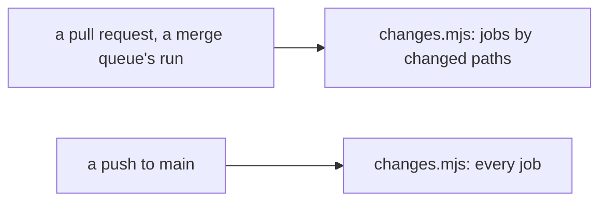
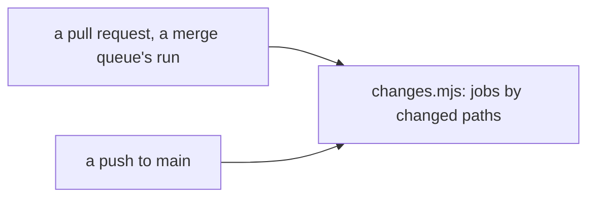

# 0175: Every run that can read its changed paths picks its jobs from them, a push to main included

**Before (0174):**

**After:**

What moves: a push to main joins the two events that already follow their paths.

**What this decides:** which jobs of `check.yaml` a run starts, on every event.

## Context

- [0174](0174-a-queue-run-follows-its-paths.md) made a merge queue's run follow its changed paths,
  and kept one line: every push to main still runs every job. This replaces that line.
  [0525](0525-todays-version-is-frozen.md) later left today's own checks nothing to start for.
- The owner's principle, stated for all CI: a run starts only the checks related to its change,
  never every check for a one-line change.
- Today's version is being replaced by `next/`
  ([clean slate](../docs/direction/clean-slate.md)). Its code rarely changes, and a faster queue
  matters more than checking again code nobody touched.

## Decision

**Every event that can read its changed paths picks its jobs from them: a pull request, a merge
queue's run and a push to main.**

- A push's changed paths are the diff from what main held before the push to its head.
- A push is never a draft. The draft rule stays for `pull_request` alone.
- Today's own checks (its tests, e2e, the promises gate and the build) have nothing left to start
  for ([0525](0525-todays-version-is-frozen.md)).
- A run that cannot say what changed starts every job (`classify` in `.github/ci/changes.mjs`):
  history that cannot be read, no path at all, a first push with no commit before it, and any event
  that is none of the three. Which tests each job runs follows
  [0534](0534-the-merge-line-runs-changed-tests-a-schedule-runs-all.md).

## Consequences

- The base for vitest's `--changed` comes from the merge queue's group and the push too, so
  neither runs a whole suite.
- The whole suite runs on the schedule (`.github/workflows/scheduled.yaml`,
  [0534](0534-the-merge-line-runs-changed-tests-a-schedule-runs-all.md)).
- **The cost, said plainly:** a test the changed files do not reach can break main, and the
  scheduled full run is what shows it.
- The laws in `.github/ci/changes.test.ts` that said a push runs every job are narrower. That narrowing is the owner's call, made
  with this decision.
- `ci-required` needs no change: it passes a skipped job when `changes` said "false" for it.

## Not decided

- Nothing about deleting today's version.
- Nothing about `next/`'s own checks.
