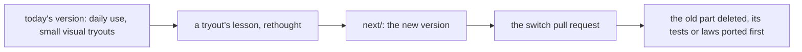

# 0217: The new version grows in next/ beside today's, imports nothing from it, and the pull request that switches a job over deletes the old part once its tests are ported

**What this decides:** how the two versions live on main, and how today's version goes away.

## Context

The owner chose a clean slate on 2026-10-30: the core is rebuilt on the new picture, not swept in
place. On 2026-10-31 it changed to build beside, because "replace a whole layer in one pull
request" had no answer for the tracker, which is used every day. This is Martin Fowler's strangler
fig. See [clean slate](../docs/direction/clean-slate.md). AGENTS.md says the same.

## Decision

**The new version grows in `next/` beside today's, which keeps running until each job has moved.**

- `next/` imports nothing from today's version, and copies nothing across.
- The core is rebuilt too, never swept in place.
- When `next/` takes a job over, the pull request that switches to it deletes the old part, only
  once the new home works and the old part's tests or laws are ported.
- Today's version takes no fixes and no picked UX work, and all new work goes into `next/`
  ([0525](0525-todays-version-is-frozen.md)). A small visual tryout on today's app is allowed until
  `next/`'s Electron window is back ([0533](0533-today-keeps-its-tests-off-ci.md)). What a tryout
  teaches goes into `next/` as a lesson, rethought, never copied.
- An approved guideline's rules are not rethought: `next/` follows them as written
  ([0543](0543-next-follows-approved-guidelines-as-written.md)).
- One case sets the lesson rule aside: `fabsh` v1 carries today's terminal over as it behaves,
  feature for feature. `next/` still imports nothing from today's version: each part is rebuilt in
  `next/`, and the switch pull request deletes the old part once its laws are ported
  ([0586](0586-fabsh-v1-is-todays-terminal.md)).

## Consequences

- A search finds two versions until the old one is gone, so every claim says which version it is
  about.
- The risk is that the old version lives forever; each tryout makes it a little bigger.
