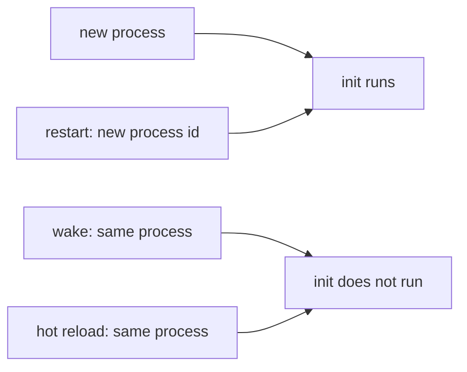

# 0253: In next/, a program has no main, and its init runs once per process start, never on a wake or a hot reload

**What this decides:** that a program has no `main`, and when its `init` runs.

## Context

Decided in [init runs once per process](../docs/direction/init-runs-once-per-process.md), following
Elm's `init` and OTP's `gen_server:init/1`.

## Decision

**A program has no `main`, and its `init` runs once per process start.**

- A program has no `main`. Its logic is run by the runner, which owns the loop.
- What `init` is, an Effect that runs once and whose failure stops the process from starting, is
  decided in [0601](0601-program-make-with-optional-pipes.md), the home of a program's shape.
- A restart is a new process, so it runs `init` again.
- A wake or a hot reload never runs `init`, even when the new code's `init` differs. A person who
  wants it to run presses Restart.

## Consequences

- Setup is paid on every restart; the restart brake bounds a crash loop, not the cost.
