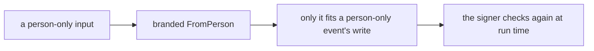

# 0258: In next/, a program's inputs are plain data, "input" means a write, and personOnly true is the one way to say person-only, branded FromPerson for tsc

**What this decides:** what an input is in a program's shape, and how a program says that only a
person may send one.

## Context

Decided by the owner in [a program's shape](../docs/direction/program-shape.md), part of
[0257](0257-a-programs-api-has-one-way.md)'s pick. Today's version is not changed. How a program
takes its inputs, as one schema that `Program.inputs` takes, is decided in
[0601](0601-program-make-with-optional-pipes.md), the home of a program's shape.

## Decision

**An input is plain data.**

- An input never names the events it may cause.
- "Input" means a write. A read port gets its own word, picked with the first program that needs
  one.
- `personOnly: true` is the one way to say person-only, on an input and on an event, as fabrika's
  own rule. Only `true` is allowed; left out means anyone. Never `who: "person"` and never
  `personOnly: false`.
- A person-only input is branded `FromPerson` (Effect's `Schema.brand`), and a person-only event's
  write takes only an input with that brand, so tsc lets nothing else in.
- A brand stops a mistake, not a forger: the signer stays the real check.

## Consequences

- A plain input writing a person-only event fails to compile, where today's shape refuses it only
  when the write runs.
- The doubt: how the brand reads in a tsc error to someone who did not write it.
