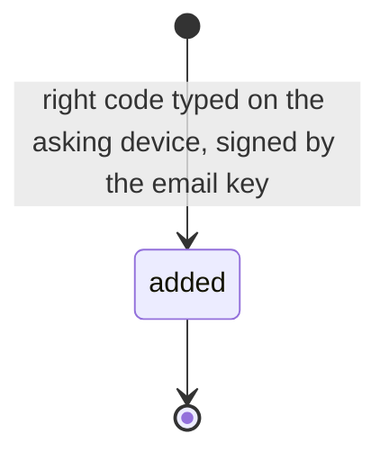

# 0338: In next/, email recovery on the cloud sends a 6-digit code typed on the asking device and lets the device in at once, signed by one brain-held key



```ts
// The event names are decided; their fields are a sketch.
{ _tag: "verified", email: "<address>", signed: sshsig(personKey) } // at setup
{ _tag: "added", add: { saw: { how: "email" } }, signed: sshsig(emailKey) } // at once
```

**What this decides:** how the email way back works, for the Cloudflare setup only.

## Context

From [account recovery, email recovery](../docs/direction/recovery-key.md#email-recovery-decided-two-unknowns-open),
decided by the owner 2026-11-05 and 2026-11-06 after experiment 217. The mail route was widened on
2026-11-08 ([what is decided](../docs/direction/recovery-key.md#what-is-decided-and-what-is-open),
[Tier 3's mail](../docs/plan/tiers.md#tier-3s-address-mail-recovery-and-join-screen-owner-2026-11-08)).
Tier 1's P36 builds it. This record first made the device wait 24 hours, with a Cancel button on
every live device, because a mailbox is weak proof; the owner ruled that recovery gets no wait
([0138](0138-email-recovery-lets-in-at-once.md)).

## Decision

**Email is weak proof, so the code must be typed on the device that asked, and the address must
be on the ledger from before the loss. The right code lets the device in at once.**

- A 6-digit code, never a link, typed on the device that asked.
- The code is good for 10 minutes and 5 tries, then a new one. Only its hash is kept, never in the
  ledger.
- Setup records which address and when it was checked, as a `verified` event. A later recovery
  trusts only an address on the ledger before the loss.
- The brain holds one email key whose only job is to sign the `added` of a device that came back by
  email. It signs at once. Its public half is on the ledger, and it never leaves the brain.
- Every live device shows a plain notice that a device came back by email. The notice carries no
  action. The new device is in the list of let-in devices as every device is.
- The "lost or stolen?" answer is asked at once, and its drops apply at once with the `added`.
- Recovery mail goes to any friend: Email Sending on the group's own domain, or Access's one-time
  PIN on `workers.dev` alone. The install sets up the address, the DNS and the mail route through
  Alchemy, with no steps by hand (2026-11-08).

## Consequences

- The gateway keeps its one signature check: the `added` is signed like any other.
- Not decided here: whether the no-domain route works, and whether the code reaches the inbox. The
  first build tries both.
