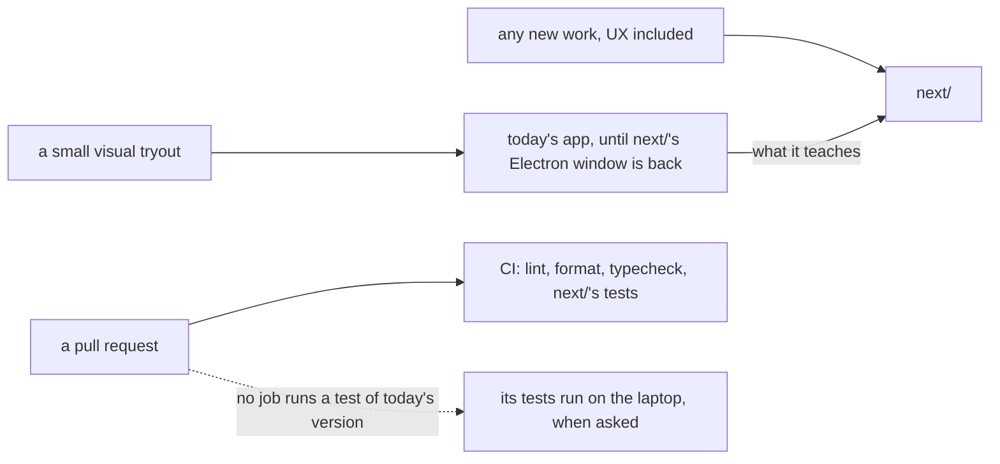

# 0525: Today's version takes no new work, so nothing builds on it, CI runs none of its tests, and all new work, UX work included, goes into next/, with small visual tryouts allowed until next/'s Electron window is back

**What this decides:** what may still happen to today's version (its product and pipeline code)
while `next/` grows, and where new work goes. It was first decided on 2026-11-13 as a freeze with
a guard, and [0533](0533-today-keeps-its-tests-off-ci.md) cut it back on 2026-11-14 to what is
below.

## Context

[0217](0217-next-grows-beside-today.md) let today's version take fixes that daily use or CI needs,
the UX work the owner picks ([0063](0063-todays-app-lanes-share-the-slots.md)) and tryouts.
`AGENTS.md` added that a product foundation decided in a walk starts on today's app at once. On
2026-11-13 the owner ruled the other way: the old pipeline does not work, building more on it is
wasted work, and running tests on code that nobody changes is waste too. The first form of this
decision removed today's tests and added a guard that failed CI on any edit under today's paths.
On 2026-11-14, during a CI cost emergency, the owner closed the pull request that built that form
and ruled that today's tests stay and small visual tryouts stay open, because next/ had no
Electron window yet. What costs money is running the tests in CI, so only that goes.

## Decision

**Today's version takes no new work, and CI runs none of its tests. All new work goes into
`next/`, and a small visual tryout on today's app stays open until next/'s Electron window is
back.**

- **Not stopped.** Today's app, its tracker and its tools for agents keep running for daily use
  until `next/` has its own tracker and the tickets move with a checked copy
  ([0159](0159-fabsh-pipes-summon-join-first.md), [0219](0219-tracker-switch-needs-checked-copy.md)).
  Nothing in this decision may stop it from running.
- **What it covers:** the product and pipeline code outside `next/`, that is `apps/` (today's app,
  `@kampus/fabrika-app-old`), `programs/`, `packages/` and `bin/` (the `tsh` launcher into
  `packages/pipeline`).
- **Not covered:** `packages/fabrika-design/`, the design package both versions share
  ([0456](0456-one-design-package-both-versions.md)), and the repo's tooling: `next/`, `.agents/`,
  `.github/`, `oxlint-plugins/`, `scripts/`, `fixtures/` and the docs.
- **No CI job runs a test of today's version:** not its vitest shards, not its Electron end to end,
  on any event. Lint, format and typecheck of its code stay, since each is one cheap job. No
  guard fails CI on an edit under today's paths.
- **Its tests stay in the repo** and run on the laptop when a person changing today's code asks
  for them. Nothing deletes them while this decision holds.
- **All new work goes into `next/`,** the owner's picked UX work and product foundations included.
  Nothing builds on today's version.
- **A small visual tryout on today's app is allowed** until next/'s Electron window is back. What
  it teaches goes into `next/`, as [0217](0217-next-grows-beside-today.md) says. The person who
  makes a tryout runs today's tests on the laptop before it lands.

**Binding constraints:**

- The code of today's version is not deleted by this decision. Deleting it is a later call.
- No CI job, shard or step runs a test of today's version.
- `ci-required` keeps its name. A job named in it or in a branch ruleset changes only with the
  owner's yes.

## Consequences

- **What is lost:** a bug in today's app gets no fix until `next/` replaces the part it is in. The
  owner keeps using today's app, its tracker included, as it is.
- A change to today's code can break one of its tests with no red check, since CI runs none of
  them and nothing guards a shared dependency (a bump, a root config).
- What it changed in other records:
  - [0217](0217-next-grows-beside-today.md): today's version takes no fixes and no picked UX work.
    Its tryouts stay open only as the small visual ones above. Its build-beside rule and the rule
    that `next/` imports nothing from today's version are kept.
  - [0063](0063-todays-app-lanes-share-the-slots.md): there are no more today's-app lanes, so no
    slot goes to one.
  - [0003](0003-a-clean-repo-kept-clean-by-code.md): "today's app passes its tests" is no longer
    a goal CI keeps, since no CI job runs them.
  - [0175](0175-every-run-follows-its-paths.md): today's own checks (its tests, e2e, the promises
    gate and the build) have nothing left to start for in CI.
  - [0454](0454-an-aria-snapshot-per-story.md), [0463](0463-react-compiler-from-day-one.md),
    [0465](0465-render-is-pure.md), [0469](0469-a-ui-check-reads-data-first.md) and
    [0481](0481-a-tile-opened-with-content.md): the parts that start on today's app first now
    start in `next/`; a tryout there is the small visual one above.
  - `AGENTS.md`'s lines that send work to today's version ("fixes that daily use or CI needs, the
    UX work the owner picks", "a product foundation decided in a walk starts on today's app at
    once", and the look step for "a screen being built in today's app") change to match this
    decision.
- Decisions titled "in today's version" or "in today's pipeline" stay as the record of how today's
  code works. They take no new work.
- **Not decided here:** today's lead scripts and the mutation skill still import or run packages
  of today's version (`@kampus/fabrika-old`, `@kampus/pipeline`, the tracker's CLI in
  `apps/fabrika`, Stryker installed under `packages/pipeline`). How that tooling moves off them is
  its own call. When next/'s Electron window counts as back, and what happens to today's tests
  then, is not decided either.
