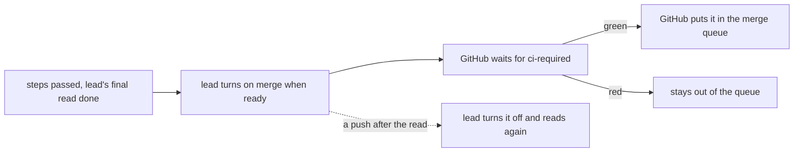

# 0530: The lead turns on GitHub's merge when ready once the steps passed and its final read is done, without waiting for CI, and GitHub queues the pull request when ci-required goes green



```graphql
mutation { enablePullRequestAutoMerge(input: { pullRequestId: "<node id>", mergeMethod: SQUASH }) { clientMutationId } }
mutation { disablePullRequestAutoMerge(input: { pullRequestId: "<node id>" }) { clientMutationId } }
```

**What this decides:** once a pull request's steps have passed and the lead has done its final read, the lead turns on GitHub's "merge when ready" (auto-merge) at once, and GitHub does the waiting for `ci-required`.

## Context

[0162](0162-no-friction-before-a-merge.md) has the lead queue a pull request only after `ci-required`
is green on its head, with no `--auto`. Plain `enqueuePullRequest` refuses until `ci-required` has
passed, so the lead ran a watch loop per pull request. That loop is the cost. GitHub's own
[auto-merge](https://docs.github.com/en/pull-requests/collaborating-with-pull-requests/incorporating-changes-from-a-pull-request/automatically-merging-a-pull-request)
waits for the required check and, with a merge queue on, adds the pull request to the queue when it
goes green, and never when it is red. This changes the "no auto-merge" lines in 0162, 0164, 0166,
0179 and 0183, which were written to stop arming auto-merge on a head that was not green.

## Decision

**The lead turns on merge when ready on a pull request the moment its steps have passed and its final read is done, and does not wait for CI first.**

- How: the GraphQL mutation `enablePullRequestAutoMerge` on the pull request's node id. Plain
  `enqueuePullRequest` is not used for this, since it refuses before `ci-required` has passed.
- GitHub puts the pull request in the merge queue when `ci-required` goes green on its head, and
  never when it is red.
- If anything is pushed after the final read, the lead turns it off with
  `disablePullRequestAutoMerge` and reads again before turning it on.
- Admin merges are unchanged: [0179](0179-an-admin-merge-is-the-owners.md) and
  [0183](0183-the-lead-admin-merges-docs-only.md) still say who may start one.
- Why: no watch loop per pull request, and a green pull request joins the queue the moment it is
  green.

**Binding constraints**

- The lead's final read, the leak check and "every step passed" come first, as before
  ([0014](0014-the-lead-merges-when-every-step-passed.md), 0162).
- `ci-required` stays the only guard on main; this adds no check and drops none.
- Still never: `--admin` without the owner's word, a force push, a change to the bypass list by an
  agent.
- A live run on a target repository still never arms auto-merge
  ([0224](0224-real-repos-keep-their-merge-rules.md)). This is about this repository's own hand
  pull requests.

## Consequences

- 0162's rule "queue only once `ci-required` is green, with no `--auto`" and the "no auto-merge"
  lines in 0164, 0166, 0179 and 0183 no longer hold for the lead's own turn-on of merge when ready;
  each file's status says so.
- The lead skill's "Land it" step and the plan's "How a change lands" change to match.
- Not decided here: the `land.ts` change that sends the mutation, and whether it keeps its refusal
  of a head that is not green for the plain queue path. A ticket follows for the tooling.
