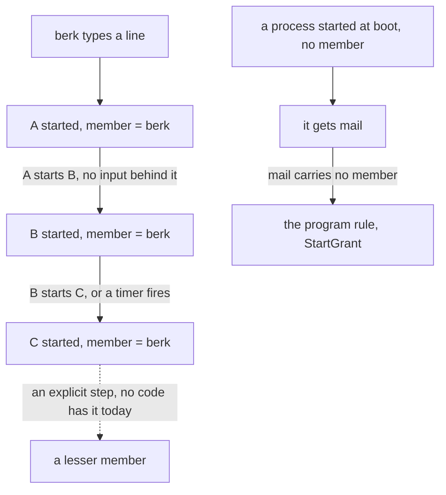

# 0531: In next/, a start with no person's input behind it acts as the member its requester was checked against, down the whole chain of starts, and the member changes only by an explicit step, never through mail



```ts
// A sketch, not the shape. `member` on a `started` line is the made-up part.
{ _tag: "started", process: "A", requester: "shell", member: "person:berk" } // a typed line: the sender of the input
{ _tag: "started", process: "B", requester: "A",     member: "person:berk" } // no input behind it: A's member
{ _tag: "started", process: "C", requester: "B",     member: "person:berk" } // a timer or a child of B: B's member
```

**What this decides:** whom a start acts as when no person's input is behind it: the member its
requester was checked against, carried down the whole chain of starts.

## Context

The owner decided this for `next/` on 2026-11-14. It settles an item that
[0172](0172-a-timers-start-is-its-owners.md) left under "Not decided here": whether the process owner
is inherited by what a process starts. It amends 0172 in part.

What is settled already:

- [0170](0170-a-start-is-checked-against-its-sender.md): a start is checked against the member whose
  input caused it, and lists a start with no member's input as not decided.
- 0172: a process keeps the member whose input started it, and a timer's start is that member's.
  It does not say what a child of a child keeps.
- [0526](0526-one-rebac-permission-system.md): one permission system. `StartGrant` is today's
  program-to-program list that it replaces.

Where it came up: ticket 953, the permission core
([pull request 1239](https://github.com/kamp-us/tea-fabrika/pull/1239)). Its plan,
`docs/plan/lanes/t953-PLAN.md` on branch `fabrikalfa/t953-permission-core`, says a ruling on the
start check "does not decide" inheritance. The review showed that a start check has to pick a member
for every start, so it does decide it. The owner then decided it here.

The known way:

- **Unix.** A child process inherits its parent's uid down the whole tree. cron runs a job as the
  crontab's owner. The identity changes only through an explicit `setuid` or a privilege drop.
- **OTP.** There is no per-process user. A spawned process inherits its group leader down the tree,
  and `proc_lib` records the chain in `$ancestors`.

## Decision

**A start with no person's input behind it acts as the member its requester was checked against, and
this holds down the whole chain.**

- Each child's `started` line records that member. A timer, or a child started by a child, still
  acts as the person who set it up.
- The member changes only by an explicit step. No code has one today. A "drop to a lesser member"
  step is added when a real case needs it.
- It does not carry through mail. A process started at boot that gets mail has no member, and falls
  back to the program rule, `StartGrant`.

**Binding constraints**

- No start picks a member from which program asked.
- No step changes the member without being named as one.
- Mail never gives a process a member.

## Consequences

- A `started` line gets a `member`. It is a fact that exists only when the start is written, so it
  goes in now, even before a rule reads it.
- A timer's start and a grandchild's start go through 0170's check with no rule of their own.
- A process started at boot with no member stays on the program rule until the permission core
  replaces it.
- Cost: a lasting process keeps its setter's reach for as long as it lives, until a drop step exists.

**Not decided here:**

- The drop step: its name, its shape and who may take it.
- Who owns a process the brain starts at boot.
- Whether a restarted process keeps the member of the one it replaces.
