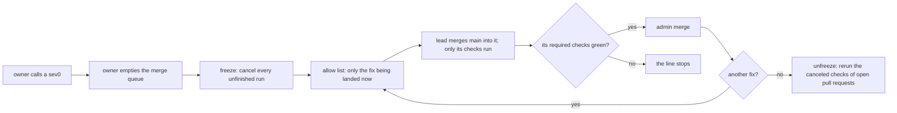

# 0532: A sev0 is the owner's call, and it empties the merge queue, cancels every CI run, and lands the fixes one at a time by admin merge

**What this decides:** what happens to CI when the owner says CI itself is the emergency, how the
fixes land, and how it ends.

[0542](0542-two-sev-levels-one-skill.md) adds a second level, the sev1, and changes how a sev0 ends: nothing is
rerun, and the script is `sev.ts`. The rest of this file still holds.



```ts
// What the freeze does with each unfinished run (.agents/skills/sev0/scripts/Freeze.ts).
verdict({ event: "pull_request", branch: "fabrikalfa/ci-cache" }, ["fabrikalfa/ci-cache"]); // keep: allowed
verdict({ event: "pull_request", branch: "fabrikalfa/ci-legs" }, ["fabrikalfa/ci-cache"]); // cancel: not its turn
verdict({ event: "push", branch: "main" }, ["fabrikalfa/ci-cache"]); // cancel
```

## Context

On 2026-11-14 CI was slow and cost too much, and the fixes for it waited behind the same runs. The
owner called a sev0. The first rule that day let the merge queue drain while every other run was
canceled, except on the fix branches. It did not work: one red queue entry made every entry behind
it run again, and the queue's full runs took 16 of the 20 runners while the fixes waited. After that
first freeze the owner changed the rule to the one recorded here.

The lead did it by hand that day, with a loop that canceled each unfinished run every 20 seconds.
No decision held the rule, and the loop lived only in that session. Tracker ticket 991 moves it into
the repo as the sev0 skill: a script for what code can do, and a short page for the judgment
([0408](0408-skills-keep-only-judgment.md)).

This amends [0179](0179-an-admin-merge-is-the-owners.md) in part: there, a yes for one pull request
does not cover the next. A sev0 call covers each fix pull request in turn. The rest of 0179 holds,
and so does [0183](0183-the-lead-admin-merges-docs-only.md) for docs.

## Decision

**A sev0 is the owner's call: the merge queue is emptied, every CI run is canceled, and the fixes
land one at a time by admin merge, until every fix has merged.**

- **Only the owner calls a sev0.** An agent never starts one, on its own word or another agent's. It
  ends when every fix has merged, or when the owner calls it off.
- **The merge queue is emptied.** The owner takes the entries out; an agent does not, and the lead's
  tooling refuses a dequeue.
- **Every unfinished run is canceled,** pull request runs, push runs on main and dispatched runs
  alike, except the runs of the one fix being landed now. The script still keeps a `merge_group` run,
  but with the queue empty there is none.
- **The fixes go one at a time.** The allow list holds only the fix being landed now. For it, the
  lead:
  - merges main into its branch, so its checks run on what main is now;
  - lets only its checks run;
  - admin-merges it once its required checks are green on its head, it has read the whole diff, and
    the leak check is clean on the change and its words;
  - then sets the allow list to the next fix.
- **A red fix stops the line.** No later fix starts until that one is green or the owner says what
  happens next.
- **A known red check does not block a fix.** A check that is not required, and is already known
  red elsewhere (on 2026-11-14, `launchd`), does not hold that admin merge. It still gets its root
  cause found and a tracker ticket.
- **Unfreeze ends it.** It stops the freeze, then reruns the newest canceled pull request run of each
  workflow at each open pull request's head, so a pull request armed to merge gets its
  `ci-required` back.
- **Only the emergency spends tokens.** Every agent, session and cloud job that is not working on a
  fix saves where it is (a pushed branch, a state file, a note) and stops until the sev0 ends. The
  lead tells each one, and pings them again when it ends.
- **The lead tells the owner in one line** when the freeze starts and when it unfreezes.
- **Code holds the canceling and the reruns:** `.agents/skills/sev0/scripts/sev0.ts`, with
  `freeze`, `next`, `allow`, `stop` and `unfreeze`. Its log of every cancel and rerun is
  `runs/sev0/log.jsonl`, which git ignores. The skill's page holds only the judgment above.

**Binding constraints:**

- No sev0 starts without the owner's call.
- No agent takes an entry out of the merge queue; the owner does.
- The allow list holds one fix at a time, and only a branch that fixes the emergency.
- Admin merges under a sev0 cover only the fix on the allow list, once its required checks are
  green.
- A red required check on a fix stops the line.
- No agent works on anything but the fixes while the sev0 is on.

## Consequences

- During a sev0 every other pull request waits, out of the queue, with its runs canceled. Unfreeze
  gives back their checks. The reruns cost one run each, once.
- Each fix gets the runners to itself, so it lands in about one run's time. The fixes land in a row,
  not side by side.
- The beat, 20 seconds by default, is a setting (`SEV0_SECONDS`), not part of this decision
  ([0069](0069-choices-are-settings.md)).
- Not decided here: a sev0 for anything other than CI, whether a sev0 may ever start on its own
  from a measure (a cost or a wait time), the order the fixes go in, and how the pull requests taken
  out of the queue go back into it.
