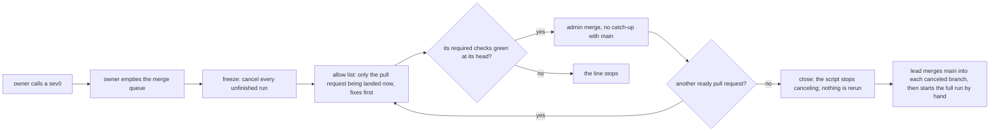

# 0532: A sev0 is the owner's call, and it empties the merge queue, cancels every CI run, and lands every ready pull request one at a time by admin merge, the fixes first

**What this decides:** what happens to CI when the owner says CI itself is the emergency, how the
ready pull requests land, the fixes first, and how it ends. This is the sev0 level of
[0542](0542-two-sev-levels-one-skill.md)'s two levels.



```ts
// What the freeze does with each unfinished run (.agents/skills/sev/scripts/Freeze.ts).
verdict({ event: "pull_request", branch: "fabrikalfa/ci-cache" }, ["fabrikalfa/ci-cache"]); // keep: allowed
verdict({ event: "pull_request", branch: "fabrikalfa/ci-legs" }, ["fabrikalfa/ci-cache"]); // cancel: not its turn
verdict({ event: "push", branch: "main" }, ["fabrikalfa/ci-cache"]); // cancel
```

## Context

On 2026-11-14 CI was slow and cost too much, and the fixes for it waited behind the same runs. The
owner called a sev0. The first rule that day let the merge queue drain while every other run was
canceled, except on the fix branches. It did not work: one red queue entry made every entry behind
it run again, and the queue's full runs took 16 of the 20 runners while the fixes waited. After that
first freeze the owner changed the rule to the one recorded here.

The lead did it by hand that day, with a loop that canceled each unfinished run every 20 seconds.
No decision held the rule, and the loop lived only in that session. Tracker ticket 991 moves it into
the repo as the sev0 skill: a script for what code can do, and a short page for the judgment
([0408](0408-skills-keep-only-judgment.md)).

This amends [0179](0179-an-admin-merge-is-the-owners.md) in part: there, a yes for one pull request
does not cover the next. A sev0 call covers each ready pull request in turn. A docs-only pull
request still lands as [0183](0183-the-lead-admin-merges-docs-only.md) says.

On 2026-11-18, in the sev0 of that day, thirteen fixes took about six hours to land one at a
time, and the owner ruled in [0603](0603-no-stacks-and-sev0-admin-merges.md) that the lead lands
every ready pull request itself by admin merge, in order, and does not catch a green one up with
main first. That changed this record's "fixes only" and "merge main into it first" rules.

## Decision

**A sev0 is the owner's call: the merge queue is emptied, every CI run is canceled, and every
ready pull request lands one at a time by admin merge, the fixes first, until every one has
merged.**

- **Only the owner calls a sev0.** An agent never starts one, on its own word or another agent's. It
  ends when every ready pull request has merged, or when the owner calls it off.
- **The merge queue is emptied.** The owner takes the entries out; an agent does not, and the lead's
  tooling refuses a dequeue.
- **Every unfinished run is canceled,** pull request runs, push runs on main and dispatched runs
  alike, except the runs of the one pull request being landed now. The script still keeps a `merge_group` run,
  but with the queue empty there is none.
- **The pull requests go one at a time.** The allow list holds only the pull request being landed
  now. **Ready** means its steps passed, `ci-required` is a success at its head, and the leak gate
  is clean on its change, its commits and its words
  ([0603](0603-no-stacks-and-sev0-admin-merges.md)). For each one, the lead:
  - allows its branch with `sev.ts allow <branch>`, so only its checks run;
  - admin-merges it with `land.ts merge <pr> --admin` once it is ready and the lead has read the
    whole diff, **without catching it up with main first**; one that conflicts after an earlier
    merge gets main merged in, as the bot, and takes its place again once its new head is green;
  - reads that merge's answer, then sets the allow list to the next one.
- **The order:** the sev fixes first, then the format and code-quality sweeps (format, lint, Effect,
  mock and exam sweeps, which touch many files), then the rest in the order they became ready, a
  child right after its parent. Decision and docs pull requests land at once, on the lead's read
  ([0183](0183-the-lead-admin-merges-docs-only.md)), with no wait for the sev0 to end.
- **A red fix stops the line.** No later pull request starts until that one is green or the owner
  says what happens next.
- **A known red check does not block a merge.** A check that is not required, and is already known
  red elsewhere (on 2026-11-14, `launchd`), does not hold that admin merge. It still gets its root
  cause found and a tracker ticket.
- **Leaving a sev0 reruns nothing** ([0542](0542-two-sev-levels-one-skill.md)). The script stops
  canceling and prints the pull requests whose runs it canceled. The lead merges main into each
  branch, in merge-line order, and pushes, so a fresh run tests today's main. Then the lead starts
  the full run by hand. A rerun would restart runs that were truly red, since a red run stops
  itself and ends `cancelled` as a canceled one does, and it would test old code. After a sev0 the
  level is a sev1 if a `ci-scheduled` issue is open, and none if not.
- **Only the emergency spends tokens.** Every agent, session and cloud job that is not working on a
  fix saves where it is (a pushed branch, a state file, a note) and stops until the sev0 ends. The
  lead tells each one, and pings them again when it ends.
- **The lead tells the owner in one line** when the freeze starts and when it ends.
- **Code holds the canceling:** `.agents/skills/sev/scripts/sev.ts`, with `status`, `open 0`,
  `next`, `allow`, `close` and `loop`. Its log of every cancel is `runs/sev/log.jsonl`, which git
  ignores. The skill's page holds only the judgment above.

**Binding constraints:**

- No sev0 starts without the owner's call.
- No agent takes an entry out of the merge queue; the owner does.
- The allow list holds one pull request at a time, the one being landed now.
- Admin merges under a sev0 cover only the pull request on the allow list, once it is ready.
- A red required check on a fix stops the line.
- No agent works on anything but the fixes while the sev0 is on.
- Nothing reruns a run when a sev0 ends.

## Consequences

- During a sev0 every pull request that is not on the allow list waits, out of the queue, with its
  runs canceled. After the sev0 each gets a fresh run on today's main, by the lead's catch-up.
- Each pull request gets the runners to itself, so it lands in about one run's time. They land in
  a row, not side by side.
- The beat of the cancel loop is a setting, `SEV_SECONDS` in `.agents/skills/sev/scripts/sev.ts`,
  not part of this decision ([0069](0069-choices-are-settings.md)).
- Not decided here: a sev0 for anything other than CI, whether a sev0 may ever start on its own
  from a measure (a cost or a wait time), and how the pull requests taken out of the queue go back
  into it.
