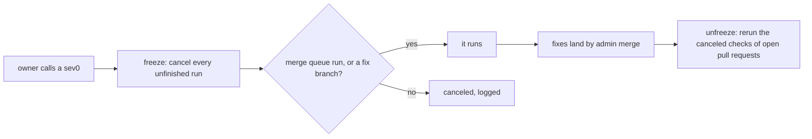

# 0532: A sev0 is the owner's call, and it freezes every CI run except the merge queue and the fix branches until the fixes merge

**What this decides:** what happens to CI when the owner says CI itself is the emergency, and how
it ends.



```ts
// What the freeze does with each unfinished run (.agents/skills/sev0/scripts/Freeze.ts).
verdict({ event: "merge_group", branch: "gh-readonly-queue/main/pr-1240-…" }, allow); // keep: queue
verdict({ event: "pull_request", branch: "fabrikalfa/ci-cache" }, ["fabrikalfa/ci-cache"]); // keep: allowed
verdict({ event: "push", branch: "main" }, ["fabrikalfa/ci-cache"]); // cancel
```

## Context

On 2026-11-14 CI was slow and cost too much, and the fixes for it waited behind the same runs. The
owner called a sev0: stop every check until all the CI fixes are merged, take nothing out of the
merge queue, let the queue drain, and stop new checks on their own as they start. The lead did it
by hand that day, with a loop that canceled each unfinished run every 20 seconds unless it was a
merge queue run or ran on one of the fix branches. No decision held the rule, and the loop lived
only in that session.

Tracker ticket 991 moves it into the repo as the sev0 skill: a script for what code can do, and a
short page for the judgment ([0408](0408-skills-keep-only-judgment.md)).

This amends [0179](0179-an-admin-merge-is-the-owners.md) in part: there, a yes for one pull request
does not cover the next. A sev0 call covers every fix pull request on its allow list. The rest of
0179 holds, and so does [0183](0183-the-lead-admin-merges-docs-only.md) for docs.

## Decision

**A sev0 is the owner's call, and while it is on, every CI run is canceled except the merge
queue's and the fix branches', until every fix has merged.**

- **Only the owner calls a sev0.** An agent never starts one, on its own word or another agent's. It
  ends when every fix has merged, or when the owner calls it off.
- **Every unfinished run is canceled,** pull request runs, push runs on main and dispatched runs
  alike, except:
  - a merge queue run (event `merge_group`), always;
  - a run on a branch on the allow list.

  A push run on main is canceled too: the queue already tested what merged.
- **Nothing leaves the merge queue.** No pull request is taken out of it, and no queue run is
  canceled. The queue drains on its own.
- **The allow list holds only branches that fix the emergency.** The lead adds one while the freeze
  runs when a new fix branch starts.
- **The fixes land by admin merge.** The sev0 call names them for 0179. The lead merges each one
  once its own checks are green on its head, it has read the whole diff, and the leak check is clean
  on the change and its words.
- **Unfreeze ends it.** It stops the freeze, then reruns the newest canceled pull request run of each
  workflow at each open pull request's head, so a pull request armed to merge gets its
  `ci-required` back.
- **The lead tells the owner in one line** when the freeze starts and when it unfreezes.
- **Code holds the canceling and the reruns:** `.agents/skills/sev0/scripts/sev0.ts`, with
  `freeze`, `allow`, `stop` and `unfreeze`. Its log of every cancel and rerun is
  `runs/sev0/log.jsonl`, which git ignores. The skill's page holds only the judgment above.

**Binding constraints:**

- No sev0 starts without the owner's call.
- No `merge_group` run is canceled, and no pull request is taken out of the queue, during a sev0.
- No branch goes on the allow list unless it fixes the emergency.
- Admin merges under a sev0 cover only the pull requests of allowed branches.

## Consequences

- During a sev0 every other pull request waits, with its runs canceled; unfreeze gives them back.
  The reruns cost one run each, once.
- A fix reaches main in minutes, without waiting behind the runs it is fixing.
- The beat, 20 seconds by default, is a setting (`SEV0_SECONDS`), not part of this decision
  ([0069](0069-choices-are-settings.md)).
- Not decided here: a sev0 for anything other than CI, and whether a sev0 may ever start on its own
  from a measure (a cost or a wait time).
