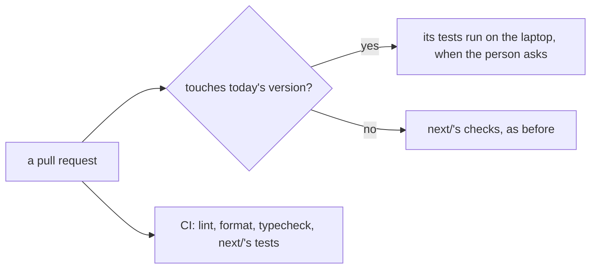

# 0533: Today's version keeps its tests and takes small visual tryouts until next/'s Electron window is back, but CI runs none of its tests

**What this decides:** what is left of [0525](0525-todays-version-is-frozen.md)'s freeze once its
cost in CI is taken out: today's tests stay in the repo, a person may still try a visual idea on
today's app, and CI stops running today's tests.

## Context

0525 froze today's version: no edit, no test, no CI job, and its tests removed. The pull request
that built it ([1221](https://github.com/kamp-us/tea-fabrika/pull/1221)) deleted about 166,000
lines, nearly all of them today's tests and fixtures, and added a guard that fails CI on any edit
under a frozen path.

On 2026-11-14, during a CI cost emergency (a sev0), the owner closed 1221
and ruled the other way on two points: next/ has no Electron window yet, so a visual idea can
still be tried on today's app, and today's tests still prove that app works. What costs money is
running them in CI on every change, so only that goes.

## Decision

**Today's version keeps its tests and stays open to small visual tryouts until next/'s Electron
window is back, and CI runs none of its tests.**

- **CI runs no test of today's version:** not its vitest shards, not its Electron end to end, on
  any event. Lint, format and typecheck of its code stay, since each is one cheap job.
- **Its tests stay in the repo** and run on the laptop when a person changing today's code asks
  for them. Nothing deletes them.
- **No freeze guard.** An edit under today's paths does not fail CI.
- **A small visual tryout on today's app is allowed** until next/'s Electron window is back. What
  it teaches goes into next/, as 0217 says. Everything else from 0525 holds: no new work builds on
  today's version, and all new work goes into next/.

**Binding constraints:**

- No CI job, shard or step runs a test of today's version.
- Today's test files are not deleted while this decision holds.

## Consequences

- A change to today's code can break one of its tests with no red check. The person who makes a
  tryout runs today's tests on the laptop before it lands.
- Amends 0525 in part: its "no edit" guard and "its tests are removed" are withdrawn. Its "no CI
  job" for today's tests, "all new work goes into next/" and "nothing builds on it" still hold.
  Its "a tryout on today's app is no longer a route" is withdrawn until next/'s Electron window is
  back.
- Not decided here: when next/'s Electron window counts as back, and what happens to today's
  tests then.
