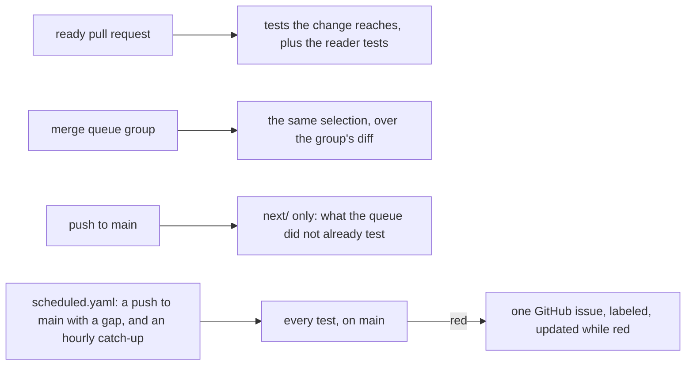

# 0534: The merge line runs only the tests a change reaches, the queue builds two groups at once, a schedule runs every test, its times in .github/workflows/scheduled.yaml

**What this decides:** which tests run where, so the full suite never sits in the path of a merge.

| Where | What runs |
|---|---|
| Draft pull request | lint and typecheck |
| Ready pull request | the tests its change reaches, plus the reader tests: next/'s in-memory laws and plain tooling laws, visual laws only with the `visual` label, never an `.integration.` law |
| Merge queue | the same selection, over the group's diff, with no visual law |
| Push to main | `next/` only, and nothing the queue already tested |
| A branch's proof run | the tests its change reaches, with no `.integration.` law |
| Main's full run (`scheduled.yaml`) | every test of `next/` and of tooling, `.integration.` and visual laws included |
| Today's version | no test anywhere in CI ([0533](0533-today-keeps-its-tests-off-ci.md)) |

## Context

On 2026-11-14 CI was slow and costly enough that the owner called a sev0
([0532](0532-a-sev0-freezes-ci.md)). The test audit of that day
(experiment 291, [pull request 1260](https://github.com/kamp-us/tea-fabrika/pull/1260)) found that the merge
queue took 46% of 15,057 machine-minutes in 13 hours, and that 49 of its 85 groups failed. Every
queue group ran the full suite. A full run on main after the merge only moves the slow part one
step later, so the owner ruled that the merge line never runs the full suite and a schedule does.

GitHub's merge queue cannot batch: each entry gets its own build, of main plus every entry ahead of
it, and its merge limits "do not combine `merge_group` builds" (GitHub's docs, managing a merge
queue). Its build concurrency is the one lever on how many run at once.
[0175](0175-every-run-follows-its-paths.md) already picks jobs from changed paths and left the
scheduled full run open. This decides it.

## Decision

**The merge line runs only the tests a change reaches. A schedule runs every test on main, a red
scheduled run opens a GitHub issue, and the merge queue builds two groups at once.**

- **Ready pull request and merge queue:** the tests the change reaches (Vitest's `--changed` over
  the diff) plus the reader tests, which read files as text. The queue uses the group's diff. Neither
  runs the full suite. A test's kind decides what the selection holds: a law that starts or reaches
  a real thing is an `.integration.` law and never runs here, and every other law, tooling
  included, runs on the pull request its change reaches
  ([0584](0584-a-tests-kind-follows-what-it-uses.md),
  [0602](0602-integration-laws-leave-merge-line.md)). Visual laws run on a pull request only when it
  carries the `visual` label, and never in the queue.
- **A change only to `.github/` does not run all of `next/`.** No `next/` test reads `.github/`; it
  leaves Vitest's rerun triggers, and `changes.mjs` stops treating it as "all of next/".
- **Push to main:** `next/` only, and nothing the merge queue already tested on the same tree.
- **A branch's proof run** runs only the tests its change reaches, plain tooling and visual laws
  included and no `.integration.` law, and the full set when the change touches a file in
  `vitest.config.ts`'s `forceRerunTriggers`
  ([0590](0590-a-branch-proof-run-runs-only-what-its-change-reaches.md), 0602).
- **Schedule:** the workflow `.github/workflows/scheduled.yaml` runs every test, all of `next/`
  and all of tooling, on main's head. A push to main starts it when no full run on main started
  within the gap, and an hourly catch-up starts it on a head that has had none, never a 3-hour
  clock ([0581](0581-main-full-run-starts-on-push-and-hourly.md)). Its times are the file's own:
  `on.push.branches`, the `on.schedule` cron and `env.GAP_MINUTES`, and `gate.mjs` decides. One
  run per ref at a time, with `queue: max`. Its jobs sit in job groups that cap them at ten
  jobs: nine test jobs, in the `scheduled-main-` groups for main's full run and the
  `scheduled-proof-` groups for a branch's proof, plus one control job in `scheduled-control`, as
  `scheduled.yaml` holds them; the merge line holds none of those groups, so pull requests keep runners
  ([0595](0595-scheduled-runs-share-slots.md),
  [0598](0598-merge-line-leaves-scheduled-groups.md)).
- **A red scheduled run opens one GitHub issue** on this repository, labeled `ci-scheduled`, naming
  the commit range and the failing tests. While one is open, a later red run comments on it instead
  of opening another. A green run closes it. This is an exception to "no GitHub issues on this
  repo", for this one label. While one is open the level is a sev1
  ([0542](0542-two-sev-levels-one-skill.md)). A second automation opens the same label: the daily
  speed job ([0541](0541-ci-speed-has-a-goal-and-a-daily-check.md), `.github/workflows/ci-speed.yaml`).
- **Merge queue build concurrency is 2** (it was 3), set in GitHub's merge queue ruleset: a failing
  group throws away at most one build behind it, and the queue never takes every runner.
- **The times are settings** ([0069](0069-choices-are-settings.md)): the cron line and the gap in
  `scheduled.yaml`.

**Binding constraints:**

- No pull request run, merge queue run or push run on main runs the whole suite.
- Today's version runs no test in CI (0533).
- The only GitHub issues opened on this repository by automation are the `ci-scheduled` ones, and
  only main's scheduled report and the daily speed job open them.

## Consequences

- **What is lost:** a test the changed files do not reach can break main, and it shows on main's
  next full run, within about the gap (`env.GAP_MINUTES` in `scheduled.yaml`), instead of before the
  merge. The fix goes forward on main.
- The queue's runs get short, so a failed group costs little, with the first red job stopping its run
  (pull request 1256).
- Mutation stays hourly ([0066](0066-mutation-runs-on-a-schedule.md)).
- Amends 0175 in part: it decides the scheduled full run 0175 left open, and takes the full suite
  off the merge queue and main.
- The schedule began as a 3-hour cron. [0581](0581-main-full-run-starts-on-push-and-hourly.md)
  replaced it with the push and the hourly catch-up on 2026-11-15, and
  [0539](0539-the-merge-line-runs-no-tooling-tests.md), its tooling rule since replaced by 0584 and
  0602, took tooling tests off the merge line for a day.
- Not decided here: lower property run counts on pull requests with the full count on the schedule
  (the audit's fix 3). That narrows what a law proves on a pull request, so it is its own call.
