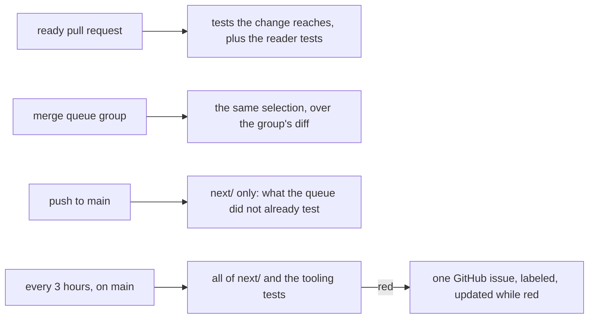

# 0534: The merge line runs only the tests a change reaches, a schedule runs the whole next/ suite every 3 hours and opens a GitHub issue when red, and the queue builds two groups at once

**What this decides:** which tests run where, so the full suite never sits in the path of a merge.

| Where | What runs |
|---|---|
| Draft pull request | lint and typecheck |
| Ready pull request | the tests its change reaches, plus the reader tests |
| Merge queue | the same selection, over the group's diff |
| Push to main | `next/` only, and nothing the queue already tested |
| Schedule, every 3 hours | all of `next/` and the tooling tests |
| Today's version | no test anywhere in CI ([0533](0533-today-keeps-its-tests-off-ci.md)) |

## Context

On 2026-11-14 CI was slow and costly enough that the owner called a sev0
([0532](0532-a-sev0-freezes-ci.md)). The test audit of that day
(experiment 291, [pull request 1260](https://github.com/kamp-us/tea-fabrika/pull/1260)) found that the merge
queue took 46% of 15,057 machine-minutes in 13 hours, and that 49 of its 85 groups failed. Every
queue group ran the full suite. A full run on main after the merge only moves the slow part one
step later, so the owner ruled that the merge line never runs the full suite and a schedule does.

GitHub's merge queue cannot batch: each entry gets its own build, of main plus every entry ahead of
it, and its merge limits "do not combine `merge_group` builds" (GitHub's docs, managing a merge
queue). Its build concurrency is the one lever on how many run at once.
[0175](0175-every-run-follows-its-paths.md) already picks jobs from changed paths and left the
scheduled full run open. This decides it.

## Decision

**The merge line runs only the tests a change reaches. A schedule runs the whole `next/` suite
every 3 hours on main, and a red scheduled run opens a GitHub issue. The merge queue builds two
groups at once.**

- **Ready pull request and merge queue:** the tests the change reaches (Vitest's `--changed` over
  the diff) plus the reader tests, which read files as text. The queue uses the group's diff. Neither
  runs the full suite.
- **A change only to `.github/` does not run all of `next/`.** No `next/` test reads `.github/`; it
  leaves Vitest's rerun triggers, and `changes.mjs` stops treating it as "all of next/".
- **Push to main:** `next/` only, and nothing the merge queue already tested on the same tree. The
  tooling tests leave main and the queue; the schedule runs them.
- **Schedule:** a GitHub Actions workflow on `schedule` and `workflow_dispatch` runs all of `next/`
  and the tooling tests on main's head every 3 hours. Its concurrency group keeps one run at a time
  and caps its legs, so pull requests keep runners.
- **A red scheduled run opens one GitHub issue** on this repository, labeled `ci-scheduled`, naming
  the commit range and the failing tests. While one is open, a later red run comments on it instead
  of opening another. A green run closes it. This is an exception to "no GitHub issues on this
  repo", for this one label.
- **Merge queue build concurrency is 2** (it was 3): a failing group throws away at most one build
  behind it, and the queue never takes every runner.
- **The interval is a setting** ([0069](0069-choices-are-settings.md)): the cron line in the
  workflow, 3 hours to start.

**Binding constraints:**

- No pull request run, merge queue run or push run on main runs the whole suite.
- Today's version runs no test in CI (0533).
- The only GitHub issues opened on this repository by automation are the `ci-scheduled` ones.

## Consequences

- **What is lost:** a test the changed files do not reach can break main, and it shows within about
  3 hours, from the schedule, instead of before the merge. The fix goes forward on main.
- The queue's runs get short, so a failed group costs little, with the first red job stopping its run
  (pull request 1256).
- Mutation stays hourly ([0066](0066-mutation-runs-on-a-schedule.md)).
- Amends 0175 in part: it decides the scheduled full run 0175 left open, and takes the full suite
  off the merge queue and main.
- Not decided here: lower property run counts on pull requests with the full count on the schedule
  (the audit's fix 3). That narrows what a law proves on a pull request, so it is its own call.

## Amendments

- 2026-11-15: the schedule line no longer holds. The full run on main starts on a push to main when
  none started in the last hour, and an hourly cron (`17 * * * *`) starts one only when main's head
  has had none, in place of "every 3 hours" and the 3-hour cron
  ([0581](0581-main-full-run-starts-on-push-and-hourly.md)). The interval is still a setting (0069).
