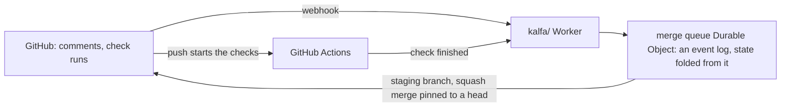

# 0537: A top-level kalfa/ folder holds the small services we run to ship fabrika, in one Cloudflare Worker deployed with Alchemy, and our own merge queue comes first, its event log the first ledger

**What this decides:** where the services that keep our own shipping flow working live, how they
deploy, and which one is built first. The folder was first decided as `infra/`;
[0556](0556-kalfa-holds-our-tooling-packages.md) named it `kalfa/` before any file carried the name.



```ts
// A sketch: the queue's state is folded from its log, as fabrika's ledger is (0216).
type Entry =
  | { _tag: "entered"; pr: number; head: string; by: string; at: string }
  | { _tag: "staged"; pr: number; base: string; commit: string; at: string }
  | { _tag: "checked"; pr: number; commit: string; result: "pass" | "fail" | "infra"; at: string }
  | { _tag: "landed"; pr: number; commit: string; tree: string; at: string };
```

## Context

On 2026-11-14 CI was a sev0 ([0532](0532-a-sev0-freezes-ci.md)). Much of the week went into working
around what GitHub's merge queue cannot do: it cannot batch, it cannot skip a change already tested
on the same tree, and it has no rules of our own (a freeze, a docs-only path). The lead ran those
rules by hand from laptop scripts. The owner ruled to build small services of our own instead, on
his Cloudflare account, as tryouts of what fabrika will later offer as programs
([0107](0107-fabrika-provides-the-merge-queue.md), [0110](0110-merge-queue-is-fabrika-programs.md)).

## Decision

**A top-level `kalfa/` folder, in the pnpm workspace, holds small services that keep our shipping
flow working, beside the other `@kalfa` packages it holds
([0556](0556-kalfa-holds-our-tooling-packages.md)). The services run in one Cloudflare Worker,
deployed with Alchemy. The merge queue is built first, and its event log is the first ledger.**

- **A tryout home.** The services in `kalfa/` are not the fabrika product. What it teaches goes into fabrika's
  programs later, rethought, the way today's app feeds `next/`. 0107 and 0110 stay the product's
  design.
- **Same standards as `next/`.** Effect, tea machines, in-memory layers for tests
  ([0536](0536-real-resource-tests-run-only-on-the-schedule.md)), accessible, readable by agents.
- **One Worker.** Each service is a module with its own Durable Object class, and modules call each
  other directly. A service that later needs its own deploy moves out with a Durable Object
  transfer migration.
- **The merge queue comes first.** Its Durable Object keeps an event log and folds its state from
  it (0216). The bot's commands and a runner scheduler add their own entries to the same log later,
  and the log moves into its own module once a second service writes to it.
- **No checkout and no container.** The queue reaches git and CI only through GitHub's API and
  webhooks: it builds staging branches, reads check results, and merges.
- **Squash merges stay** ([0004](0004-squash-merges-and-native-stacks.md)). The queue tests a
  change on top of current main, squash-merges it pinned to that head, then checks that main's new
  tree is the tree it tested.
- **CI stays on GitHub Actions** ([0112](0112-checks-run-on-free-ci.md)) unless another free
  option appears. What starts a run, and in what order, is ours.
- **The GitHub App's private key and webhook secret live in Cloudflare's Secrets Store** (owner,
  2026-11-14).

**Binding constraints:**

- The queue never lands a tree it did not test.
- No service in `kalfa/` holds a key outside the Secrets Store.
- No new folder or path is named `infra/`.

## Consequences

- The first version's plan is written by a plan agent and comes to the owner before any build.
- Two settings wait for the owner's word when the build reaches them: the App's webhook pointing at
  the Worker, and the App bypassing the ruleset so it can merge once GitHub's queue is off.
- Not decided here: batching (only if the line backs up), the runner scheduler's design, and when
  GitHub's own merge queue is turned off.
