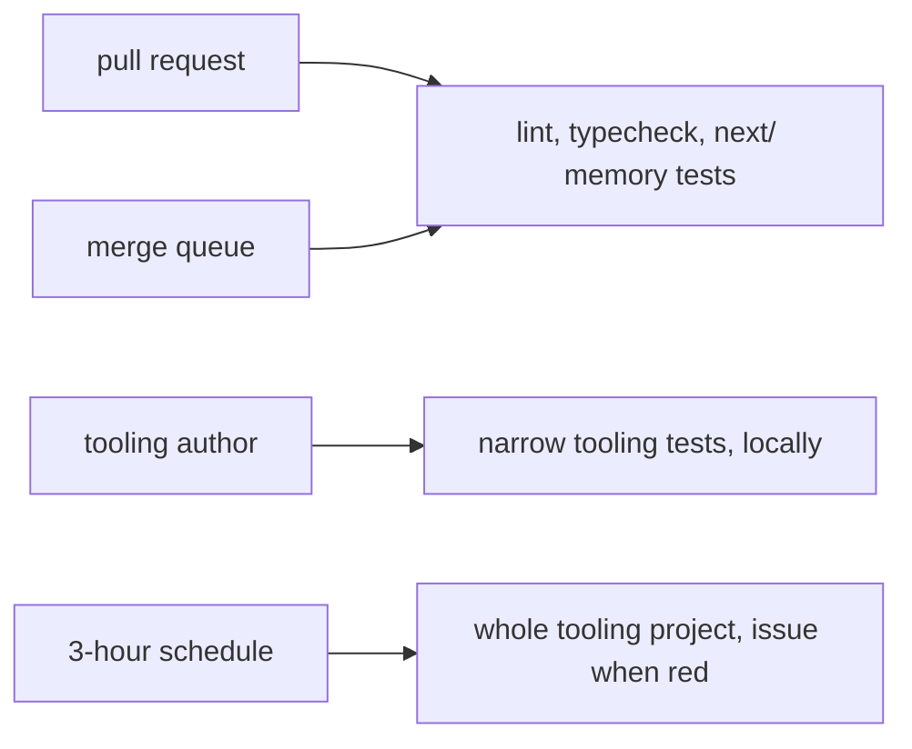

# 0539: The merge line runs no tooling tests, a tooling pull request runs its narrow tests locally, and the 3-hour schedule runs the whole tooling project

**What this decides:** where the `tooling` Vitest project's tests run: never on a pull request or in
the merge queue, only on the author's machine and on the 3-hour schedule.

## Context

After [0536](0536-real-resource-tests-run-only-on-the-schedule.md) took next/'s real-resource tests
off the merge line, the tooling `test` job became the slowest job on most pull request runs: 314 to
593 s, with files such as `boxrm.test.ts` at 426 to 559 s. Its leg ran out of time and canceled
[pull request 1276](https://github.com/kamp-us/tea-fabrika/pull/1276)'s whole run twice. The owner
had ruled earlier the same day that 0536 covers tooling tests too, which would sort them file by
file. The owner then ruled the simpler rule: tooling tests leave the merge line entirely. Tooling is
our own scripts, nothing ships from it, and the schedule from
[0534](0534-the-merge-line-runs-changed-tests-a-schedule-runs-all.md) catches what slips.

## Decision

**Pull requests and the merge queue run no tooling tests.**

- The `tooling` Vitest project runs on no `pull_request` and no `merge_group` run.
- A pull request that changes tooling runs its narrow tooling tests on the author's machine, as
  `AGENTS.md`'s checks table says, before it is offered.
- The 3-hour schedule runs the whole tooling project, and a red run opens or updates its GitHub
  issue, as 0534 says for next/.
- Lint and typecheck stay on the merge line; they cover tooling code too.

**Binding constraints:**

- No tooling test is a required check on a pull request or in the merge queue.
- The schedule always runs the whole tooling project.

## Consequences

- The merge line's slowest job goes away; a tooling bug can now land and is found by the next
  scheduled run, at most about 3 hours later, or at once if it breaks CI itself.
- The earlier same-day ruling that 0536 covers tooling tests is replaced by this rule; nothing in
  tooling needs sorting into an integration layer for the merge line's sake.
- Not decided here: whether a tooling pull request should show the author's local test result in
  its body.
