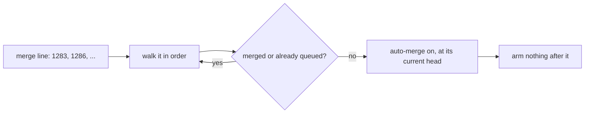

# 0540: Pull requests enter the merge queue only in the order of the lead's merge line, and only the first one not yet queued or merged has auto-merge on

**What this decides:** who picks the order pull requests land in, and how that order reaches
GitHub's merge queue.

## Context

On 2026-11-14 the lead turned auto-merge on for each pull request as soon as its review passed, so
the queue took them in whatever order their checks turned green, not the order the lead had said
they would land in. The owner ruled that the queue follows the merge line.

## Decision

**The merge queue takes pull requests only in the merge line's order.**

- The lead keeps one ordered merge line, shown on the status page.
- Walking it from the top, merged and already-queued pull requests are passed. The first one that
  is neither gets auto-merge on, at its current head, and nothing after it does.
- A pull request leaves the line only by merging or by the lead taking it off; a stuck one is taken
  off, not skipped around silently.
- A pull request is put on the line only after its review passed.

**Binding constraints:**

- No pull request has auto-merge on while one before it on the line is neither merged nor queued.

## Consequences

- Landing order is the lead's call, visible in one place, instead of a race between checks.
- A slow pull request at the top holds the ones behind it; the lead takes it off the line rather
  than letting the line wait on it.
- Today the order is kept by a loop the lead runs; fabrikalfa's own queue
  ([0537](0537-infra-holds-our-own-small-services.md)) is where it moves later.
