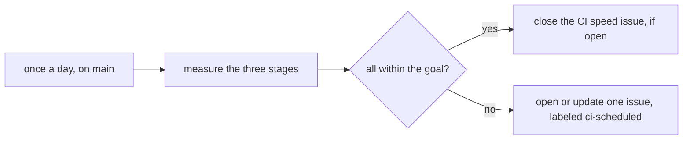

# 0541: CI speed has a goal in three numbers, and a daily job measures it and opens or closes one `ci-scheduled` issue

**What this decides:** how fast CI must be, and what tells us when it stops being that fast.

| Stage | Median | Worst 10% |
|---|---|---|
| Pull request checks: a ready run's start to `ci-required` green | 3 min | 5 min |
| Merge queue: a group run's start to its green end | 3 min | 5 min |
| Last push to merged | 8 min | 15 min |

## Context

On 2026-11-14 CI was slow enough that the owner called a sev0
([0532](0532-a-sev0-freezes-ci.md)). The owner set the goal above that day, and the fixes that
followed ([0534](0534-the-merge-line-runs-changed-tests-a-schedule-runs-all.md),
[0536](0536-real-resource-tests-run-only-on-the-schedule.md),
[0539](0539-the-merge-line-runs-no-tooling-tests.md)) were judged against it. During the sev0 the
numbers were watched by hand on a page the lead kept. Nothing would say so if CI got slow again
after the sev0 ended, so the owner said yes to a daily job that measures the goal.

0534 allows automation to open GitHub issues on this repository only under the `ci-scheduled`
label, and names the 3-hour run's report as the opener. This adds a second opener under the same
label.

## Decision

**CI's speed goal is the three stages in the table, and a daily job on main measures them and keeps
one `ci-scheduled` issue open while any stage is over its goal.**

- The goal is median and worst 10%, in minutes, for each stage, over the runs of the last day.
- A GitHub Actions workflow on `schedule` and `workflow_dispatch` measures the three stages once a
  day and writes them to its job summary.
- While any number is over its goal, one GitHub issue titled "CI speed", labeled `ci-scheduled`, is
  open; a later over-goal run comments on it. A run that meets the goal closes it.
- The daily job is the second and last automation that may open issues here. Lint names both jobs;
  any other workflow that asks for the `issues` permission fails it.
- **The numbers and the interval are settings** ([0069](0069-choices-are-settings.md)): the goal's
  minutes and the cron line are changed where they are declared, with no new decision.

**Binding constraints:**

- The only GitHub issues opened on this repository by automation carry the `ci-scheduled` label,
  and only the 3-hour run's report and the daily speed job open them.
- The daily job only reads runs and writes its summary and its one issue. It runs no tests and
  cancels nothing.

## Consequences

- A slow CI shows up as an open issue within a day, without anyone watching a page.
- It costs one short scheduled run a day, and one more job that holds the `issues` permission.
- Amends 0534 in part: its "only the `ci-scheduled` issues" rule stays, and its one opener becomes
  two.
- Not decided here: what happens when the issue opens. Whether an over-goal day starts a sev0 is the
  owner's call each time.
