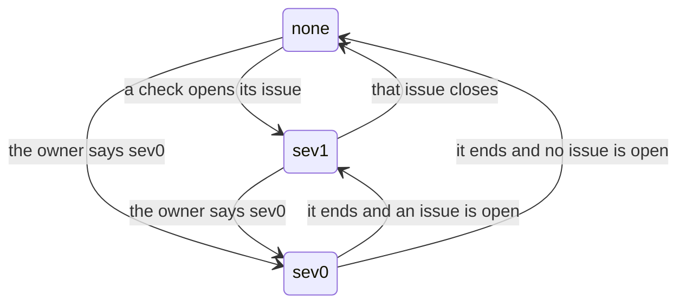

# 0542: CI has two severity levels in one sev skill, a sev1 is on while a check's ci-scheduled issue is open, only the owner calls a sev0, and leaving a sev0 reruns nothing

**What this decides:** how bad a CI problem is, in two levels, who or what starts and ends each one,
and what the lead does at each.



```ts
// The level as the skill's script works it out (pull request 1257). Never two at once.
type Level =
  | { _tag: "none" }
  | { _tag: "sev1"; issues: ReadonlyArray<Alert> } // each open issue labeled `ci-scheduled`
  | { _tag: "sev0"; since: string; reason: string; allow: ReadonlyArray<string> }; // from the log
```

| | sev0 | sev1 |
|---|---|---|
| What is broken | Nothing can land, or every run makes it worse | Changes land, but the 3-hour run is red or a speed number is over its goal |
| Merge line | Stopped; the owner empties the queue | Runs as normal |
| CI runs | All canceled, except the one fix's | All run |
| How a fix lands | One at a time, by admin merge | Through the merge line, ahead of other changes |
| Other work | Stops | Keeps going |
| Who calls it | Only the owner | Nobody: a check opens its issue |
| Ends when | Every fix has merged, or the owner calls it off | The check closes its issue |

## Context

On 2026-11-14 CI was in a sev0 ([0532](0532-a-sev0-freezes-ci.md)). Once its fixes had merged, the
merge line ran again, fixes went first, and other work went on. That state had no name and no rule:
it was no longer 0532's freeze, and it was not normal either. The owner ruled that it is a second
level, and that there are only two.

The known way has the same shape. PagerDuty's public guide defines each level by its impact and
gives each one fixed response, and its lowest level is "create a ticket"
([severity levels](https://docs.pagerduty.com/ops-guides/incident-response-guide/severity-levels)).
Incident tools keep one incident whose severity is a field that is raised or lowered; nobody opens a
second incident to change the level.

Two checks already notice a problem with nobody watching: the 3-hour full run
([0534](0534-the-merge-line-runs-changed-tests-a-schedule-runs-all.md)) and the daily speed check
([0541](0541-ci-speed-has-a-goal-and-a-daily-check.md)). Each opens one GitHub issue labeled
`ci-scheduled` and closes it when it recovers.

## Decision

**CI has two severity levels, sev0 and sev1, held by one skill, `sev`. A sev1 is on while a check's
`ci-scheduled` issue is open, and nobody calls it. A sev0 is only the owner's call. Below a sev1 a
problem is a ticket.**

- **One skill, the level is its argument:** `/sev 0`, `/sev 1`. There is one level at a time, and an
  open sev0 wins over any open issue.
- **A sev1 starts and ends by itself.** It is on while at least one open GitHub issue carries the
  `ci-scheduled` label: the 3-hour run's when main is red, the daily speed check's when a speed
  number is over its goal. It ends when that check closes its issue.
- **What the lead does in a sev1:** the response only. The merge line runs
  ([0540](0540-the-queue-follows-the-merge-line.md)), CI runs, and other work keeps going. Each
  cause is found and ticketed the same day, and its fix goes first on the merge line. The owner gets
  one line when a sev1 starts and one when it ends.
- **A fix is proven by the next full run that is read,** not by its own green pull request: visual
  and real-resource tests do not run on pull requests
  ([0536](0536-real-resource-tests-run-only-on-the-schedule.md),
  [0539](0539-the-merge-line-runs-no-tooling-tests.md)).
- **When it looks like a sev1 and no issue is open,** the lead starts the full run by hand, so the
  check opens its own issue.
- **A sev0 stays as 0532 says,** with one change, below. Only the owner raises to it. When the lead
  thinks one fits, it says so in one line and does not argue the level while a sev is on; that
  belongs in the write-up.
- **Leaving a sev0 reruns nothing.** The script stops canceling and prints the pull requests whose
  runs it canceled. The lead merges main into each branch, in merge-line order, and pushes, so a
  fresh run tests today's main. Then the lead starts the 3-hour full run by hand.
  - Why: since pull request 1256 a red run stops itself, so a red run and a run the freeze canceled
    both end `cancelled`, and a rerun would restart runs that were truly red.
  - Why: a rerun tests old code. On 2026-11-14 a fresh run tested a pull request against a main that
    was 40 minutes old (run 43672758072).
- **After a sev0** the level is a sev1 if such an issue is open, and none if not.
- **Every sev ends with a write-up:** one note under `field/notes/` the same day, with what broke,
  each level and when, each fix and its pull request, what it cost and what was learned.
- **Code holds what code can:** `.agents/skills/sev/scripts/sev.ts`, with `status`, `open 0`,
  `next`, `allow`, `close` and `loop`. A sev0's log is `runs/sev/log.jsonl`, which git ignores. A
  sev1 has no log: its open issue is the record. The script only reads issues.

**Binding constraints:**

- There is no level other than sev0 and sev1.
- Two levels are never open at once.
- No sev0 starts without the owner's call (0532).
- No person or agent opens, closes or labels a `ci-scheduled` issue by hand.
- Nothing reruns a run when a sev0 ends.

## Consequences

- **What is lost:** a problem neither check sees is not a sev1 until someone starts a full run by
  hand. And a false alarm puts us in a sev1, so the two checks must stay worth trusting: a check
  that cries wolf is itself a fix that goes first.
- A sev1 depends on the scheduled runs firing and reporting. On the day of this decision the first
  full run was red and opened no issue (ticket 1023, fixed by pull request 1296), and no run had yet
  started from a `schedule` event in this repository.
- Amends 0532 in part: its sev0 stands, but leaving one no longer reruns canceled runs, and the
  script is `sev.ts` with the commands above, in place of `sev0.ts` and its `freeze`, `stop` and
  `unfreeze`.
- The beat of the cancel loop is a setting, `SEV_SECONDS`
  ([0069](0069-choices-are-settings.md)).
- Not decided here: where the owner is told that a sev is on and where to look (GitHub's own
  notifications are not that place); whether a service of ours may recommend a sev0; how our own
  merge queue reads the level; and a sev for anything other than CI.
