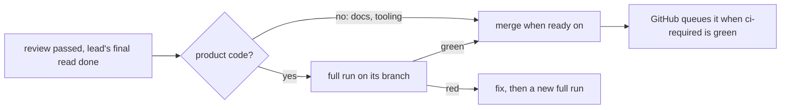

# 0544: Every pull request whose review passed has merge when ready on, and product code first needs a green full run on its own branch



```sh
# the full run, on the pull request's own branch
gh workflow run scheduled.yaml --ref <branch>
```

**What this decides:** which pull requests have GitHub's merge when ready on, and what a product
pull request must show first.

## Context

[0540](0540-the-queue-follows-the-merge-line.md) let only the first pull request on the lead's merge
line have merge when ready on, so the landing order was the lead's. On 2026-11-15 the numbers were:
pull request checks took about 2.5 minutes with no failure in the last 80 runs, the merge queue was
green 9 times out of 9, and the last six full runs that finished were green. The same night, two
pull requests that were green on their own checks each broke a law that only the 3-hour full run
checks ([0536](0536-real-resource-tests-run-only-on-the-schedule.md)): a pull request runs only the
tests its change touches ([0534](0534-the-merge-line-runs-changed-tests-a-schedule-runs-all.md)).
The owner ruled that every reviewed pull request is armed again, with the full run as the condition
for product code.

## Decision

**The lead turns on merge when ready on every pull request whose review passed, and a pull request
that changes product code first shows a green full run on its own branch.**

- Product code is code under `next/`, `packages/`, `programs/` and `apps/`. Docs, decisions, field
  rows, skills and CI tooling are armed as soon as the review passed and the lead's final read and
  leak check are done.
- The full run is the scheduled workflow started by hand on the pull request's branch. It must be
  green on the head that is armed. A push after it means a new full run.
- How merge when ready is turned on, and when it is turned off again, is as
  [0530](0530-lead-turns-on-merge-when-ready.md) says.
- The landing order is the order the pull requests become ready. The lead no longer keeps an
  ordered merge line.
- A sev1 fix still goes ahead of other changes
  ([0542](0542-two-sev-levels-one-skill.md)): the lead turns the others off until it has landed.

**Binding constraints**

- No product pull request has merge when ready on without a green full run on its armed head.

## Consequences

- 0540 is superseded: more than one pull request may be armed at once, and the order is no longer
  the lead's.
- Full runs go one at a time, about 12 minutes each, so on a busy day they are the line. If that
  line gets long, the rule is looked at again with a day's numbers.
- A full run on a branch does not prove main: two pull requests that are each green can still clash
  once both land. The 3-hour run on main still catches that, and a red one is a sev1.
- Not decided here: a program that starts the full run and arms the pull request by itself.
  Today the lead does both by hand.
