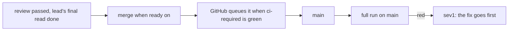

# 0544: Every pull request whose review passed has merge when ready on, with no full run first, and a break the full run on main finds is fixed there

**What this decides:** which pull requests have GitHub's merge when ready on, and where a break that
only a real thing can show is caught.

## Context

[0540](0540-the-queue-follows-the-merge-line.md) let only the first pull request on the lead's merge
line have merge when ready on, so the landing order was the lead's. On 2026-11-15 the numbers were:
pull request checks took about 2.5 minutes with no failure in the last 80 runs, the merge queue was
green 9 times out of 9, and the last six full runs that finished were green. The same night, two
pull requests that were green on their own checks each broke a law that only the full run, which
then started every 3 hours, checks ([0536](0536-real-resource-tests-run-only-on-the-schedule.md)):
a pull request runs only the tests its change touches
([0534](0534-the-merge-line-runs-changed-tests-a-schedule-runs-all.md)). The owner ruled that every
reviewed pull request is armed again, and that such a break is the full run's to catch.

## Decision

**The lead turns on merge when ready on every pull request whose review passed, product code
included, and runs no full run on its branch first.**

- How merge when ready is turned on, and when it is turned off again, is as
  [0530](0530-lead-turns-on-merge-when-ready.md) says.
- The landing order is the order the pull requests become ready. The lead no longer keeps an
  ordered merge line.
- A break that only the full run can see is one that only a real thing can show: a plain law's
  break is caught before the merge, and a law that starts or reaches a real thing runs only in the
  full run ([0584](0584-a-tests-kind-follows-what-it-uses.md)). The full run on main catches it, and
  it is fixed as a sev1 ([0542](0542-two-sev-levels-one-skill.md)). When that run starts is in
  `.github/workflows/scheduled.yaml`'s `on.push` and `on.schedule`
  ([0581](0581-main-full-run-starts-on-push-and-hourly.md)). If that run is too slow or misses a
  break, the cure is in the run, never a wait in front of a merge.
- A sev1 fix still goes ahead of other changes: the lead turns the others off until it has landed.

## Consequences

- 0540 is superseded: more than one pull request may be armed at once, and the order is no longer
  the lead's.
- Main can be red, until the full run on main finds the break, after a pull request that was green
  on its own checks. That is accepted for speed.
- Not decided here: how often the full run starts, which
  [0581](0581-main-full-run-starts-on-push-and-hourly.md) decides, and which tests move from the
  full run to a pull request's own checks, which
  [0584](0584-a-tests-kind-follows-what-it-uses.md) decides.
