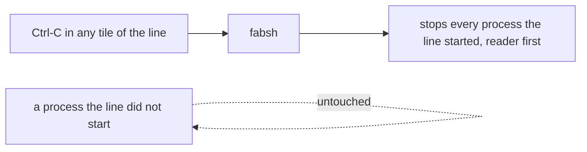

# 0548: In next/, Ctrl-C in any tile of a piped line stops every process the line started, never only that tile's



```text
fabsh$ tracker | ticket | trace     three processes, one line
Ctrl-C in ticket's tile             tracker, ticket and trace all stop
a second tracker, started alone     keeps running
```

**What this decides:** what Ctrl-C stops when the tile it is pressed in is part of a piped line.

## Context

The proposed pipes note, "how a pipe carries output"
(https://github.com/kamp-us/tea-fabrika/pull/1322), asks what a person's Ctrl-C stops. Two answers were drawn on a pressable mockup on
2026-11-15: the whole line, as a Unix shell stops a job, or only the process in that tile, with the
other side told its neighbor is down, as Erlang/OTP would. Today's version already stops the whole
line. The owner ruled for the whole line.

## Decision

**In `next/`, a piped line is one job: Ctrl-C in any of its tiles stops every process that line
started.**

- It holds for a line of any length, and for the first, a middle or the last tile alike.
- fabsh does the stopping, reader first, as the pipes note says.
- A process the line did not start is not part of the job and keeps running. A second copy of the
  same program, started by itself in another tile, is one.
- This is a shell's Ctrl-C to a foreground job (POSIX job control: the terminal's interrupt goes to
  every process in the foreground process group).

## Consequences

- The mockup's "only that tile" answer is dropped.
- A reader that outlives its source is still a real case, and still needs its words on screen: a
  source can crash, or be a program that prints its answer and exits.
- Not decided here: what a tile does on screen once its process has ended, and what Ctrl-C does to
  a process that was already running before a line piped into it.
