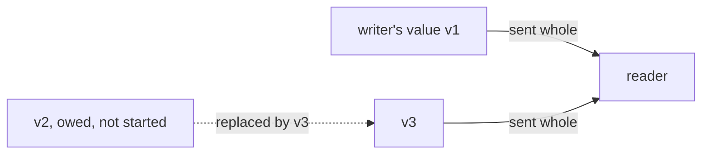

# 0549: In next/, a pipe's reader gets the writer's whole current value and the newest wins, so the right side of a pipe is a projection of the left



```text
tracker | outline          tracker's rows change three times while outline is busy
v1  sent whole            outline receives all of v1
v2  owed, not started     never sent: v3 replaces it
v3  sent whole            outline receives all of v3; it holds v3, made from tracker's value now
```

**What this decides:** what the reader of a pipe gets from the writer, in `next/`.

## Context

The proposed pipes note, "how a pipe carries output"
(https://github.com/kamp-us/tea-fabrika/pull/1322), leaned that a piped output is sent whole each
time it changes and only the newest value is owed. The owner ruled on 2026-11-15.

It builds on [0260](0260-an-output-is-a-model-value.md): an output is a value picked from the
model and sent when it changes, never a Cmd. It keeps [0109](0109-a-pipe-is-saved-program-mail.md):
the value rides saved program mail, in chunks. Today's version keeps
[0434](0434-outputs-are-events-kept-nowhere.md), outputs as events, until it goes.

## Decision

**The reader gets the writer's whole current value, and the newest wins: the right side of a pipe
is a projection of the left side.**

- What a reader holds is always made from one whole value of the writer, never from a history of
  past values.
- When a newer value comes before an owed one is sent, the newer one is sent in its place.

## Consequences

- A slow reader costs the writer at most the value in flight and one waiting, never a growing
  queue.
- A reader wired late starts from the writer's value now, with nothing to replay.
- Cost: a big value that changes often is sent whole each time.
- Not decided here: whether a piped value is always a list, how the reader folds chunks, and how
  the end of output is said. The note holds those as the design.
- [0553](0553-a-pipe-sends-one-way.md) settles the first: every value travels as a list underneath,
  and no program sees it. The rest of this file still holds.
