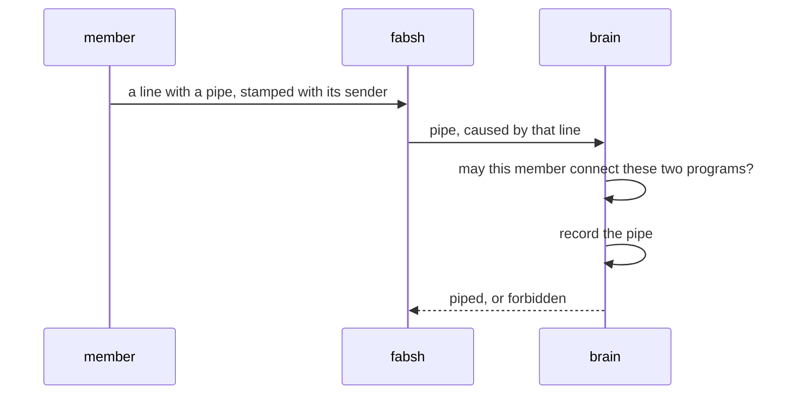

# 0551: In next/, the brain checks that the member behind a line may connect the two programs of a pipe and records the pipe, for one project where both people are members



```ts
// A sketch, next/: `mayPipe` and `piped` are made-up names.
const member = yield* senders.sender(from.parent); // the member behind the line, as 0170 reads it
if (!mayPipe(member, writer.program, reader.program)) return refuse("forbidden");
yield* ledger.append(piped({ pipe, from, to, cause: from.parent, by: member }));
```

**What this decides:** who checks a pipe, whom it is checked against, and that it is recorded, in
`next/`.

## Context

The proposed pipes note, "how a pipe carries output"
(https://github.com/kamp-us/tea-fabrika/pull/1322), leaned that fabsh asks the brain for a pipe and
the brain checks the member and records it. The owner ruled on 2026-11-15.

It applies what [0170](0170-a-start-is-checked-against-its-sender.md) decided for a start to a
pipe: the brain checks the member whose input caused it, never the program that asked, so fabsh
holds no pipe permission of its own. Every permission is one system
([0526](0526-one-rebac-permission-system.md)).

## Decision

**The brain checks that the member may connect the two programs, and records the pipe.**

- The member is the one behind the line, not fabsh.
- The case decided is one project where both people are members.

## Consequences

- A pipe is on the record: who made it, from which line, between which two programs.
- Not decided here, and not in scope: two brains talking to each other.
- Not decided here: the rule itself (who may connect what), the shape of the record, and the shape
  of the mail right in 0526's model. The note holds a sketch of each.
