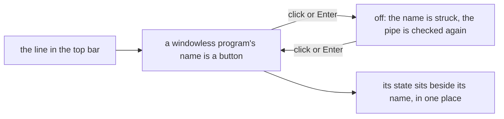

# 0552: In next/, a program with no window shows as a pressable name on the top bar's line, with its state beside the name and nowhere else



```text
tracker | double | outline            running: the line as typed, nothing added
tracker | double · Ended (crashed)    | outline
tracker | double · Paused (off)       | outline      the name is struck through
tracker | roman · Paused (off) | upper · Waiting (integers do not fit text) | outline
```

**What this decides:** where a program with no window is seen when it runs in a piped line, how a
person turns it off, and where its state is shown.

## Context

A piped line gives each program with a window a tile. Some programs have no window: they take a
value and send one on, as `seq`, `double` and `upper` do today. Decision
[0548](0548-ctrl-c-stops-the-whole-line.md) left open how such a program shows on screen. The
owner picked this first version on 2026-11-15, on a pressable mockup at three window widths, and
asked that it be simple and be changed after real use.

## Decision

**A program with no window gets no tile. Its name on the top bar's line is a button, and its state
is shown beside that name and in no other place.**

- The top bar keeps the line as it was typed. Each windowless program's name in it is a button:
  a click or Enter turns the program off, and the same turns it on again. A music tool's device
  on and off switch is the model.
- While it runs, nothing is added to its name.
- Its state uses the tile title bar's own form, `name · State (reason)`: `Ended (crashed)`,
  `Paused (off)`, `Waiting (<why the pipe does not fit>)`. A name that is off is also struck
  through, so color is never the only cue.
- The state is shown once, on the name. No other tile's title bar and no status bar repeats it.
- Turning a program off checks again that the pipe fits
  ([0550](0550-a-pipe-fits-on-needed-fields.md)), now between the programs on either side of it.
  Where it does not fit, the programs after it wait and say so, and a reader keeps the last whole
  value it got
  ([0549](0549-a-pipe-carries-the-whole-value.md)).
- A crash and an off switch end the same way for the rest of the line, so they look alike: the
  state on the name, the line still on screen.
- The line starts at the same place and stays on one row at every window width. The app name gives
  way first ([0495](0495-the-top-bar-name-gives-way-first.md)). A state word, the name it belongs
  to and the line's mark are never cut.

**Binding constraints**

- The top bar stays a place to drag the window by: a name button is only as large as its words and
  the smallest size a pointer needs (24 by 24 px, WCAG 2.5.8).
- The words a narrow line hides stay in the button's accessible name.

## Consequences

- The top bar's line, which did nothing until now, takes clicks and keys. The top bar note and the
  tile guideline get this rule when the slice that builds it lands.
- This is a first version, to be changed after it is used. What gives way after the app name
  (the bracketed reason, then a run of running names folded to a count, then running names
  shortened) is the mockup's order and is not decided.
- Not decided here: showing the value that passes through a windowless program, the keys that move
  focus to the line, and what Ctrl-C does to a process that ran before a line piped into it.
