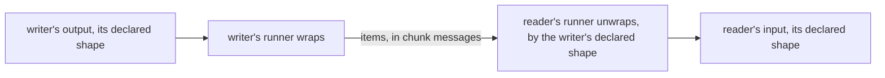

# 0553: In next/, a pipe sends every value one way underneath, as items in chunk messages, and a program never sees the wrapping



```ts
// A sketch, next/: `wrap`, `unwrap`, `Row` and the rows a, b, c are made up; the schemas are real Effect Schema.
import { Schema } from "effect";

const TicketNumber = Schema.Int;  // what tracker declares it writes, and what ticket declares it reads
const Rows = Schema.Array(Row);   // what a program that writes a list declares

wrap(TicketNumber, 1041);  // items: [1041]     a value that is not a list goes as a list of one item
wrap(Rows, [a, b, c]);     // items: [a, b, c]  a list goes as its items

unwrap(TicketNumber, [1041]);  // 1041       the writer declared a number, so the reader gets a number
unwrap(Rows, [a, b, c]);       // [a, b, c]  the writer declared a list, so the reader gets a list
// A reader whose input is Schema.Unknown gets 1041 too, never [1041].
```

**What this decides:** how a value travels through a pipe, and what a program sees of that, in
`next/`.

## Context

[0549](0549-a-pipe-carries-the-whole-value.md) left open whether a piped value is always a list.
The proposed pipes note, "how a pipe carries output"
(https://github.com/kamp-us/tea-fabrika/pull/1322), leaned that a piped output's schema is always a
list, so a program with one value to give declares a list of one, and a reader declares a chunk
input and folds the chunks in its own model. The owner ruled on 2026-11-15 for one transport that
stays out of programs. This file settles that open point of 0549.

It keeps [0109](0109-a-pipe-is-saved-program-mail.md): the value rides saved program mail, in
chunks. It keeps [0260](0260-an-output-is-a-model-value.md): an output is a value picked from the
model, checked against the output's schema. It keeps
[0550](0550-a-pipe-fits-on-needed-fields.md), and says what that check compares. It adds one thing
to the record [0551](0551-the-brain-checks-and-records-pipes.md) decides.

## Decision

**There is one way a value travels through a pipe, and no program can tell how its value
traveled.**

- A list goes as its items, in chunk messages. A value that is not a list goes the same way, as a
  list of one item.
- A program declares its output and its input as the real shape. tracker says "a ticket number",
  and ticket says "a ticket number". No program wraps or unwraps.
- The runner wraps on the way out and unwraps on the way in.
- The unwrap follows what the writer declared, never what the reader asked for. A reader that takes
  anything gets a number as a number and a list as a list.
- The brain's record of the pipe (0551) holds both declared shapes: the writer's output and the
  reader's input.
- The check that a pipe fits (0550) compares the two declared shapes. The wrapping is never part of
  it.
- An item is never cut: one item sits whole in one saved message. So one item is capped by the row
  size, about 2 MB (`ROW_BYTES` in `next/packages/libfabrika/src/ledger/Log.ts`). That is the same
  for a list's item and for a single value.

**Binding constraints**

- No program's declared output or input names a chunk, a part or a list that is there only for the
  pipe.
- No second transport is added for a value that is not a list.

## Consequences

- One transport is simpler to build and to test: the cutting from ticket 1041 is the only cutting,
  and every law about it covers every piped value.
- A program's schemas say what the program means, so the same output reads the same in a pipe, in a
  test and in the program's own docs.
- Cost: a single small value pays for a chunk message's wrapping, and the runner does work the
  program would have done.
- Folding chunks moves from the reader's own model to its runner. The note's sketch of a reader
  with a chunk input and a pending value in its model is from before this ruling.
- The reader still gets the writer's whole current value, and the newest still wins (0549).
- Today in `next/`, `send_chunks` refuses one item whose message alone is over `mail.chunk`
  (`TooBig` in `next/packages/libfabrika/src/runtime/Chunk.ts`). That setting is 64 KiB by default
  and 1 MiB at most, so today an item is refused well under the row size.
- Not decided here: whether `mail.chunk` goes on refusing one item that is under the row size.
- Not decided here: how the runner folds chunks on the way in, and where it keeps a value that is
  still arriving. How the end of output is said stays open, as in 0549.
- Not decided here: the keys of the brain's record, beyond that it holds both declared shapes
  (0551 leaves the record's shape open).
- Not decided here: how the check compares two shapes field by field, or two shapes with no fields,
  such as two numbers (0550 leaves the comparing of types open).

## Records

- `.glossary/TERMS.md`: the `pipe` row says every value travels one way underneath and a program
  sees only its declared shape. No word is coined.
- [0549](0549-a-pipe-carries-the-whole-value.md) and
  [0551](0551-the-brain-checks-and-records-pipes.md) each get a one-line pointer here.
