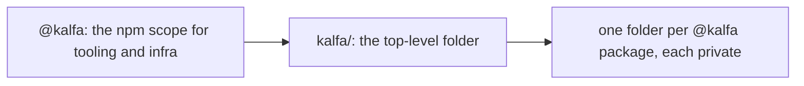

# 0556: @kalfa is our npm namespace for tooling and infra, and the top-level folder 0537 called infra/ is named kalfa/ and holds every @kalfa package, all private for now

**What this decides:** the npm scope our tooling and infra packages are named under, and the name
and job of the top-level folder they live in.



```text
# A sketch. The folder is not on main yet.
kalfa/
  <name>/
    package.json    { "name": "@kalfa/<name>", "private": true }
```

## Context

[0537](0537-infra-holds-our-own-small-services.md) decided a top-level `infra/` folder for the
small services we run to ship fabrika. [0538](0538-kampus-vitest-holds-the-test-primitives.md) then
made a shared test package that this folder and `next/` both use. So we now have packages that are
neither the product (`@kampus/fabrika`, `@kampus/libfabrika`) nor a service: they are tooling. They
had no name of their own and no one home.

On 2026-11-15 the owner ruled on both. He holds the `@kalfa` scope on npm.

The folder does not exist on main yet. The first plan that builds 0537 is still an open pull
request ([pull request 1279](https://github.com/kamp-us/tea-fabrika/pull/1279)). So this renames a
decided name before any file carries it, and gives the folder a wider job.

This amends 0537 in part: the folder's name and what it holds. Everything else in 0537 still
holds.

## Decision

**`@kalfa` is our namespace on npm for tooling and infra. The top-level folder that 0537 named
`infra/` is named `kalfa/`, and every `@kalfa` package lives in it.**

**Before** (0537, a sketch):

```text
infra/          the small services we run to ship fabrika
```

**After** (a sketch):

```text
kalfa/          every @kalfa package: tooling, and the small services of 0537
```

What moves: the folder's name, and its job, from services only to every tooling and infra package.

- **The scope.** A package that is our tooling or our infra is named `@kalfa/<name>`. The product
  keeps `@kampus`.
- **The folder.** `kalfa/` is top-level, beside `next/` and today's version, in the pnpm workspace.
  It holds all `@kalfa` packages.
- **Nothing is published now.** Each `@kalfa` package stays `"private": true`. Holding the scope
  only keeps the name ours.
- **The rest of 0537 holds as written,** with `kalfa/` read where it says `infra/`: a tryout home,
  the same standards as `next/`, one Cloudflare Worker deployed with Alchemy, the merge queue first,
  its event log the first ledger, and both binding constraints.

**Binding constraints:**

- No new folder or path is named `infra/`.
- A `@kalfa` package lives in `kalfa/`, nowhere else.
- No `@kalfa` package is published until a later decision says so.

## Consequences

These are the lead's reading of what follows from the ruling. They are not the owner's words.

- **The workspace gains `kalfa/*`** in `pnpm-workspace.yaml`, in the pull request that adds the
  first package there.
- **The plan in pull request 1279 changes its folder name.** It says `infra/` throughout: the
  package path `infra/fabrikalfa`, the workspace line `- infra/*`, the `infra/**` lint override, the
  `infra/**` test paths, the CI path rule and its law, and `infra/AGENTS.md`. Each becomes `kalfa/`.
  That pull request makes the change itself; this one does not edit it.
- **The merge queue's package takes the `@kalfa` scope.** The plan names it `@kampus/fabrikalfa`,
  and it is infra, so the scope rule covers it. Its name inside the scope is the plan's to pick.
- **The test package moves here** and becomes `@kalfa/vitest`. That is its own decision, which
  amends 0538.
- **The cost:** a reader meets a word of ours, `kalfa`, where `infra` was the industry's plain word.
  The glossary row carries the gloss
  ([use the industry's names](../docs/direction/use-the-industrys-names.md) asks for one). `infra`
  stays the everyday word for what the services are; only the folder and the scope are named
  `kalfa`.

**Not decided here:**

- Whether the tooling packages that exist today move in and take the scope: `oxlint-plugins`,
  `.github/ci` and `.agents`, named `@tea-fabrika/*` now.
- When, and whether, any `@kalfa` package is published.
- Today's version (`packages/`, `programs/`, `apps/`) is not covered. Nothing there is renamed
  ([0217](0217-next-grows-beside-today.md)).

## Records

- `.glossary/TERMS.md`: a new `kalfa` row under Shared names.
