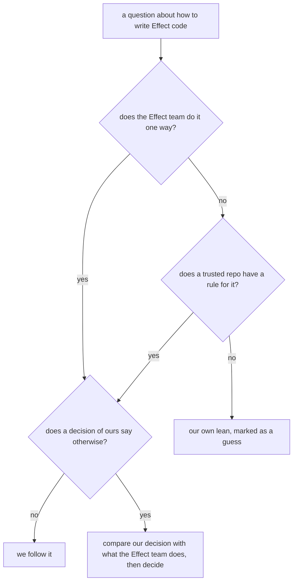

# 0560: Effect code in next/ and our tooling follows the Effect team first, then the trusted repos, and a clash with a decision of ours is settled by comparing ours with what the Effect team does



```ts
// The first use. next/packages/libfabrika/src/packs/RepositoryTrustLedger.ts on main, trimmed.
export const layer = Layer.effect(
  RepositoryTrust,
  Effect.gen(function* () {
    const digest = yield* Digest.Digest; // taken once, when the layer is built
    const checkSettings = (saved: Snapshot.Snapshot) =>
      Snapshot.read(Declarations.all, saved).pipe(
        Effect.provideService(Digest.Digest, digest), // handed to the inner effect
        Effect.mapError(invalid),
      );
    // ...so no method of RepositoryTrust asks its caller for Digest.
  }),
);

// A trusted repo's rule, `no-reprovide-ambient-service`, fires on the line marked "handed to".
// Its fix leaves Digest in each method's requirements. The Effect team's own checker calls that
// `leakingRequirements`, an error at tsconfig.base.json:49. So the rule is not taken.
```

**What this decides:** whose way wins when sources disagree about how Effect code is written, in
`next/` and our tooling.

## Context

- Three records already point at the Effect team, each for one part:
  - [0023](0023-next-follows-effects-code-style.md) covers how a line and a doc comment look in
    `next/`, and lists each kept difference with its reason.
  - [0114](0114-effects-team-as-the-builder.md) asks, for every plan and review in `next/`, how
    the Effect team would build the piece, and says a decision here still wins where the two
    differ.
  - [0120](0120-effect-code-guidelines.md) holds the eight guidelines that came out of that
    question. E1 is "use what Effect ships", E5 is "a layer asks for what it needs", E8 is "where
    we differ from Effect, the file says why".
- [`AGENTS.md`](../AGENTS.md#before-you-design-anything) has two lines on the same ground. "Lead
  with the known way" says to look up how the makers and the industry do it before a lean. "Read
  the installed version" says to read `node_modules/effect/AGENTS.md` before writing Effect code,
  and that a decision here wins where the two differ.
- [0054](0054-read-upstream-before-patching-it.md) says to read a package's own answer before
  changing that package. [0040](0040-existing-tools-before-hand-written.md) says to try an
  existing tool before writing one.
- On 2026-11-15 two outside repos of lint rules for agent-written code were read against this
  repo, rule by rule: 28 rules, 7 of them for Effect. Some agree with the Effect team, some with
  us, and some clash with a decision of ours. None of the records above says what to do with a
  rule from a repo that is not the Effect team's, or how such a clash is settled.

**What this adds that those do not say:**

- **A third source, with its rank.** The records above know two voices: the Effect team and our
  own decisions. This names a third, the trusted repos, and puts it below the Effect team.
- **A named list** of which repos count. None existed.
- **How a clash with our decision is settled.** 0023 and 0114 say our decision stays. This says
  what happens next: the clash is not closed by rank, in either direction. Our decision is put
  beside what the Effect team does, and then it is decided.
- **Our tooling by name.** 0023, 0114 and 0120 say `next/`.
  [0033](0033-agents-code-follows-next-rules.md) brought `.agents/` under `next/`'s rules. This
  order also covers `oxlint-plugins/` and `.github/ci/`.

This builds on 0023, 0114 and 0120 and changes none of their rules, so none is amended. 0023 and
0114 each get a one-line pointer to this file.

## Decision

**Effect code in `next/` and our tooling follows this order: what the Effect team does, then what
a trusted repo has, and where either clashes with a decision of ours, we compare our decision with
what the Effect team does, and then decide (owner, 2026-11-15).**

- **1. What the Effect team does, we follow.** It is read, never remembered, in the places 0114
  and `AGENTS.md` already name:
  - the installed source and `node_modules/effect/AGENTS.md`, at the version in the lockfile;
  - the repo the installed `package.json` names in `repository`, at that version's tag;
  - their own checker, `@effect/tsgo`, whose checks are set in `tsconfig.base.json`.
- **2. What a trusted repo has, we follow, unless it clashes with what the Effect team does.**
  Then the Effect team's way stands and the repo's rule is not taken.
- **3. Where 1 or 2 clashes with something we already decided,** our decision is compared with
  what the Effect team does, both as code with a path and line, and then it is decided. Until
  then our decision stays in force, as 0023 and 0114 say.
- **A difference that was already compared and kept is not a clash to settle again.** A row of
  0023's table is one. A recorded difference is not a gap (0114).
- **A repo that is not on the list has no rank here.** Its rule is one more thing looked at, as
  0040 asks.
- **The trusted repos,** each read at its `main` on 2026-11-15:
  - <https://github.com/dmmulroy/anti-slop>, lint rules for oxlint (at commit `13909c9`);
  - <https://github.com/K-Mistele/anti-slop>, a fork of the first with more rules, 7 of them for
    Effect (at commit `5360c12`);
  - the Effect skill inside that fork, `skills/effect-program-design/`, which is design notes for
    Effect programs and no lint rule.
- **Scope:** `next/`, and our tooling: the lead and step scripts under `.agents/`,
  `oxlint-plugins/` and `.github/ci/`. Today's app (`packages/`, `programs/`, `apps/`) is not
  covered.

## Consequences

- **The first use: the rule `no-reprovide-ambient-service` is not taken, and our way is kept.**
  The rule refuses a layer that takes a service when it is built and hands it to an inner effect.
  Its message says to leave the service in the operation's requirements. That is what the Effect
  team's checker forbids: `leakingRequirements` reports a service whose methods ask every caller
  for an inner dependency, and it is an error here (`tsconfig.base.json:49`). Our way is 0120's
  E5.
- **Following a rule is not the same as switching on a check.** A check that can block still has
  its false alarms measured first ([`AGENTS.md`](../AGENTS.md#checks),
  [0523](0523-advice-rules-block-where-clean.md)), and a ban still gets no list of leftovers
  ([0524](0524-no-list-lets-broken-code-pass.md)).
- **The cost.** One more read per question: the Effect source or checker first, then the trusted
  repos. A clash costs a comparison written down with code from both sides.
- **The list can go stale.** The fork was pushed to on the day it was read. This file names the
  commit each was read at.
- `AGENTS.md` is not changed by this pull request. Its two lines stand as written.
- **Not decided here:**
  - How a repo gets on the list, or leaves it. Today the list is the three entries above.
  - Whether the repo the Effect skill credits as its source, <https://github.com/kitlangton/skills>,
    is on the list. It is not, until that is decided.
  - Which of the trusted repos' other rules are taken. Each is its own decision, as
    [0554](0554-no-reflect-get-set-has.md) and [0555](0555-no-vi-mock-or-domock.md) are.
  - Today's app.

## Records

- `.glossary/TERMS.md` gets the row "trusted repo", under Records.
