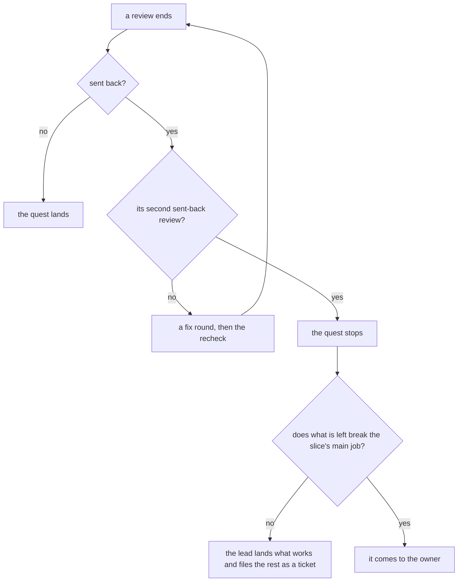
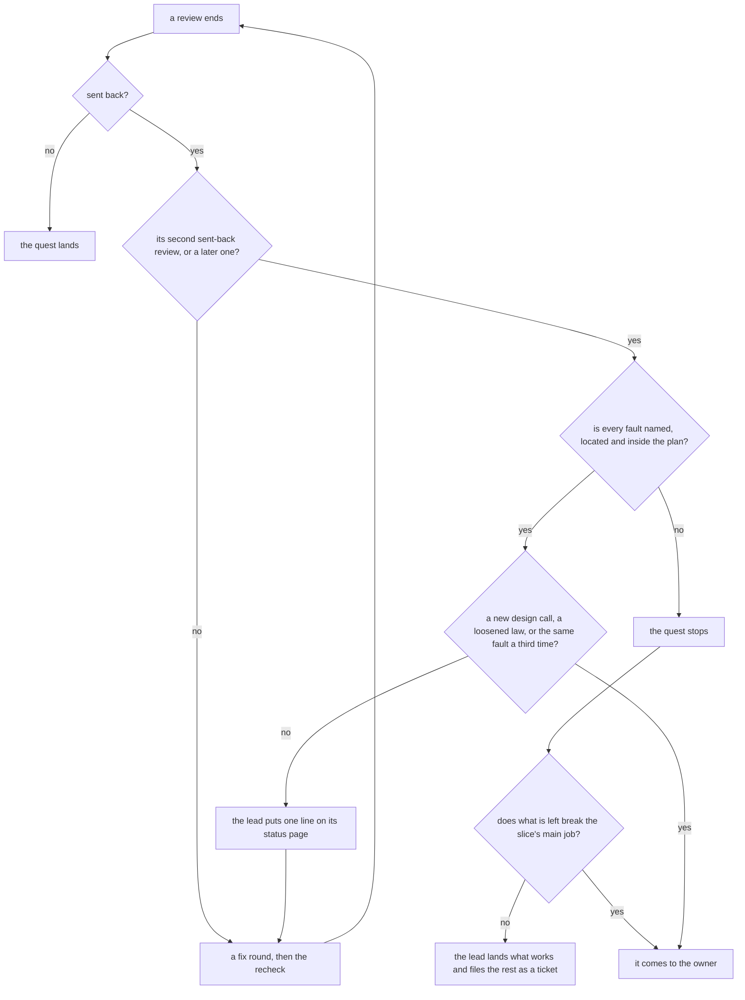

# 0564: After a quest's second sent-back review the lead decides a further fix round itself when the faults are named, located and inside the plan, and no approval the owner would surely give is asked for

**What this decides:** who decides what happens after a quest's second sent-back review, and when
the lead acts without asking the owner for a yes the owner would surely give.

**Before** ([0176](0176-second-send-back-stops-lane.md)):



**After:**



```ts
// Sketch, not built.
// before (0176): the count alone stops the quest.
const stop = { sentBackReviews: 2 };
// after: from the second sent-back review on, the faults decide.
type Next =
  | { _tag: "fix"; by: "lead" } // every fault named, located and inside the plan
  | { _tag: "ask"; to: "owner"; for: "design_call" | "loosened_law" | "same_fault_third_time" }
  | { _tag: "stop" }; // 0176 as written: land what works, file the rest as a ticket
```

One thing moves: at the second sent-back review the count no longer stops the quest by itself. The
lead reads the faults, and a quest with small, located faults gets one more fix round.

## Context

- [0176](0176-second-send-back-stops-lane.md) stops a quest the second time a review sends it back.
  Its file says lane; a lane is called a quest since
  [0546](0546-a-lane-is-called-a-quest.md).
- 0176 was written against quests with 7 to 12 sent-back reviews each. Its count is blunt on
  purpose, and it does not look at what the faults are.
- **What the count could not tell apart.** On 2026-11-15 two quests each reached a second sent-back
  review, or a red full run after a merge, with faults that were small and located:
  - the hands slice 4b, [pull request 1331](https://github.com/kamp-us/tea-fabrika/pull/1331);
  - P34c slice 4, [pull request 1092](https://github.com/kamp-us/tea-fabrika/pull/1092), taken back
    out by [pull request 1353](https://github.com/kamp-us/tea-fabrika/pull/1353).

  By 0176's count each would have stopped, and the only way on was to ask the owner. The answer was
  sure to be yes. Each got one more fix round, which is this decision's first use.
- **The principle behind it.** An approval the owner would always give is not worth asking for. The
  ask is friction: work stands still while it waits for a yes that was never in doubt.
- **How it fits older decisions.**
  - It amends 0176 in part. What moves and what stays is listed under [Decision](#decision).
  - It amends [0177](0177-fix-round-is-one-agent.md) in one line: a second send-back on the recheck
    no longer always stops the quest. The fix round's shape, one fix agent and the same reviewer
    resumed, does not change, and a further fix round has the same shape.
  - It follows [0014](0014-the-lead-merges-when-every-step-passed.md) and
    [0166](0166-owed-work-needs-no-owner-read.md), which already keep only real loosening and a new
    design call for the owner. Neither changes.
  - [0096](0096-the-lead-fixes-forward-while-the-owner-is-away.md) and
    [0162](0162-no-friction-before-a-merge.md) already let the lead answer the stop of
    [0076](0076-a-lane-stops-at-its-budget.md) itself and note it. This gives the same answer for
    0176's stop.

## Decision

**After a quest's second sent-back review, the lead decides a further fix round itself when every
fault is named, located and inside the plan; and the lead asks the owner for no approval the owner
would surely give (owner, 2026-11-15).**

For a sent-back review:

- The lead still counts a quest's sent-back reviews.
- At the second one, and at each later one, the lead reads the faults the review named.
- **The lead starts one more fix round itself** when every fault is:
  - named: the review says what is wrong;
  - located: it gives the file and line;
  - inside the plan: the fix builds what the approved plan already says.
- **It comes to the owner only when:**
  - the fix needs a new design call;
  - the fix loosens a law;
  - the same fault comes back a third time.
- **For every other quest, 0176's stop applies.** When what is left is not named and located, or
  not inside the plan, the quest stops. The lead lands what works and files the rest as a ticket,
  and it comes to the owner only when what is left breaks the slice's main job.
- Each further fix round the lead decides gets one line on the lead's status page: the quest, which
  sent-back review it was, and the faults.

For any approval the lead would ask for:

- **The test:** the lead acts, and puts one line on its status page, when the answer is surely yes
  and nothing in it is:
  - a new design call;
  - a loosened law;
  - something a person sees or presses;
  - a decision walked back.
- If any of the four is in it, or the answer is not sure, the lead asks.

**The lead's reading of the test.** These are not the owner's words, and the owner may take them
back.

- A decision that keeps an act or a call for the owner by name still holds: stepping past it would
  walk that decision back. Examples are an admin merge
  ([0179](0179-an-admin-merge-is-the-owners.md)), a run on the owner's Mac
  ([0178](0178-host-only-laws-run-first.md)), and a GitHub or security setting
  ([0163](0163-the-lead-acts-on-the-owners-word.md)).
- The test is for the lead, the session the owner is talking to (0163). No other agent uses it.

**Binding constraints**

- The count is kept. A further fix round is never started without reading the faults first.
- A fault with no file and line, or a fix outside the plan, never gets a further fix round under
  this rule.
- No further fix round starts without its line on the status page.

## Consequences

- A quest with small, located faults keeps moving, with no wait for a yes.
- **The cost:** a quest can run more fix rounds than 0176 allowed. What holds it is the lead's read
  of the faults, the stop at the same fault's third time, and 0076's backstop in steps and dollars.
  No check in code holds it yet.
- **The owner sees it after, not before.** The line on the status page is the record, and the owner
  can ask for any of it back.
- The lead skill's "When a review sends back" says the new rule, and `AGENTS.md` names this file
  beside 0176.
- Three points 0176 left open are open here too: how the count is kept while quests run by hand,
  what "breaks the slice's main job" means, and whether the number stays 2.
- Not decided here:
  - whether there is a number of fix rounds after which a quest stops whatever its faults look
    like. The ruling names the same fault's third time, and no other number;
  - how the lead tells the same fault from a new fault in the same place. For now it is the lead's
    judgment.
