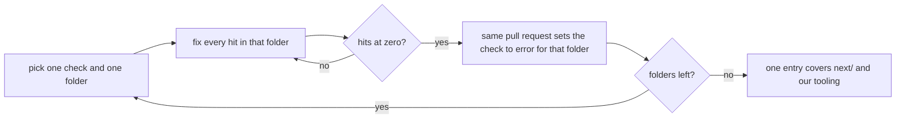

# 0565: In next/ and our tooling, every check in the Effect checker, all 135, is on as an error at zero hits, turned on one check and one folder at a time



```jsonc
// tsconfig.base.json, a sketch, not run: one more entry in "overrides", grown folder by folder
{
  "include": ["next/programs/counter/**/*.ts", "next/programs/counter/**/*.tsx"],
  "options": { "diagnosticSeverity": { "preferEffectArray": "error" } }
}
```

**What this decides:** that all 135 checks of the Effect team's checker block in `next/` and our
tooling, how they are turned on, and which of them clash with something we decided and wait for
the owner.

## Context

- The Effect team ships a checker, `@effect/tsgo`, that runs inside `tsc`. The lockfile pins
  0.63.0. Its `schema.json` lists 135 checks. `tsconfig.base.json` sets 59 of them, and no other
  tsconfig sets any.
- **How a check's level is set today.** The plugin block in `tsconfig.base.json` has a
  `diagnosticSeverity` map (line 22) for every folder, for example `leakingRequirements` as
  `error` at line 49. Its `overrides` list (line 69) sets a level for some folders only. Each
  entry has `include` globs, optional `exclude` globs and its own map. `globalErrorInEffectCatch`
  is `off` at line 27 and back to `error` at line 100, in the entry that includes `next/` and
  excludes its test files (lines 96 to 97). `preferNamespaceImport` is on for two library folders
  at lines 113 to 116, and that list grows a folder at a time.
- `includeSuggestionsInTsc` is `false` (line 21), so a check whose default level is `suggestion`
  runs nowhere until a level is set for it.
- A count ran on 2026-11-15, on main at `98bcdfa22`, with all 135 checks printed as messages over
  `next/`, `.agents/`, `.github/ci/` and `oxlint-plugins/`. Its report and raw output are in the
  private archive ([0027](0027-experiment-results-live-in-a-private-archive.md)). **Every hit
  count in this file is that report's number. The checker was not run again for this file.** The
  lists were checked against the report's raw output, and the default levels against the
  installed `schema.json`.
- The count found 39,314 hits from 56 checks. The other 79 checks have 0 hits.
- Earlier leans went the other way for some checks. The report's own lean was to turn on 23 and
  leave the rest off. Experiments [262](../experiments/262-effects-team-as-the-builder.md) and
  [272](../experiments/272-lint-rules-and-effect-checks-one-pass.md) leaned the same way, and a
  smaller call in [the Effect code guidelines](../docs/direction/effect-code-guidelines.md),
  "Nine shipped checks stay off", was approved on 2026-11-11 as an 80% lean. This decision
  replaces that call. The note keeps a pointer here.
- This builds on [0168](0168-old-lint-breaks-are-fixed.md) (a new rule turns on folder by folder,
  each folder at zero), [0524](0524-no-list-lets-broken-code-pass.md) (no list, no warn level),
  [0114](0114-effects-team-as-the-builder.md) (a check Effect's own tooling ships comes before a
  rule of ours) and [0120](0120-effect-code-guidelines.md) (a check blocks only after all its
  hits are counted, and each sweep turns its check to `error` when it lands).

## Decision

**Every check in the Effect checker, all 135, is on as an error in `next/` and our tooling, at
zero hits. The Effect team wrote each one for a reason, and the size of the change does not
matter (owner, 2026-11-15).**

- **Scope:** `next/`, tests too, and our tooling: the lead and step scripts under `.agents/`,
  `oxlint-plugins/` and `.github/ci/`. Today's app (`packages/`, `programs/`, `apps/`) is not
  covered.
- **The five that are off at the root today are in scope:** `unstableApiUsage`,
  `multipleEffectProvide`, `promiseInEffectSuccess`, `globalErrorInEffectCatch` and
  `globalErrorInEffectFailure`.
- **A check on for part of the scope goes on for all of it.** That is the 16 that are errors for
  `next/` only, the 4 for `next/` product only, and `preferNamespaceImport`, on for two folders.
- **A check that clashes with something we decided is not skipped and not settled here.** It is
  listed under "Not decided here", with the code on both sides, and the owner rules.

**The 56 checks with hits, 39,314 in all**

Each number is hits in `next/` and tooling together.

- **Built-in helpers, 3 checks:** `preferEffectArray` 7,065, `preferEffectString` 2,949,
  `preferEffectRecord` 843.
- **Faults or risk, 6:** `anyUnknownInErrorContext` 695, `preferTypedSchemaDecoder` 331,
  `schemaNumber` 290, `schemaSyncInEffect` 154, `processEnvInEffect` 92, `globalConsoleInEffect`
  17.
- **One-line cleanups, 17:** `unnecessaryTypeofType` 65, `unnecessaryArrowBlock` 30,
  `catchToOrElseSucceed` 22, `schemaStructWithTag` 19, `unnecessaryFailYieldableError` 9,
  `catchConditionalRefailToCatchIf` 7, `mapMapErrorToMapBoth` 7, `preferSucceedSomeOrNone` 7,
  `preferUnsafeConstructor` 6, `extendsNativeError` 6, `flatMapConditionalToFilterOrFail` 5,
  `unnecessaryEffectGen` 5, `catchToIgnore` 4, `effectSucceedWithVoid` 4, `nestedEffectGenYield`
  4, `flatMapIgnoredParamToAndThen` 1, `runOfExitToRunExit` 1.
- **What the report calls design calls, 12:** `strictEffectProvide` 1,513,
  `strictBooleanExpressions` 302, `apiStabilityLeak` 235, `schemaClassMissingBrand` 193,
  `runEffectInsideEffect` 125, `globalDate` 97, `processEnv` 67, `missedPipeableOpportunity` 53,
  `instanceOfSchema` 50, `deterministicKeys` 35, `lazyEffect` 8, `returnEffectInGen` 7.
- **What the report calls noise, or held by a lint rule of ours, 10:** `asyncFunction` 1,441,
  `newSchemaClass` 941, `schemaSync` 632, `preferSchemaOverJson` 505, `nodeBuiltinImport` 400,
  `missingPipeableSignature` 381, `globalConsole` 82, `newPromise` 47, `globalTimers` 19,
  `globalFetch` 15.
- **Set today, with hits where they are off, 8:** `unstableApiUsage` 16,281,
  `preferNamespaceImport` 3,098, `multipleEffectProvide` 44, `globalDateInEffect` 38,
  `globalErrorInEffectFailure` 36, `globalErrorInEffectCatch` 24, `globalFetchInEffect` 5,
  `multipleCatchTag` 2.

**The 79 checks with 0 hits**

Each is named as `error` for all of `next/` and our tooling in one pull request, since nothing has
to be fixed first.

- **51 are set today** and stay. `promiseInEffectSuccess` and the 14 others that are errors for
  `next/` only have 0 hits in tooling, so tooling takes them now.
- **`preferBarrelImport`** has 0 hits because it needs a setting we do not use. It is under "Not
  decided here".
- **27 block only by the checker's default level.** Naming them means a version bump of the
  checker cannot lower one without a diff here.
  - Default `error` (12): `classSelfMismatch`, `effectFnImplicitAny`, `floatingEffectInVitest`,
    `missingEffectContext`, `missingEffectError`, `missingLayerContext`,
    `missingReturnYieldStar`, `missingStarInYieldEffectGen`, `nonObjectEffectServiceType`,
    `overriddenSchemaConstructor`, `schemaLiteralNonFinite`, `schemaOpaqueInstanceMember`.
  - Default `warning` (15): `duplicatePackage`, `effectFnIife`, `effectGenUsesAdapter`,
    `effectInFailure`, `effectInVoidSuccess`, `experimentalApiUsage`, `genericEffectServices`,
    `layerMergeAllWithDependencies`, `lazyPromiseInEffectSync`, `obsoleteMatchImport`,
    `obsoleteSchemaImport`, `outdatedApi`, `schemaClassObjectLiteral`, `scopeInLayerEffect`,
    `unknownInEffectCatch`.

**What replaces a flagged call**

Each check's message names its replacement. For the three helper checks, read in the installed
Effect, 4.1.2, at `node_modules/effect/src/Array.ts`, `String.ts` and `Record.ts` (its `AGENTS.md`
says nothing about these three modules):

```ts
// before
const open = tickets.filter((t) => t.state === "open").map((t) => t.title);
const mine = tickets.find((t) => t.id === id); // Ticket | undefined
const line = names.join(", ");

// after (a sketch, not compiled)
import * as Arr from "effect/Array";
import { pipe } from "effect/Function";

const open = pipe(
  tickets,
  Arr.filter((t) => t.state === "open"),
  Arr.map((t) => t.title)
);
const mine = Arr.findFirst(tickets, (t) => t.id === id); // Option<Ticket>
const line = Arr.join(names, ", ");
```

The built-in chain becomes a `pipe`, and `find` now answers an `Option`, so its callers change
too.

- **Arrays:** `preferEffectArray` flags 16 built-in methods. `.map` is 2,351 of the hits,
  `.filter` 1,788, `.join` 657, `.some` 631, `.find` 532 and `.flatMap` 438.
- **Not every fix is one line.** The checker's own description of all three checks ends "with
  semantic caveats", and each message says what differs. `Arr.findFirst` and `String.indexOf`
  answer an `Option`. `Arr.sort` takes an `Order`, where `toSorted` took a compare function.
  `Arr.join` needs its separator.
- **The string helpers take the string last:** `String.startsWith("a")(text)`
  (`String.ts:579`), so they read best in a `pipe`.
- **Records:** `Record.keys`, `Record.values`, `Record.toEntries`, `Record.fromEntries` and
  `Record.has`.
- **Import names.** Effect's own source imports the module as `Arr` in 18 files.
- **The six that find faults:** `Schema.decodeUnknownEffect` with a mapped error for a decode
  that throws; a named error type for `unknown`; `Schema.Finite` for `Schema.Number`; `Config` for
  `process.env`; the typed decoder, such as `Schema.decodeEffect`, for `decodeUnknown...` on a
  typed value; `Console.log` or `Effect.log` for `console`.

**How it is rolled out**

- **One check, one folder, one pull request.** A check is set to `error` for a folder in the same
  pull request that brings its hits in that folder to zero.
- **Folder by folder to zero.** The folder is as small as the code allows, so one busy folder does
  not hold back its clean neighbors. A folder with 0 hits today is turned on first.
- **The level is set where levels are set today:** an entry in `overrides` in
  `tsconfig.base.json`, the way `preferNamespaceImport` grows at lines 113 to 116. When the last
  folder is at zero, one entry covers `next/` and our tooling. A check does not move to the top
  map for this, since that map also reaches today's app.
- **An exception is the checker's own comment on the line before, only where the code is right,
  and the line says why:**

  ```ts
  // @effect-diagnostics-next-line preferEffectArray:off -- <plain reason>
  ```

  The form is read from the checker's parser at 0.63.0 (`internal/directives/parser.go` in
  `Effect-TS/tsgo`): the check's name, a colon, the level. The ` -- <plain reason>` tail is our
  own, as on an oxlint disable line. By the parser's pattern the tail is ignored as long as it
  holds no `word:word`. That was read, not run. The first sweep pull request plants one line to
  prove it. The Effect team uses the same comment in its own source.

**Binding constraints**

- No list of leftovers and no `warning` level ([0524](0524-no-list-lets-broken-code-pass.md)). A
  check is `error` for a folder, or not set for it yet.
- A folder that blocks never goes back to let a pull request pass.
- A fix does not swap one flagged call for an unflagged trick, such as a hand-written loop only to
  get past `preferEffectArray`.
- An ignore comment is for one line that is right where the check does not fit. It is never a
  way to postpone a fix, never the file-wide `skip-file` form, and never added in bulk to make a
  folder pass.
- Each sweep pull request reports, per check: the hits it met, the ones it fixed, and each ignore
  line with its reason.
- A check listed under "Not decided here" is not swept and not switched off until the owner
  rules.

## Consequences

- This file records the ruling and the order of work. It changes no config. Until a sweep lands
  for a folder, nothing stops a new hit there.
- **The cost.** 39,314 hits over 56 checks. In the report's raw output they sit in 905 of the
  1,034 `.ts` and `.tsx` files in scope. `unstableApiUsage` alone is 16,281, and what its fix is
  waits on the owner. The checker lists the three helper checks as "Fixable: No", so their 10,857
  hits have no quick fix. A change that turns `undefined` into an `Option` reaches the callers
  too.
- **It conflicts with every open branch.** The sweep touches most files in `next/`. The order it
  runs in against work in flight is the lead's to plan. This file does not set it.
- **False alarms were not measured to the bar `AGENTS.md` asks.**
  [Checks](../AGENTS.md#checks) asks that a check that can block has its false alarms measured
  first, at about 0%. The ruling goes ahead of that measure. The report read 5 to 10 hits per
  check, out of up to 16,281. What it found:
  - Array, string and record: no hit is a fault. Each is a style change.
  - `schemaSyncInEffect`: of the 9 hits in plain product files, 3 are real and 6 sit inside
    `Effect.try`, which already catches the throw. Those 6 are false alarms in effect.
  - `anyUnknownInErrorContext`: real in product, where 45 of 64 plain product hits are in three
    files. In tests it mostly flags suites that are generic over their error.
  - `processEnvInEffect`: 71 of the 92 hits are tests that set and restore a variable.
  - `schemaNumber`, `preferTypedSchemaDecoder`, `globalConsoleInEffect` and the 17 cleanups:
    right in every hit read, except `extendsNativeError`, whose 6 hits are tests that make a plain
    error on purpose. `Schema.Finite` changes what decodes, and stored data was not checked for a
    `NaN`.
  - The design-call group: right only part of the time. `missedPipeableOpportunity` was wrong in
    about half the hits read. `strictEffectProvide` has 1,231 of its 1,513 hits in tests, which
    provide layers by design. `runEffectInsideEffect`'s 8 plain product hits are callbacks handed
    to a tool that wants a Promise.
  - The noise group: `asyncFunction` has 1,239 of 1,441 hits in test callbacks.
    `missingPipeableSignature` is made for authors of pipeable libraries and fires on test
    helpers. `nodeBuiltinImport`, `globalConsole` and `processEnv` fire on CI scripts that read
    GitHub's variables and print their output.
  - The report gives its own doubt: about 75% sure for the six, 85% for the cleanups and the
    noise group, 65% for the design calls.
- **So the sweep is where the measure happens.** A check that proves wrong for a whole class of
  files shows in the per-check numbers each sweep pull request reports, and goes back to the
  owner. It is not answered with ignore lines in bulk.
- **Our own lint rules that repeat a check give way to it,** as
  [0114](0114-effects-team-as-the-builder.md) already says. The report names
  `fabrika/no-promises`, `fabrika/no-node-imports`, `fabrika/no-effect-run-outside-edge` and
  `fabrika/no-hand-tag` as overlaps. Each sweep says which rule of ours its check replaces, or why
  both stay.
- **Against the Effect team's own repo: much stricter.** Read on 2026-11-15 at `d5f8bdf4f` of
  `Effect-TS/effect`, the repository the installed `effect` names. Its `tsconfig.base.json` uses
  `@effect/tsgo` 0.69 and:
  - sets two checks to `error`: `effectFnOpportunity`, and `apiStabilityLeak` for its public
    sources;
  - turns three off: `globalErrorInEffectFailure`, `unstableApiUsage` and `experimentalApiUsage`;
  - hides suggestions, as we do today, and sets `ignoreEffectWarningsInTscExitCode` to `true`,
    so a warning does not fail its build;
  - leaves every other check at its default, so the checks whose default is `off` or `suggestion`
    do not run there. Its source calls the built-in methods freely: `Object.keys` and its four
    siblings appear 420 times in 123 files of the installed `node_modules/effect/src`, comments
    included.
  - The same: it uses the `@effect-diagnostics-next-line` comment for its exceptions.
  - The checker's `effect-native` lint preset has the three helper checks, at `warn`.
- **Version drift.** The Effect team's repo is on 0.69 of the checker and we pin 0.63.0. A bump
  can add checks and change defaults. By this ruling a new check is on as an error too; the bump's
  pull request counts its hits.
- **Not decided here: a check that cannot be on together with something we decided.** Each waits
  for the owner, with the code on both sides.
  - **RULED on 2026-11-15 by [0577](0577-libraries-namespace-programs-barrel-imports.md): clash 5, `preferBarrelImport` against namespace imports**
    ([0120](0120-effect-code-guidelines.md), E7). It fires only for packages named in
    `barrelImportPackages`, and `preferNamespaceImport` only for those in
    `namespaceImportPackages`. One package cannot be in both.

    ```ts
    import * as Effect from "effect/Effect"; // what E7 and preferNamespaceImport ask
    import { Effect } from "effect"; // what preferBarrelImport asks, once "effect" is named for it
    ```

    Set to `error` with no package named, it is on and can never fire.
  - **RULED on 2026-11-15 by [0574](0574-no-stability-tag-and-unstable-api-is-an-error.md): clash 1, `unstableApiUsage` (16,281) against our doc tags**
    ([0118](0118-no-since-tag-before-a-release.md)). Every public export of ours carries
    `@stability unstable`, so 12,933 of the hits are our own exports used by our own code. About
    3,350 point at Effect's packages, 1,632 of them `it` from `@effect/vitest`.

    ```ts
    // next/packages/libfabrika/src/ledger/Ledger.ts:49, the tag every export of ours carries
    /** @stability unstable */
    export class Doorbell extends Context.Service<Doorbell, Ring>()("...") {}

    // any file of ours that names it is flagged, and so is each test that calls `it`
    import { Doorbell } from "@kampus/libfabrika/ledger/Ledger"; // a sketch of a use
    ```

    The checker has an `allowedUnstableApis` setting. Whether that is a list in the sense of 0524
    is part of the question.
  - **RULED on 2026-11-15 by [0574](0574-no-stability-tag-and-unstable-api-is-an-error.md): clash 2, `apiStabilityLeak` (235), the same root.** It flags an export whose type shows a less
    stable type. With every export unstable, and Effect's `Path` and `FileSystem` unstable too, it
    fires on almost any export.
  - **RULED on 2026-11-15 by [0576](0576-schema-sync-error-result-in-plain-code.md): clash 3, `schemaSync` (632, 620 on main at `61d551ff3`) against a ledger step that is a plain function**
    ([0050](0050-a-ledger-step-is-a-plain-function.md)). The check flags every synchronous decode
    or encode, also outside Effect code, and asks for the Effect form. A step may not be an Effect.

    ```ts
    // next/packages/libfabrika/src/tasks/TasksLedger.ts:35, flagged
    const encodePointer = Schema.encodeSync(Pointer);
    // what the check asks for, which a plain step cannot run
    const encodePointer = Schema.encodeEffect(Pointer);
    ```

  - **RULED on 2026-11-15 by [0575](0575-deterministic-keys-is-the-service-id-form.md): clash 4, `deterministicKeys` (35) against our service id shape**
    ([0120](0120-effect-code-guidelines.md), E7).

    ```ts
    "@kampus/libfabrika/ledger/Ledger.Doorbell"; // ours, Ledger.ts:55
    "@kampus/libfabrika/ledger/Ledger/Doorbell"; // what the check expects
    ```

    The pattern is a setting, `keyPatterns`. Whether it can express ours was not checked.
- **What this cannot tell us:** what a fix breaks, since none was tried; how many hits today's
  app has, since it was not run; whether more clashes exist than the five found by reading the
  report against `.decisions/`; and the count on any commit after `98bcdfa22`. Main moves fast,
  and the report saw `schemaSyncInEffect` go from 27 hits to 154 in six days.

## Amendments

- 2026-11-15: [0573](0573-trusted-lint-rule-replaces-ours.md) names which of our rules give way to a check of the Effect checker or another trusted rule, and which stay. `fabrika/no-node-imports`, `fabrika/no-effect-run-outside-edge` and `fabrika/no-hand-tag` go to trusted rules; `fabrika/no-promises` stays, since theirs is narrower. It leaves `deterministicKeys` and `service-id` as an unruled clash.
- 2026-11-15: [0574](0574-no-stability-tag-and-unstable-api-is-an-error.md) rules clashes 1 and 2. `unstableApiUsage`: `@stability` is dropped until the first release and the check is an error, with `allowedUnstableApis` naming each unstable Effect part we use. `apiStabilityLeak`: recounted after the tags go; an error if zero, off if hits remain from Effect's unstable types, which we use on purpose.
- 2026-11-15: [0575](0575-deterministic-keys-is-the-service-id-form.md) rules clash 4. `deterministicKeys` is an error and sets the service ID form, `service-id` is deleted, and the sweep tries `keyPatterns` with our dot form first, then renames the 35 IDs to the checker's form.
- 2026-11-15: [0576](0576-schema-sync-error-result-in-plain-code.md) rules clash 3. `schemaSync` is an error; a plain function (a ledger step, [0050](0050-a-ledger-step-is-a-plain-function.md)) uses the Result form and handles the failure, Effect code the Effect form. The count is 620 on main at `61d551ff3`, where this file said 632. Each hit must handle the failure it ignores today.
- 2026-11-15: [0577](0577-libraries-namespace-programs-barrel-imports.md) rules clash 5. Libraries in `next/packages/` import `effect` by namespace, held by `preferNamespaceImport`; programs and apps in `next/programs/` and `next/apps/` import it from the barrel, held by `preferBarrelImport`. Both are errors, set in each package's own tsconfig. With it, all five clashes this file lists are ruled.

### 2026-11-15: `strictEffectProvide` covers library and program source, not test files

Slice E30 found 775 `strictEffectProvide` hits: 757 in 129 test files, 14 at
`NodeRuntime.runMain` entry points, and 4 in library code. The checker's own page
([strict-effect-provide](https://github.com/Effect-TS/tsgo/blob/main/docs/rules/strict-effect-provide.md))
says the rule warns on `Effect.provide` outside an application entry point, because a layer
provided elsewhere "may break scope lifetimes". It also says: "If this is an entry point, you can
safely disable this diagnostic."

The lead ruled, following the makers:

- **Test files are out of the lock.** A test that provides its own fresh layer is the scope the
  rule protects: one layer per test run, with nothing shared. So the lock's globs cover library
  and program source only. Like any other check, it stays on wherever those globs reach.
- **Entry points keep the check on, with a reasoned disable line.** Each of the 14 gets a
  `@effect-diagnostics-next-line strictEffectProvide:off -- <why>` that quotes the doc's
  entry-point reason.
- **The 4 library hits get fixed.**

The lead is about 75% sure. The doubt: the makers' page never names tests, and `@effect/vitest`'s
`layer(...)` helper is another way to give a test its layer. Moving the 757 sites to that helper
would keep tests in the lock. If the owner prefers that, this amendment is reversed and E30 moves
the tests instead.

### 2026-11-15: the four bare-Node CI scripts stay outside the Effect checks

Four scripts in `.github/ci/` run with bare Node before `pnpm install`, so `changes.mjs` can pick a
run's CI jobs before anyone pays for an install (0175). The Effect checks ask for Effect-native
counterparts, and those cannot load before install. The lead ruled that each lock lists these four
files by exact path in its `exclude`, never by a glob, with this reason. A new script then needs
its own diff and its own reason.

### 2026-11-15: `missingPipeableSignature` covers every folder

The owner ruled on 2026-11-15 that Effect's `missingPipeableSignature` check covers everything:
library code, scripts, test helpers, Layer constructors and comparators. All 135 hits left after
slice E43 get a `Function.dual` signature, and the lock covers every folder. This overrules the
lead's lean, which would have covered exported library code only.
