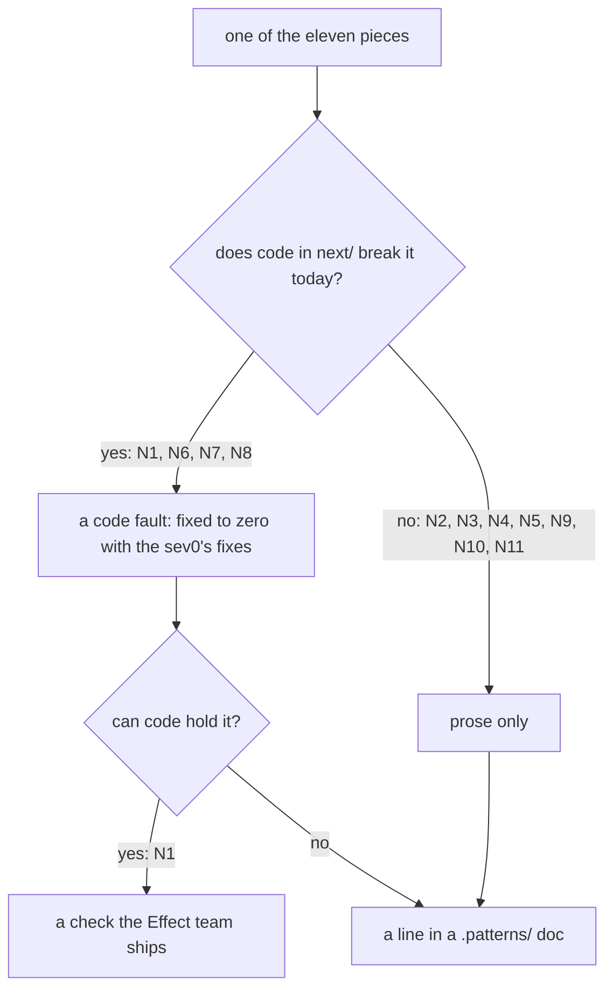

# 0566: In next/ and our tooling, we take all eleven pieces of the trusted Effect skill that are new to us, each held by a shipped check or a pattern doc line, and code that breaks one is a fault fixed to zero



```ts
// One piece, N6. next/packages/libfabrika/src/ledger/internal/ledgerStore.ts:323 on main: every
// cause is dropped, an interrupt too.
ring(stream, rev, waiter).pipe(Effect.catchCause(() => Effect.void));

// next/programs/pipeline/src/handlers.ts:29 on main already has the taken shape: the interrupt
// goes on, and only then is the rest handled.
Effect.catchCause((cause) => {
  if (Cause.hasInterrupts(cause)) {
    return Effect.interrupt;
  }

  return Effect.fail(new HandlerDefect({ cmd }));
});
```

**What this decides:** which rules of the trusted Effect skill we add to our own, where each one
is held, and which of them `next/` breaks today.

## Context

- [0560](0560-an-order-for-effect-code.md) puts <https://github.com/kitlangton/skills> on the list
  of trusted repos, at commit `71195e3`. Its Effect skill is `skills/effect/`: a core file of 103
  lines and nine reference files, 1,140 lines in all. It says it was checked against Effect
  4.0.0. We are on 4.1.2 (the lockfile).
- The skill was read whole on 2026-11-15, beside `next/`, the Effect pattern docs in `.patterns/`
  and the decisions. We already hold most of it, in lint rules, in the Effect team's checker and
  in pattern docs. Eleven pieces are new to us. They are named N1 to N11 below.
- Six of the skill's defaults go the other way from a decision of ours. They are listed under
  "Not decided here" and nothing in this file leans on them.
- **What was checked for this file,** on main at `a31798b20`:
  - Each rule below was read in the skill's own text at `71195e3`.
  - Each Effect name used below is exported by the installed `effect` 4.1.2:
    `Config.String`, `Config.orElse`, `Config.map`, `Effect.retry`, `Effect.cached`,
    `Effect.catchCause`, `Effect.catchCauseIf`, `Effect.forkScoped`, `Cause.hasInterrupts`,
    `Layer.effectContext`, `Layer.mock`, `Cache.make`, `Cache.makeWith`, `ScopedCache.makeWith`,
    `Schema.optionalKey`, `Schema.optional`, `Schema.encodeKeys`, `Stream.runCollect`,
    `Stream.take`, `HttpClient.withRateLimiter` (in `effect/http`), and the modules `Queue`,
    `PubSub`, `SubscriptionRef`, `Latch`, `FiberMap` and `RequestResolver`. Names were checked,
    and the one signature read is `Effect.catchCauseIf(predicate, f)`.
  - Each count is a search over `next/**/*.ts` and `*.tsx` with `*.test.ts`, `*.test.tsx`,
    `*Test.ts` and `*.test-support.ts` left out. That is 284 files, called product files below.
    A count is lines that match, not lines that were each read, unless it says so.
- **One run, for N6.** A short script on `effect` 4.1.2 ran the shape of the two `ledgerStore.ts`
  lines. When the fiber that makes the call is interrupted, the `catchCause` handler does not run
  and the call ends interrupted, with one ring at a time and with all at once. When the ring
  itself ends in an interrupt (`Effect.interrupt`, or a join of an interrupted fiber), the handler
  runs and the call goes on as a success. So the bare form drops an interrupt that starts inside
  the caught effect, and not one that comes from the caller.

## Decision

**We take all eleven pieces, in `next/` and our tooling. Each is held where code can hold it, by a
check the Effect team ships, and otherwise by a line in a `.patterns/` doc. Code that breaks a
taken piece is a fault, and it is fixed to zero with the fixes of the sev0 the owner called on
2026-11-15 (owner, 2026-11-15).**

- **Scope** is 0560's: `next/`, the lead and step scripts under `.agents/`, `oxlint-plugins/` and
  `.github/ci/`. Today's app is not covered.
- **Four pieces are code faults today:** N1, N6, N7 and N8. Each also gets its doc line.
- **Seven are prose only:** N2, N3, N4, N5, N9, N10 and N11. No code in `next/` is known to break
  them.
- A block marked "a sketch" was not compiled. Every other block is code on main, trimmed.

### The four with code to fix

**N1. A setting is read through `Config`, never from `process.env`.**

- Held by two checks of the Effect team's checker, `processEnvInEffect` and `processEnv`.
  [0565](0565-effects-own-checks-block.md) already turns every check on, and counts 92 and 67
  hits for the two over `next/` and tooling, tests included.
- In product files: 14 lines name `process.env`, all read. 9 are reads, in 3 files
  (`next/apps/fabrika/dev.ts:94` to `:103`,
  `next/packages/libfabrika/src/node/repositories/RepositoriesGit.ts:82` to `:90`,
  `next/packages/vitest/src/Depth.ts:30`). 3 are writes and 2 are a bundler's `define` text.

```ts
// before: next/apps/fabrika/dev.ts:94. One line reads the same kind of value two ways.
const home = process.env.FABRIKA_HOME ?? path.join(yield* Config.String("HOME"), ".fabrika");

// after: a sketch
const home = yield* Config.String("FABRIKA_HOME").pipe(
  Config.orElse(() => Config.map(Config.String("HOME"), (dir) => path.join(dir, ".fabrika"))),
);
```

**N6. A catch on the whole cause is only for an edge or a supervisor, and it lets an interrupt
through.**

- Held by lines in `.patterns/effect-swallowed-failures-leave-a-trace.md`. That doc shows the bare
  `catchCause(() => Effect.void)` today, so its own example changes too
  ([0562](0562-nothing-teaches-the-wrong-shape.md)).
- In product files: 10 lines call `Effect.catchCause`. 2 pass an interrupt on by their own text
  (`next/programs/pipeline/src/handlers.ts:29`,
  `next/packages/libfabrika/src/processes/ChildrenLedger.ts:292`). The other 8 are read one by one
  in the fix, and each one that can drop an interrupt is a fault: `ledgerStore.ts:323` and `:465`,
  `cloudflare/tail.ts:57` and `:82`, `cloudflare/connection.ts:176`, `gateway/Gateway.ts:1424`,
  `next/apps/fabrika/src/brain.ts:333` and `next/apps/fabrika/src/local-instance.ts:53`.
- The skill's rule for a typed failure stays the first choice: catch the typed error
  (`Effect.catchTag`, `Effect.catchIf`) where that is enough.

```ts
// before: ledgerStore.ts:465
ring(stream, rev, waiter).pipe(Effect.catchCause(() => Effect.void));

// after: a sketch
ring(stream, rev, waiter).pipe(
  Effect.catchCauseIf(
    (cause) => !Cause.hasInterrupts(cause),
    () => Effect.void,
  ),
);
```

**N7. An error has one named helper that makes it, and a wrapper is not written again at each
call.**

- Held by lines in `.patterns/effect-errors-keep-their-cause.md`.
- In product files: 113 lines in 33 files write the wrapper in place
  (`mapError((cause) => new SomeError(...))`), 32 of them in
  `next/packages/libfabrika/src/cloudflare/runtime.ts`. 24 named helpers exist in 18 files.

```ts
// before: next/packages/libfabrika/src/processes/ProcessManager.ts:341, and again word for word
// at :453 and :511
Effect.mapError((cause) => new ProcessError({ reason: "bad_text", cause }));

// after: the shape on main in next/packages/libfabrika/src/packs/RepositoryTrustLedger.ts:24, :63
const storage = (cause: unknown) =>
  new RepositoryTrustError({ reason: new Storage({ cause: Redacted.make(cause) }) });
ledger.read(stream(key, person), 0).pipe(Stream.take(LIMIT + 1), Stream.runCollect, Effect.mapError(storage));
```

**N8. A key that may be absent is `Schema.optionalKey`. `Schema.optional` is only for a contract
where a written `undefined` is a real value.**

- Held by one row in the Schema part of `.patterns/effect-reach-for-what-ships.md`.
- In product files: 21 lines use `Schema.optional(` and 135 use `Schema.optionalKey(`. 13 of the
  21 are an error's `cause`, which is not decided here. The other 8 are the faults:
  `apps/fabrika/src/exam/plant.ts:21` and `:24`, `apps/fabrika/src/exam/commits.ts:78` and `:79`,
  `gateway/Gateway.ts:233`, `transport/Answer.ts:16`, `transport/Webauthn.ts:119` and `message` at
  `ledger/Ledger.ts:34`.

```ts
// before: next/packages/libfabrika/src/transport/Webauthn.ts:119, a field of a JSON text
crossOrigin: Schema.optional(Schema.Boolean),

// after: a sketch. JSON cannot carry `undefined`, so the key is absent or it has a value.
crossOrigin: Schema.optionalKey(Schema.Boolean),
```

### The seven that are prose

**N2. A retry is bounded, only around a call that is safe to repeat, at the narrowest place.**

- Held by lines in `.patterns/effect-state-and-time.md`. No check: code cannot know that a call
  is safe to repeat.
- Product files have 2 `Effect.retry` calls, both in `cloudflare/runtime.ts` (`:1521`, `:2221`).
  Both are bounded. The second says why its calls are safe to repeat.

```ts
// next/packages/libfabrika/src/cloudflare/runtime.ts:2218 on main: already the taken shape
// Every manager call is idempotent by its own IDs, so an answer the transport lost is asked again,
// a bounded number of times. A refusal is an answer and is never asked again.
work.pipe(
  Effect.retry({
    times: 2,
    while: (error) => error instanceof LedgerError && error.reason === "unreachable",
  }),
);
```

**N3. A fake that a test steers has a control service beside the real one, with one object behind
both.**

- Held by a section in `.patterns/effect-tests-run-in-it-effect.md`. Two fakes already have the
  shape (`codehost/CodeHostTest.ts`, `ci/CiTest.ts`) and no doc says so.

```ts
// next/packages/libfabrika/src/codehost/CodeHostTest.ts:42, :59, :199 on main
export class Control extends Context.Service<
  Control,
  {
    readonly put: (change: ChangeData) => Effect.Effect<void>;
    readonly fail: (method: Method, fault: Fault) => Effect.Effect<void>;
    readonly calls: () => ReadonlyArray<Call>;
    // ...main, crashMerge, read
  }
>()("@kampus/libfabrika/codehost/CodeHostTest.Control") {}

export const layer = (options = {}): Layer.Layer<CodeHost | Control> =>
  Layer.effectContext(
    Effect.sync(() => {
      // ...one set of maps, read by both services
      return Context.make(CodeHost, host).pipe(Context.add(Control, { /* put, fail, calls */ }));
    }),
  );
```

**N4. Effect's caches come before a hand-written one:** `Cache`, `ScopedCache` and
`Effect.cached`, and no map of calls in flight, since one key's gets share one lookup.

- Held by rows in the table of `.patterns/effect-reach-for-what-ships.md`. No hand cache was
  found: of the 23 product lines that name a lifetime, the ones read are tea machines, ledger
  rows and the one cache below.

```ts
// next/packages/libfabrika/src/cloudflare/SettingsRuntime.ts:21 on main: already the taken shape
ScopedCache.makeWith({
  capacity: 1,
  requireServicesAt: "construction",
  lookup: (_key: void) => build,
  timeToLive: (exit, _key: void) => (Exit.isSuccess(exit) ? Duration.infinity : Duration.zero),
});
```

**N5. The stream rules.** A service offers a `Stream` and keeps its queue private. A consumer
that lives long is forked in its layer's scope, and building the layer finishes. No
`Stream.runCollect` on a stream that may not end. A stream is not used only to loop.

- Held by lines in `.patterns/effect-services-and-layers.md`.
- Product files have 14 `Stream.runCollect` lines. Each was read at the line, not in the source
  of its stream, and none was shown to be on a stream that never ends. Several read a ledger
  stream from its first entry, which grows with history; whether that is right was not judged.

```ts
// next/packages/libfabrika/src/ledger/Ledger.ts:96 on main: the service offers a Stream
readonly read: (stream: string, after: Rev) => Stream.Stream<Entry, LedgerError>;

// next/packages/libfabrika/src/packs/RepositoryTrustLedger.ts:61 on main: a read with a bound
ledger.read(stream(key, person), 0).pipe(Stream.take(LIMIT + 1), Stream.runCollect, Effect.mapError(storage));
```

**N9. A network call stays outside a database transaction.**

- Held by [0050](0050-a-ledger-step-is-a-plain-function.md) for the ledger: a step there is a
  plain function, so a call that waits cannot be written in it. This file states the rule for any
  other transaction. No doc line is added until a second kind of transaction exists.

```ts
// next/packages/libfabrika/src/ledger/internal/ledgerStore.ts:460 on main
const transact = Effect.fn("ledger.transaction")(function* <A>(step: (turn: LedgerTurn) => A) {
  const committed = yield* atomic((now) => inTurn(step, now));
```

**N10. A wrapper around a whole function goes in `Effect.fn`'s extra arguments, never in a
`.pipe` on it.**

- Held by the installed guide, `node_modules/effect/AGENTS.md`, which says the same and which the
  build skill already makes a must-read. No line of ours is added. A search cannot count it.

```ts
// next/packages/libfabrika/src/processes/ProcessManager.ts:336 on main: the taken shape
}, Effect.tapError(failed));

// next/apps/fabrika/src/exam/commits.ts:389 on main wraps the whole body inside it
const run = Effect.fnUntraced(function* (cmd: string, args: ReadonlyArray<string>, input?: string) {
  return yield* Effect.scoped(/* ... */).pipe(
    Effect.mapError(() => new Failed({ message: `could not start ${cmd}` })),
  );
});

// the same in the taken shape: a sketch
const run = Effect.fnUntraced(
  function* (cmd: string, args: ReadonlyArray<string>, input?: string) {
    return yield* Effect.scoped(/* ... */);
  },
  (effect, cmd) => Effect.mapError(effect, () => new Failed({ message: `could not start ${cmd}` })),
);
```

**N11. Six small ones, with no place in `next/` that needs them yet.**

- A library layer offers `layer(options)` and `layerConfig(Config.Wrap<Options>)`.
- Request batching (`Effect.request`, `RequestResolver`) only when the backend has a real batch
  call.
- `Layer.mock` only for a tiny fake where an unused member should fail loudly.
- `Schema.encodeKeys` when only the key names differ between the type and the wire.
- A related schema reuses fields (`.fields`, `Schema.fieldsAssign`) and does not copy them.
- `HttpClient.withRateLimiter` to pace an outgoing client.
- Each becomes a row in `.patterns/effect-reach-for-what-ships.md` when its first use lands. There
  is no code from `next/` to show.

```ts
// a sketch, after the skill's own example: the one with the most shape
export const layerConfig = (config: Config.Wrap<ClientOptions>) =>
  Layer.effect(Client, Effect.flatMap(Config.unwrap(config), makeClient));
```

**Binding constraints**

- A fault here is fixed in the code. No list of leftovers, no rule at a lower level, no disable
  on code that is wrong ([0524](0524-no-list-lets-broken-code-pass.md)).
- A check that could hold N3, N5 or N7 in code is not part of this decision. A new check still has
  its false alarms measured first ([`AGENTS.md`](../AGENTS.md#checks)).

## Consequences

- **The sev0's fixes grow by four sweeps:** N1's 9 reads, N6's 8 lines to read, N7's 113 lines and
  N8's 8 lines, all in product files. Tooling was not counted here; 0565's numbers cover it for
  N1.
- **The pattern doc lines are written with the write-pattern skill,** each with code from main,
  in their own pull requests. This pull request changes no pattern doc, no code and no check.
- **A consequence, and not a ruling:** our build, tests and review skills will each get a short
  list over `.patterns/`, of the form "your task is X, read only pattern Y". That is how the
  skill itself is built: its core file tells the reader which reference to open for which task.
  It is later skill prose and is not in this pull request.
- **The cost.** N7 touches 33 files and N1's fix changes how the dev program finds its home
  folder. N8 changes what decodes: `optionalKey` refuses a key written as `undefined`, so each of
  the 8 lines needs its callers read.
- **Not decided here.** The six places where the skill's default differs from ours. Each stays as
  our decisions have it until the owner rules:
  - where a layer lives: in the service's file, or in a sibling file;
  - module names: a tag class called `Service` and a file that exports itself as a namespace, or
    a class named after the service;
  - record types: an `interface` beside the schema, or the schema's own type;
  - `Data.TaggedEnum` for a union that never leaves a module;
  - `optionalKey` on an error's `cause`, which is why 13 of N8's 21 lines wait;
  - `Effect.fn`: which functions get it.
- **What this cannot tell us.**
  - Whether agents write better Effect code with these rules. Nothing was measured.
  - The counts are searches. N6, N7 and N8 each need every line read before its fix.
  - How a line at a real edge is excused from N1's two checks was not tried.
  - The record of the sev0 named above was not found on main, so this file links none.
