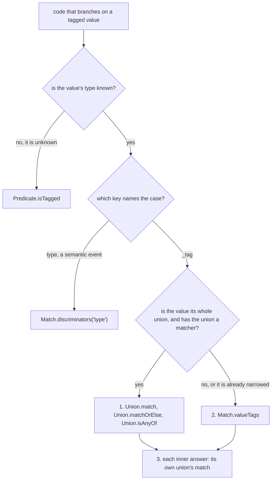

# 0567: In next/ and our tooling, a tagged value is matched, by its union's own matcher first and Effect's Match module second, never by comparing _tag by hand, and that holds inside a tea machine's update too



**Before:**

```ts
// next/packages/libfabrika/src/runtime/BrainLife.ts:45 and :80, on main
const terminal = (s: BrainState) => s._tag === "braked" || s._tag === "stopped";

    stop: (s) => [terminal(s) ? s : BrainState.cases.stopping.make({}), []],
```

**After (not on main; the research type-checked it against effect 4.1.2 and tea 0.25.0):**

```ts
const terminal = BrainState.isAnyOf(["braked", "stopped"]);

    stop: (s) => [terminal(s) ? s : BrainState.cases.stopping.make({}), []],
```

The handler does not change. The check it calls is now the union's own, and no `_tag` is compared
by hand.

The examples in this file return the `[model, cmds]` tuple. A cell answers a `Step`
([0578](0578-tea-cell-answers-a-step.md)), so the examples change with the sweep.

**What this decides:** how code in `next/` and our tooling branches on a tagged value, which two
lint rules hold it, and that the form is the same inside a tea machine's `update`.

## Context

- The anti-slop lint plugin has two rules about branching on a tag.
  [0563](0563-anti-slop-plugin-as-it-ships.md), which takes the plugin as it ships, lists both as
  waiting on the owner. This file moves them to taken, and 0563's rules for a taken rule apply to
  them.
- **What the two rules fire on,** read in the plugin's source at commit `5360c12` of
  <https://github.com/K-Mistele/anti-slop>, under `src/effect/`:
  - `anti-slop-effect/no-manual-tag-comparison` fires on `x._tag` compared with a string, by
    `===`, `!==`, `==` or `!=`, and on `switch (x._tag)`. It skips a comparison written straight
    inside a handler passed to `Effect.catch`, `Effect.catchAll` or `Effect.catchIf`. It reads
    only `_tag`, never `type` (`rules/no-manual-tag-comparison.ts`, `shared/tagged-values.ts`).
  - `anti-slop-effect/prefer-effect-match` fires on a ternary chain that compares the same value
    with a literal two or more times. It does not look for a tag: a chain on `m.type`, or on any
    plain string or number, fires too (`rules/prefer-effect-match.ts`).
- **The hits:** 2,433 for the first rule and 247 for the second. Both are the research's syntax
  counts, not runs of the rules. A plain line search made for this file, on `origin/main` at
  `9a53b828d` over `next/`, `.agents/`, `.github/` and `oxlint-plugins/`, finds about 2,290
  compared `_tag`s and 20 switches, so the first number is of the right size. The plugin was not in
  the repo yet: it comes in as its `src/` folder, whole and unchanged at one commit
  ([0563](0563-anti-slop-plugin-as-it-ships.md)). Its first run gives the real numbers.
- **This is stricter than the Effect team's own code, and it is the owner's choice.**
  [0560](0560-an-order-for-effect-code.md) asks a file to say so plainly. What was read on
  2026-11-15, in the installed `node_modules/effect/src` at 4.1.2:
  - `_tag ===` is on 978 lines in 175 files, and `switch (x._tag)` on about 200 lines more.
  - The `Match` module is called in 6 files, all under `ai/internal/mcpProtocol`.
  - No sentence of theirs says "use `Match`, not `===`". `node_modules/effect/AGENTS.md` does not
    mention `Match` or a `_tag` check at all. The rule comes from the plugin's authors alone.
  - The owner was shown this and took both rules anyway (2026-11-15).
- **What the Effect team does teach** is the form, once code matches at all, and this file
  follows it:
  - A union built with `Schema.TaggedUnion` carries its own `match`, `matchOrElse`, `isAnyOf` and
    `guards` (`Schema.ts:6543-6548`). Its doc example is titled "Pattern matching a discriminated
    union" and calls `Shape.match(value, {...})` (`Schema.ts:6555-6571`).
  - Their source calls a union's own matcher where one exists: `Action.$match(action, {...})` in
    `cli/Prompt.ts`.
  - `Match.valueTags` takes one handler per `_tag` of the value it is given (`Match.ts:474`), and
    `Match.discriminators(field)` does the same for a field other than `_tag` (`Match.ts:1121`).
  - `Predicate.isTagged` takes `unknown` (`Predicate.ts:1452`). Their source calls it about 40
    times, on values of unknown type, such as
    `(u: unknown): u is RpcClientError => Predicate.isTagged(u, "RpcClientError")`
    (`rpc/RpcClient.ts:66`).
- **[0046](0046-one-tea-machine-per-file.md) said the opposite for one place.** Its rule of
  2026-11-10 said an `update` handler picks the next state with a plain conditional on `_tag`, not
  `Match` and not the Model's own `.match`. Its tryout wrote every handler as a
  `Match.type<Model>().pipe(Match.tag(...), Match.exhaustive)` chain, and refused it for two
  reasons: each handler listed every state that stays, and a missing state gave about ten lines of
  type noise. It named the union's own `.match` but did not try it.
- **The research of 2026-11-15 tried it,** on three handlers of `next/`, type-checked against
  effect 4.1.2 and tea 0.25.0. Its results are kept outside git
  ([0027](0027-experiment-results-live-in-a-private-archive.md)).
  - `isAnyOf` and `matchOrElse` do not list the states that stay.
  - A state missing from `Union.match` is one line, which names it:
    `Property 'stopping' is missing in type ...`.
  - A misspelled tag is refused by `match`, `matchOrElse` and `Match.tag`.
  - The rewritten merge machine passed its own 12 laws.
- **This file amends 0046 in part:** it replaces the rule of 2026-11-10 that an `update` handler
  picks the next state with a plain conditional on `_tag`.
- [0558](0558-no-ternary-deeper-than-two.md) left "Effect's `Match` in place of a ternary" open,
  and its sketch of a fix still compares `_tag` by hand. The checks in its sketch are written as a
  match from now on, and it gets a one-line pointer.
- [0214](0214-unions-are-tagged-with-tag.md) tags every union with `_tag`, and since
  [0569](0569-tea-msgs-are-keyed-on-tag.md) a tea Msg is one of them.
  [0562](0562-nothing-teaches-the-wrong-shape.md) is why tests and tooling are inside the scope.

## Decision

**In `next/` and our tooling, code that branches on a tagged value matches it, and never compares
`_tag` by hand. The two Match rules of the anti-slop plugin are taken (owner, 2026-11-15).**

- **The rules:** `anti-slop-effect/no-manual-tag-comparison` and
  `anti-slop-effect/prefer-effect-match`, as they ship. Each goes on as an error where its hits are
  at zero, folder by folder, with no list of leftovers and no warn level, as
  [0563](0563-anti-slop-plugin-as-it-ships.md) says for every taken rule
  ([0524](0524-no-list-lets-broken-code-pass.md), [0168](0168-old-lint-breaks-are-fixed.md)).
- **Scope:** `next/`, and our tooling: the lead and step scripts under `.agents/`,
  `oxlint-plugins/` and `.github/ci/`, test files included. Today's app (`packages/`,
  `programs/`, `apps/`) is not covered.
- **It holds inside a tea machine's `update` too.** A handler picks the next state with the forms
  below.

**The form we write, in this order:**

1. **The union's own matcher first.** Every `Schema.TaggedUnion` has them in the installed
   version.
   - `Union.match(value, {...})`, one key per case, when each case does its own work.
   - `Union.matchOrElse(value, {...}, orElse)`, some cases and then the rest.
   - `Union.isAnyOf([...])`, a yes or no for a subset of cases.
2. **The `Match` module second,** where a union has no matcher of its own, or the value is already
   narrowed to some of its cases: `Match.valueTags(value, {...})`. For a value keyed by a field
   other than `_tag`, such as a semantic event's `type`: `Match.discriminators("type")({...})`,
   closed with `Match.exhaustive` or `Match.orElse`. A tea Msg is keyed on `_tag`
   ([0569](0569-tea-msgs-are-keyed-on-tag.md)), so point 1 reads it.
3. **Each inner answer is matched by its own union,** inside the case that holds it, such as
   `CodeHost.Updated.match(m.value, {...})` inside the `updating` state's case.
4. **Never `Predicate.isTagged` on a value whose type is known.** It is for `unknown`. The first
   rule's own message offers it "for a simple reusable predicate"; we do not take that offer.

**Two readings by the writer of this file, not the owner's words.** The ruling gave the four
points above and did not spell these two out. Each follows from point 1, and each is open to a
later ruling:

- **A check for one case is a subset of one:** `Union.isAnyOf(["idle"])`. The ruling names
  `isAnyOf` for a subset check and gives no other form for a single case.
- **Point 1 covers Effect's own `Exit`, `Option` and `Result`,** through their own `match` and
  guards: `Exit.match` and `Exit.isSuccess` (`Exit.ts:776`, `:406`), `Option.match` and
  `Option.isSome` (`Option.ts:418`, `:385`), `Result.match` and `Result.isSuccess`
  (`Result.ts:1218`, `:744`). The ruling puts the `_tag` checks on these three in the state side
  of the cleanup, and does not say which form replaces them.

```ts
// next/programs/pipeline/src/Merger.ts:262, on main: the state and the answer, compared by hand.
    if (s._tag === "updating" && m.type === "update_ok") {
      const v = m.value;

      if (v._tag === "current" || v._tag === "updated") {
        if (v._tag === "current" && s.checked !== null) {
          // ask to merge
        }
        // ...
      }

      if (v._tag === "conflict") {
        return finish(s, Reply.cases.conflict.make({ ...identity(s), main: v.main, paths: v.paths }));
      }
```

```ts
// The same lines after, cut short (not on main; type-checked in the research, 12 of 12 laws pass).
    return Match.valueTags(s, {                        // form 2: `s` is narrowed, `idle` is gone
      reading: (s) => /* ... */,
      updating: (s) => {
        if (m.type !== "update_ok") {
          return stay(s);
        }

        return CodeHost.Updated.match(m.value, {       // form 3: the answer's own union
          current: (v) => (s.checked === null ? check(v, false) : /* ask to merge */),
          updated: (v) => (s.round === settings.rounds ? /* behind */ : check(v, true)),
          conflict: (v) => finish(s, Reply.cases.conflict.make({ ...identity(s), main: v.main, paths: v.paths })),
          moved: (v) => finish(s, Reply.cases.moved.make({ ...identity(s), head: v.head })),
          closed: (v) => finish(s, Reply.cases.closed.make({ ...identity(s), state: v.state })),
        });
      },
      checking: (s) => /* Change.Verdict.match(...) */,
      merging: (s) => /* CodeHost.Merged.match(...) */,
    });
```

What moves: the outer `if` chain becomes one record by state, and each `v._tag` check becomes a
key of `CodeHost.Updated`'s own `match`. The outer call is `Match.valueTags` because `s` is
already narrowed there: `Model.match` wants a key for every case of the Model, `idle` too.

**The order of the cleanup:**

- **The state side first:** the `_tag` checks on our states and answers, and on Effect's own
  `Exit`, `Option` and `Result`.
- **The Msg side last:** the checks on a tea Msg, which is a `_tag` union since 0569, so point 1
  reads it.
- **The cleanup leans on `isAnyOf` only from effect 4.1.3 on.** On 4.1.2, `isAnyOf(["typo"])`
  compiled: its type took any key (`Schema.ts:6543`, `<const Keys>` with no bound).
  <https://github.com/Effect-TS/effect/pull/10355> bounds the keys by the union's tags, and the
  release notes of `effect@4.1.3` list it. `pnpm-workspace.yaml`'s catalog entry for `effect` is
  at that release. `match`, `matchOrElse` and `Match.tag` refused a misspelled tag on 4.1.2
  already.

**Binding constraints**

- Neither rule is turned on by this file. A rule goes on for a folder in the pull request that
  brings that folder to zero.
- A fix does not hide the comparison from the rule, such as reading `_tag` into a variable first
  or comparing through a helper of our own.
- A fix does not swap a typed check for `Predicate.isTagged`. That passes the rule and breaks
  point 4.
- The rules are not edited, copied or wrapped. An exception is one inline ignore on the line with
  its reason, `// oxlint-disable-next-line <rule> -- <why>` (0563).

## Consequences

- **0046's rule of 2026-11-10 is replaced.** An `update` handler no longer picks the next state
  with a plain conditional on `_tag`; it matches, as this file says. The line in
  [`next/AGENTS.md`](../next/AGENTS.md) that repeated it was changed in the same pull request.
- **The compiler now checks more.** With `Union.match`, a new state does not compile until every
  matcher has a key for it. 0046 had left that to the machine's property tests. `isAnyOf` and
  `matchOrElse` stay silent on a new state, as the plain check did.
- **Lint holds less than this file says.** The two rules catch a hand comparison. They do not
  check the order of points 1 to 3, and `Predicate.isTagged` on a typed value passes them. Those
  are for the plan and the review.
- **A value keyed on `type` is only partly held.** The first rule does not read `type`, so a plain
  `if (e.type === "land")` on a semantic event passes both rules. Only a ternary chain on `e.type`
  fires, by the second rule.
- **The second rule reaches past tags.** It fires on any chained ternary over one value and a
  literal. The form for a value that is no tag is not decided here.
- **The cost.** About 2,700 hits to rewrite, most of them in tests, across every machine in
  `next/`. A handler written as a full `match` lists every state, the ones that stay included.
- **The pattern doc** [a tagged value is matched by its union](../.patterns/effect-tagged-value-is-matched.md)
  shows the forms with code from `next/`.
- **Not decided here:**
  - The form for a chained ternary over a plain literal that is no tag.
  - Which folder goes first, and how the cleanup is cut into pull requests.
  - Today's app.

## Records

- [0046](0046-one-tea-machine-per-file.md): its rule of 2026-11-10 on how an `update` handler picks
  the next state is replaced by this file.
- [`next/AGENTS.md`](../next/AGENTS.md): the line on how an `update` handler picks the next state.
- [`.patterns/effect-tagged-value-is-matched.md`](../.patterns/effect-tagged-value-is-matched.md):
  new.
- [0563](0563-anti-slop-plugin-as-it-ships.md): a one-line pointer under its list, where the two
  rules stood as waiting.
- [0558](0558-no-ternary-deeper-than-two.md) and [0561](0561-a-cast-says-its-reason.md): a
  one-line pointer each, where they name the two rules as not taken or not decided.
- `.glossary/TERMS.md`: no word is coined.
