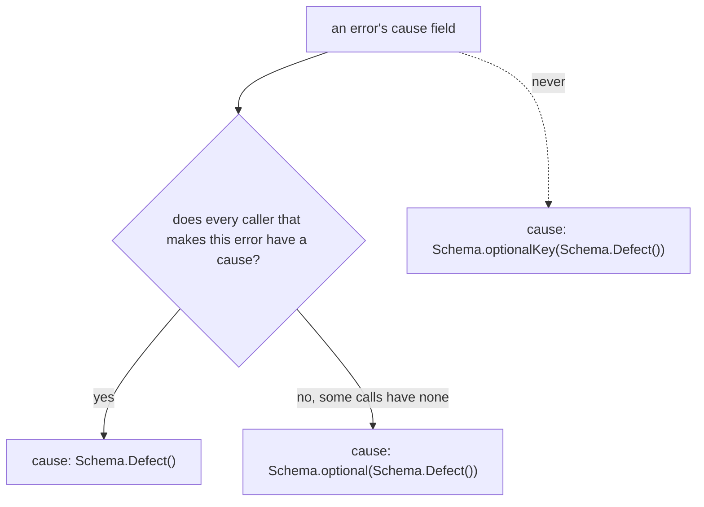

# 0568: In next/ and our tooling, an error's cause follows the Effect library's own form, required when every caller has one and Schema.optional when it may be missing, never Schema.optionalKey



```ts
// Required. effect 4.1.2, node_modules/effect/src/sql/SqlError.ts:20-24
const ReasonFields = {
  cause: Schema.Defect(),
  message: Schema.optional(Schema.String),
  operation: Schema.optional(Schema.String)
}

// May be missing. effect 4.1.2, node_modules/effect/src/workers/WorkerError.ts:41-47
export class WorkerSpawnError extends Schema.Error<WorkerSpawnError>(
  "effect/workers/WorkerError/WorkerSpawnError"
)({
  _tag: Schema.tag("WorkerSpawnError"),
  message: Schema.String,
  cause: Schema.optional(Schema.Defect())
}) {}
```

**What this decides:** which of the three ways to write an error's `cause` we use, and how to pick
between the two that stay.

## Context

- [0566](0566-effect-skill-pieces-taken.md) took eleven pieces of the trusted Effect skill and left
  six places where that skill differs from us under "Not decided here". One of them was
  "`optionalKey` on an error's `cause`". This file settles that one. The skill says
  `Schema.optionalKey` for any key that may be absent, and its own error example has a required
  cause.
- [0560](0560-an-order-for-effect-code.md) says the Effect team comes first. For an error's cause,
  the library itself is the clearest answer.
- **What the installed `effect` 4.1.2 does,** counted in `node_modules/effect/src` on 2026-11-15:

  | How `cause` is written | Lines |
  |---|---|
  | `cause: Schema.optional(Schema.Defect())` | 16 |
  | `cause: Schema.Defect()` | 12 |
  | `cause: Schema.optionalKey(Schema.Defect())` | 0 |

  For example `workers/WorkerError.ts:46`, `socket/Socket.ts:451` and
  `persistence/CircuitBreaker.ts:953` for the optional form, and `sql/SqlError.ts:21`,
  `socket/Socket.ts:383` and `cluster/ClusterError.ts:70` for the required one. No file in the
  library writes `optionalKey` around a `Schema.Defect()` at all.
- **What `next/` writes today,** on main at `a16c31d54`, over the 284 product files that 0566
  counts (`next/**/*.ts` and `*.tsx`, with `*.test.ts`, `*.test.tsx`, `*Test.ts` and
  `*.test-support.ts` left out):

  | How `cause` is written | Lines |
  |---|---|
  | `cause: Schema.Defect()` | 58 |
  | `cause: Schema.optional(Schema.Defect())` | 14 |
  | `cause: Schema.optionalKey(Schema.Defect())` | 12 |

  The 14 count `next/packages/libfabrika/src/Id.ts:15`, which writes the same thing with the import
  named `S`. Without it the count is 13, as 0566 has it. With test files in, the three counts are
  77, 14 and 13.
- **Our tooling** (`.agents/`, `oxlint-plugins/`, `.github/ci/`) writes 2 required and 3 optional
  causes, and no `optionalKey` one.
- `exactOptionalPropertyTypes` is on (`tsconfig.base.json:8`), so the two optional forms are not the
  same type. `Schema.optional` is `Schema.optionalKey` with `undefined` added
  (`node_modules/effect/src/Schema.ts:2434`), so `new X({ reason, cause })` compiles when `cause`
  may be `undefined`. With `optionalKey` the same call fails the type check.
- [0119](0119-an-errors-reason-is-a-tagged-error.md) gives each reason of a service error
  `cause: Schema.Defect()`. This file keeps that for a reason that always wraps a failure from
  below, and lets a reason that may have none use `Schema.optional`. That changes part of 0119.

## Decision

**In `next/` and our tooling, an error's cause follows the Effect library's own form (owner,
2026-11-15).**

- A cause that every caller always has is required: `cause: Schema.Defect()`.
- A cause that may be missing is `cause: Schema.optional(Schema.Defect())`.
- Never `Schema.optionalKey` on a cause.
- Ordinary optional fields do not change. `Schema.optionalKey` stays the default there, as 0566's
  N8 has it.
- **Scope** is 0560's: `next/`, the lead and step scripts under `.agents/`, `oxlint-plugins/` and
  `.github/ci/`. Today's app is not covered.

```ts
// before: next/packages/libfabrika/src/client/Journal.ts:56-59 on main, one of the 12
export class JournalError extends Schema.TaggedError<JournalError>()("JournalError", {
  reason: Schema.Literals(["storage", "bad_entry"]),
  cause: Schema.optionalKey(Schema.Defect()),
}) {}

// after: a sketch. Which of the two it becomes is read from its call sites.
cause: Schema.Defect(),                    // every call has a cause
cause: Schema.optional(Schema.Defect()),   // some call has none
```

**Binding constraints:**

- No new error in scope writes `optionalKey` on its cause.
- A pattern doc in `.patterns/` shows only the two kept forms
  ([0562](0562-nothing-teaches-the-wrong-shape.md)).

## Consequences

- **The 12 `optionalKey` lines in `next/` product files are faults,** and so is the one in test support,
  `next/apps/fabrika/e2e/node/P19Launchd.test-support.ts:46`. They are fixed to zero, for example `next/packages/libfabrika/src/client/Journal.ts:58` and
  `next/apps/fabrika/dev.ts:22`.
- **The cleanup is not mechanical.** It reads each error's call sites to sort "always has a cause"
  from "may be missing". That holds for the 12 `optionalKey` lines and for the 14 `optional` ones,
  since some of those may always have a cause and belong required. A required cause also changes
  every call that makes the error with none.
- **Whether a check holds it is for the cleanup's plan.** "No `optionalKey` on a cause" could be a
  lint rule or a check of the Effect team's checker. That plan answers it through the false-alarm
  rule in [AGENTS.md "Checks"](../AGENTS.md#checks). Nothing is turned on here.
- **`.patterns/effect-errors-keep-their-cause.md` says the same,** with real code from `next/`, in
  this pull request.
- **0119 is amended in part:** its "each reason has `cause: Schema.Defect()`" now reads "required
  when every caller has one". The rest of 0119 holds.
- **Three more of 0566's six were settled our way in the same walk.** The owner kept our own rule
  on where a layer lives ([0095](0095-a-service-file-holds-only-its-contract.md)), on module names
  ([0023](0023-next-follows-effects-code-style.md),
  [0032](0032-libraries-take-effects-file-layout.md)) and on record types
  ([0251](0251-types-are-inferred-except-contracts.md)). Those files do not change.
- **Not decided here.** Inner unions, a `Schema` union against `Data.TaggedEnum` for a union that
  never leaves a module, wait on a cost measurement. `Effect.fn`, which functions get it, is still
  open as 0566 has it.
- **What this cannot tell us.**
  - The counts are searches for one line shape. No cause is written over two lines today, but a
    cause under another field name is not in them.
  - How many of the 26 optional causes in `next/` always have a cause was not read.
  - How many calls change when a cause becomes required was not counted.
