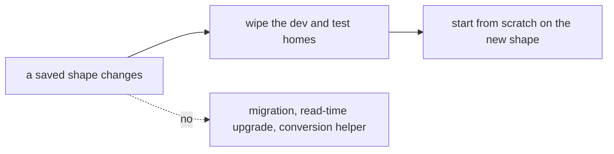

# 0572: Before the first release, a saved-shape change in next/ deletes the stored data and starts from scratch, with no migration of any kind

**What this decides:** until fabrika's first release (v0.0.0), `next/` keeps no data worth saving, so when a saved shape changes, the stored data is deleted and the state starts again.

## Context

Decided by the owner on 2026-11-15, final. Nothing in `next/` is released, so nothing stored has a
reader who needs it. [0227](0227-saved-state-carries-shape-number.md) made a saved model carry a
number `v` and a chain of named upgrades run on read; that work is a cost with no one to pay it for
yet. First use: the `_tag` change of [0569](0569-tea-msgs-are-keyed-on-tag.md)
([plan PR](https://github.com/kamp-us/tea-fabrika/pull/1382)) wipes the dev and test homes when it
lands.

## Decision

**Before the first release, a saved-shape change deletes the stored data and starts from scratch.**

- This holds for state, ledger rows and saved tea messages.
- No migration step, no read-time upgrade, no conversion helper.
- [0227](0227-saved-state-carries-shape-number.md) is set aside until the first release.
- The upgrade code in `runtime/State.ts` is dead weight under this decision. It goes in its own
  pull request through the steps, ticketed separately. This decision changes no code.
- How the wipe is done is a runbook ("a saved shape changed: wipe the dev and test homes"),
  written the first time it is done for real, in the `.runbooks/` folder.

**Binding constraints:**

- No new upgrade, conversion or read-time migration is written in `next/` before the first release.
- A saved-shape change names the wipe in its pull request.

## Consequences

- Shape changes cost one wipe, not a chain of upgrades.
- Not decided: what a saved-shape change does after the first release.
