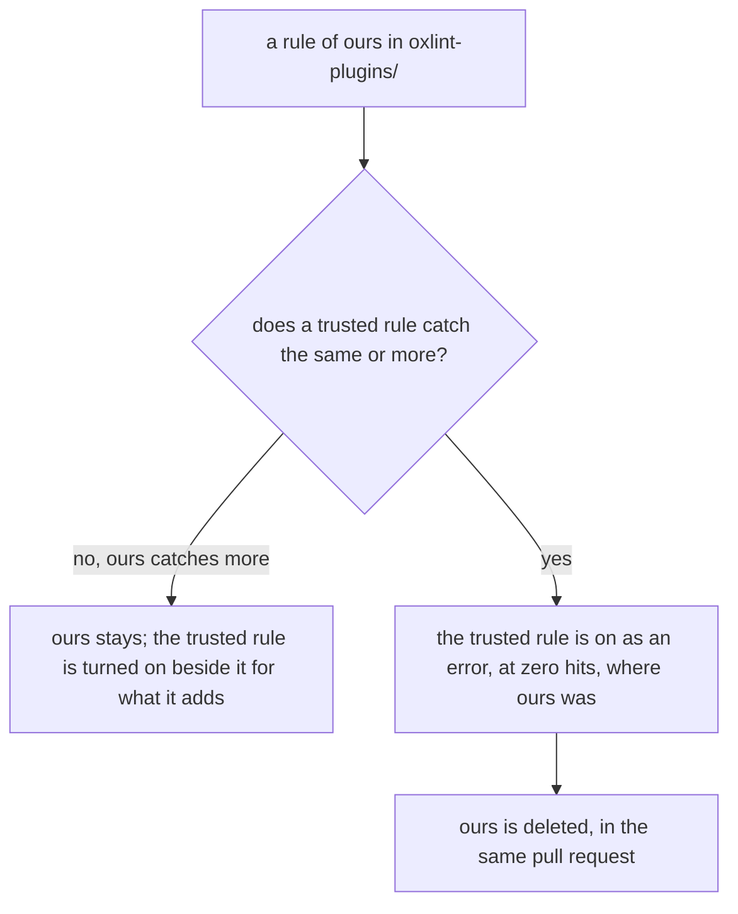

# 0573: In next/ and our tooling, a trusted lint rule replaces ours wherever it catches the same or more, and ours stays wherever it catches more



```jsonc
// a sketch, not run: one pull request holds both halves, so no folder is ever unguarded
{ "files": ["next/**"], "rules": { "anti-slop-effect/no-manual-tagged-construction": "error" } }
// and in the same diff: oxlint-plugins/no-hand-tag.ts and its test are deleted
```

**What this decides:** in `next/` and our tooling, our own lint rules give way to a trusted rule
(oxlint's own, the anti-slop plugin, the Effect checker) wherever that rule catches the same or
more, and stay wherever ours catches more.

## Context

- [0563](0563-anti-slop-plugin-as-it-ships.md) rule E says theirs replaces ours and leaves "which
  of our rules" to an audit. [0565](0565-effects-own-checks-block.md) says our rules that repeat an
  Effect check give way to it, and leaves "which" to each sweep. This file is that audit's ruling.
- The audit read all 48 of our oxlint rules in `oxlint-plugins/` against the three trusted sources,
  on 2026-11-15. It is outside git ([0027](0027-experiment-results-live-in-a-private-archive.md)).
  This file keeps its verdicts.
- [0524](0524-no-list-lets-broken-code-pass.md) and
  [0168](0168-old-lint-breaks-are-fixed.md): a rule turns on where its breaks are at zero, and an
  old break is fixed, never listed.
- [0560](0560-an-order-for-effect-code.md) sets the order: the Effect team first, then the trusted
  repos, then ours.
- It is part of the sev0 cleanup (owner, 2026-11-15).

## Decision

**A trusted lint rule replaces ours wherever it catches the same or more, and ours stays wherever it
catches more (owner, 2026-11-15).** Scope: `next/` and our tooling. Today's app is not covered.

- **Each deletion keeps the code at zero.** The trusted rule is on as an error where ours was, in the
  same pull request, before ours goes
  ([0524](0524-no-list-lets-broken-code-pass.md), [0168](0168-old-lint-breaks-are-fixed.md)). Its
  test and its plants go with it.
- **Where a trusted rule adds something ours does not catch, it is turned on beside ours.**
- **Go now.** Ours is already held by another rule or a check:
  - `no-data-taggederror`, held by the Effect checker's `preferSchemaTaggedError`.
  - `no-context-tag`, held by the type check and the checker's `outdatedApi`, which is named as
    `error` in `tsconfig.base.json` in the same pull request so a later default cannot switch it off.
  - `no-node-filesystem`, held by our `no-node-imports`.
  - `one-id-module`, held by our `modules`.
- **Go, through the steps first.** Each needs a cleanup before theirs is on at zero:
  - `no-hand-tag`, to `anti-slop-effect/no-manual-tagged-construction` and
    `anti-slop-effect/no-manual-tagged-type`, inside the cleanup of
    [0562](0562-nothing-teaches-the-wrong-shape.md). That file leaves open which rule holds the ban;
    this one says theirs.
  - `no-redacted-value`, to oxlint's `no-restricted-properties` on `Redacted.value`.
  - `no-secret-env`, to the checker's `processEnv` and `processEnvInEffect`, folder by folder as each
    reaches zero. Tests and tooling are not left out.
  - `no-expect-in-if`, to oxlint's `vitest/no-conditional-expect`, folder by folder.
- **Also go, where theirs is the same or wider:**
  - `no-implicit-effect-concurrency`, to the checker's `missingConcurrencyOption`, after
    `@effect/tsgo` moves to 0.69.0.
  - `no-wall-clock` and `no-clock-in-view`, to the checker's `globalDate`, `globalDateInEffect`,
    `globalRandom` and UUID checks.
  - `no-node-imports`, to oxlint's `import/no-nodejs-modules`.
  - `no-cause-squash` and `no-effect-run-outside-edge`, to oxlint's `no-restricted-properties` and
    `no-restricted-imports`.
  - `padding-line-between-statements`, to anti-slop's `require-readable-spacing`, only once that rule
    is on and a check on main shows it flags every line ours does.
- **Stay, because theirs is narrower:** `no-raw-try-catch`, `effect-functions`, `no-effect-promise`,
  `no-bare-disable`, `use-import-extensions`, `no-promises`, `no-type-assertions`,
  `no-question-word-key`, `one-store-hook`, `no-bare-tell`, `service-id`.
- **Stay, as the audit marked them:** `door-is-library`, `edge-comment`, `integration-test-name`,
  `law-shape`, `isolate-boundary`, `modules`, `no-ledger-sql`, `no-of`, `no-project-settings`,
  `no-stage-word`, `no-static-layer`, `one-machine-per-file`, `program-package-layout`,
  `outside-input-constructor`, `package-imports`, `runs-from-depth`, `service-contract`,
  `written-service-type`, `jsdocs`, `no-numeric-duration`, `no-throw-in-effect-gen`,
  `prefer-schema-arbitrary`.
- **`service-id` stays for now.** The checker's `deterministicKeys` stays one of
  [0565](0565-effects-own-checks-block.md)'s unruled clashes. It is not decided here.

**Binding constraints**

- A rule of ours is deleted only in the pull request that turns the trusted one on as an error where
  ours was, at zero hits. Never a gap between the two.
- A rule under "stay" is not deleted for being narrower on paper. A later decision names the trusted
  rule that would catch more, or it stays.
- No list of allowed leftovers and no warn level ([0524](0524-no-list-lets-broken-code-pass.md)).

## Consequences

- Each swap is its own later pull request, in the audit's order. Nothing is deleted by this file.
- **The cost is cleanups.** `no-secret-env` and `no-expect-in-if` widen a lot (the audit counted 159
  and 947 new hits). `no-hand-tag`'s are in 0562's cleanup.
- The anti-slop rules are brought in whole at one commit
  ([0563](0563-anti-slop-plugin-as-it-ships.md)), so a swap changes who wrote the file, not whether
  we hold one.
- A swap changes the name in every disable line for the rule it replaces, and in
  [`oxlint-plugins/README.md`](../oxlint-plugins/README.md), `edge-comment` and CI's `edges` step
  where they read the old name.
- Not decided here: the `@effect/tsgo` bump itself, `service-id`, and the five rules in the "stay"
  list whose trusted rule may later catch more.

## Records

- Findings from the audit, written as rows in `field/findings/`: the stale `effectFnOpportunity`
  line in `oxlint-plugins/README.md`, and the two files `outside-input-constructor` names that no
  longer exist.
