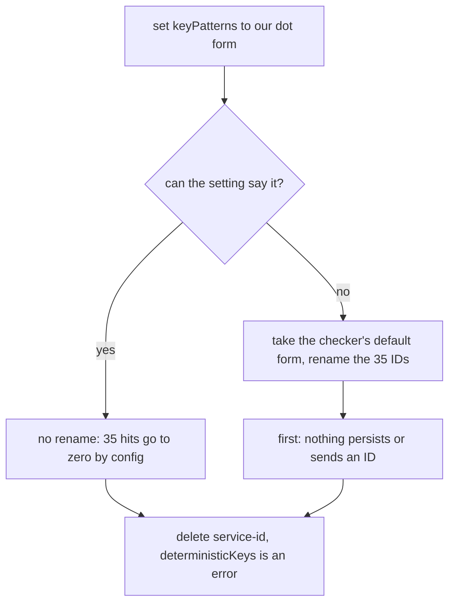

# 0575: In next/ and our tooling, the checker's deterministicKeys is an error and sets the service ID form, and our lint rule service-id is deleted



```ts
// Our form today, from next/packages/libfabrika/src/ledger/Ledger.ts: dot before the class name.
"@kampus/libfabrika/ledger/Ledger.Doorbell";
// The checker's default form for the same class: a slash before the class name.
"@kampus/libfabrika/ledger/Ledger/Doorbell";
```

**What this decides:** clash 4 of [0565](0565-effects-own-checks-block.md), the checker's
`deterministicKeys` against our own lint rule `service-id`, goes to the checker.

## Context

- 0565 lists five clashes and leaves them to the owner. This one is `deterministicKeys` (35 hits)
  against the ID form of [0120](0120-effect-code-guidelines.md), point E7, which our rule
  `oxlint-plugins/service-id.ts` holds: the package, the file path, then `.Name` when the class is
  not named like its file.
- [0573](0573-trusted-lint-rule-replaces-ours.md) kept `service-id` "for now" and left this clash
  open. This decision rules it.
- 0565 said whether `keyPatterns` can express our form "was not checked". It was read on
  2026-11-15, as follows.
- **What the setting is, in the installed `@effect/tsgo` 0.63.0**
  (`node_modules/@effect/tsgo/schema.json`). `keyPatterns` is a list. Each entry has three keys and
  no others (`additionalProperties` is `false`):
  - `target`: `service`, `error`, `custom` or `taggedClass`. The default list has `service` and
    `custom`, so `error` and `taggedClass` are not checked until an entry names them.
  - `pattern`: one of four fixed formulas, `default`, `package-identifier`, `default-hashed` or
    `identifier`. It is an enum, not a template.
  - `skipLeadingPath`: path prefixes stripped from the folder part, default `["src/"]`.
- **What the formulas build.** Read from the checker's source, `internal/keybuilder/keybuilder.go`
  in `Effect-TS/tsgo` on its main branch, since the installed package ships a compiled binary. The
  version of that file matching 0.63.0 was not read. Every formula joins its parts with `/`:
  - `default`: package, folder, file name, then the class name when it differs from the file name.
    That is `@kampus/libfabrika/ledger/Ledger/Doorbell`.
  - `package-identifier`: package, file name, then the class name when it differs.
  - `identifier`: the class name alone.
  - `default-hashed`: `default`, then hashed.
- **So `keyPatterns` cannot express our form.** No formula joins with a dot, and no setting changes
  the separator. This was read, not run. The sweep proves it on the first hit.
- Service IDs are not saved data. The sweep still checks it before any rename (below). Before
  v0.0.0 a rename needs no migration either way
  ([0572](0572-pre-release-shape-change-wipes-data.md)).

## Decision

**`deterministicKeys` is an error in `next/` and our tooling, and our rule `service-id` is deleted,
because the Effect team ships the tool ([0114](0114-effects-team-as-the-builder.md),
[0573](0573-trusted-lint-rule-replaces-ours.md)) (owner, 2026-11-15).**

- **The ID form is whatever `deterministicKeys` holds.** E7 of
  [0120](0120-effect-code-guidelines.md) no longer fixes the dot form.
- **The order of the sweep:**
  1. Try `keyPatterns` with our current dot form. By the reading above it cannot say it. If the
     first run proves otherwise, no ID is renamed.
  2. If it cannot, take the checker's default form, with `skipLeadingPath` set to our source
     folder, and rename the 35 IDs.
- **Before any rename, the sweep checks that nothing persists or sends an ID.** It searches
  `next/` and our tooling for a service ID used as a stored value, a wire value, a log key that
  another program reads, or a test fixture. A hit is reported to the owner and not renamed.
- **`service-id` is deleted in the pull request that turns `deterministicKeys` on as an error where
  `service-id` ran, at zero hits.** Never a gap between the two
  ([0573](0573-trusted-lint-rule-replaces-ours.md)). The same pull request drops its name from
  `oxlint-plugins/README.md` and from any disable line.
- **Roll out as 0565 says:** one folder at a time, each at zero, with the level set in `overrides`
  of `tsconfig.base.json`.

**Binding constraints**

- No second ID form stays beside the checker's. No list of IDs that are allowed to differ
  ([0524](0524-no-list-lets-broken-code-pass.md)).
- A `keyPatterns` entry is a setting, not a rule of ours. It names `target`, `pattern` and
  `skipLeadingPath` only.

## Consequences

- **Cost if a rename is needed:** 35 IDs change, and any test or doc that spells one. With the
  default form the dot before a class name becomes a slash.
- **The rule that goes:** `oxlint-plugins/service-id.ts` and its test, which held 1 true and 0 false
  alarms in its replay. The checker has no equivalent measure yet. The sweep reports its numbers.
- **Not decided here:** the other clashes of 0565 that are still open, `preferBarrelImport` and
  `schemaSync`; the checker bump; the sweep's order against branches in flight.
- **What this cannot tell us:** whether the 0.63.0 binary matches the source read on main; whether
  an ID is read anywhere that a search misses.

## Records

- Amends [0120](0120-effect-code-guidelines.md) (E7), [0573](0573-trusted-lint-rule-replaces-ours.md)
  (`service-id` stays) and [0565](0565-effects-own-checks-block.md) (clash 4 is RULED).
