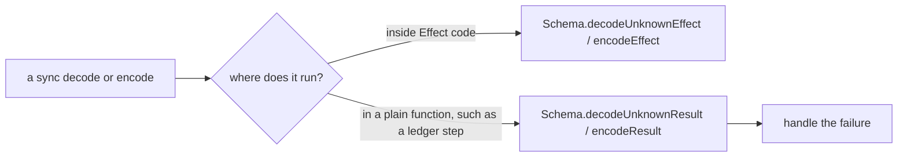

# 0575: In next/ and our tooling, schemaSync is an error, a plain function decodes with the Result form and handles the failure, and Effect code uses the Effect form



```ts
// before: flagged by schemaSync, and a bad value throws
const encodePointer = Schema.encodeSync(Pointer);

// after, in a plain function (a sketch, not compiled): the failure is a value
const encoded = Schema.encodeResult(Pointer)(pointer); // Result<Encoded, SchemaError>

// after, inside Effect code
const encoded = yield* Schema.encodeEffect(Pointer)(pointer);
```

**What this decides:** clash 3 of the five in [0565](0565-effects-own-checks-block.md). The Effect
checker's `schemaSync` is on as an error in `next/` and our tooling, and the plain-function ledger
step of [0050](0050-a-ledger-step-is-a-plain-function.md) stands.

## Context

- 0565 listed `schemaSync` (632 hits) against 0050 as a clash the owner had to rule. The check
  flags every synchronous decode or encode and asks for the Effect form. A ledger step may not be
  an Effect, so the Effect form cannot run there.
- The way out was checked on 2026-11-15 on `@effect/tsgo` 0.63.0 (installed) and 0.69.0. The check
  flags only `decodeSync`, `decodeUnknownSync`, `encodeSync` and `encodeUnknownSync`. These are
  the keys of `syncToEffectMethodV4` in `internal/rules/schema_sync_in_effect.go` of
  `Effect-TS/tsgo`, which `schema_sync.go` uses. It never flags a Result form. A scratch run with
  `schemaSync` at `error` flagged the four sync calls and none of `decodeUnknownResult`,
  `encodeResult` or `decodeResult`.
- The count on main at `61d551ff3` is 620 hits: `decodeUnknownSync` 504, `encodeSync` 98,
  `decodeSync` 11, `encodeUnknownSync` 7. 0565 said 632, from its count at `98bcdfa22`. About 397
  are in `next/packages/libfabrika` and 134 in `next/apps/fabrika`.
- [0215](0215-untrusted-input-never-throws.md) already says plain code that needs a failure's
  details uses `decodeResult` and `decodeUnknownResult`.

## Decision

**`schemaSync` is on as an error in `next/` and our tooling. A plain function decodes and encodes
with the non-throwing Result form and handles the failure. Inside Effect code the call is the
Effect form. The ledger step stays a plain function (owner, 2026-11-15).**

- **Plain function** (a ledger step, a pure domain function, a script helper): `Schema.decodeUnknownResult`,
  `Schema.decodeResult`, `Schema.encodeResult` and `Schema.encodeUnknownResult`, then handle the
  `Result`.
- **Effect code:** `Schema.decodeUnknownEffect`, `Schema.decodeEffect`, `Schema.encodeEffect` and
  `Schema.encodeUnknownEffect`.
- **0050 stands unchanged.** A step still returns a value, with no Effect inside it.
- It is turned on one folder at a time, to zero hits, as 0565 says. An ignore line is for code that
  is right and not a way to postpone the fix.

**Binding constraints**

- **A hit is not a mechanical rewrite.** Each must handle the failure the sync call ignored. The
  sweep may not swap `decodeUnknownSync` for a Result and then unwrap it with a throw, or fold the
  failure into a bare default, to make the check quiet.
- **A decode of outside input** (the wire, disk, saved state, a tool's output, an environment
  value) gets a real failure path: a typed error in Effect code, a handled `Result` in a plain
  function.
- **An encode of a value the code just built** may map its failure to a defect, since a failure
  there is a bug and not a case. The defect says what was encoded.
- Each sweep pull request reports, per folder, how many hits were decodes of outside input and how
  many were encodes of a built value, and what failure path each decode got.

## Consequences

- This file changes no config and no code. Until a sweep lands for a folder, nothing stops a new
  sync call there.
- About 620 hits, most of them decodes. Some of them show a failure that is silently a throw today.
- [0215](0215-untrusted-input-never-throws.md): its rule that `decodeSync` takes trusted input is
  now enforced by the checker, which refuses it. [0554](0554-no-reflect-get-set-has.md) lists
  `decodeUnknownSync` as one replacement. Both carry a dated line.
- `.patterns/effect-pure-domain-returns-result.md` and `.patterns/settings.md` show sync calls.
  They describe the code as it is, and change when their code does.
- **Not decided here:** the clashes of 0565 still open (`preferBarrelImport`, `deterministicKeys`), and the order of
  the sweep against work in flight.
- **What this cannot tell us:** how many of the 620 hits decode outside input; the sweep reports it.
