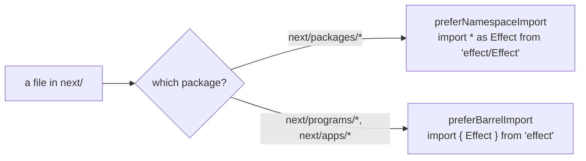

# 0577: In next/, libraries import Effect by namespace and programs and apps by the barrel, as Effect's own repo does, each held as an error by the Effect checker in the package's own tsconfig



```jsonc
// next/packages/libfabrika/tsconfig.json, a library (a sketch of the end state)
"compilerOptions": {
  "plugins": [{
    "name": "@effect/language-service",
    "namespaceImportPackages": ["effect"],
    "diagnosticSeverity": { "preferNamespaceImport": "error" }
  }]
}

// next/programs/counter/tsconfig.json, a program; next/apps/fabrika takes the same block
"compilerOptions": {
  "plugins": [{
    "name": "@effect/language-service",
    "barrelImportPackages": ["effect"],
    "diagnosticSeverity": { "preferBarrelImport": "error" }
  }]
}
```

**What this decides:** which import form for `effect` each part of `next/` uses, which check of the
Effect checker holds it, and where that check is set.

## Context

- [0565](0565-effects-own-checks-block.md) puts every check of the Effect checker (`@effect/tsgo`,
  pinned at 0.63.0) on as an error in `next/`. Its clash 5 was `preferBarrelImport` against
  [0120](0120-effect-code-guidelines.md)'s E7, which asks for namespace imports in libraries. One
  package name cannot be held by both checks in the same file: the checker gives a package named in
  both lists the namespace form (`PackageStyle` in `internal/importstyle/importstyle.go` of
  `Effect-TS/tsgo`).
- [0023](0023-next-follows-effects-code-style.md) already says the same split in words: follow
  Effect's namespace imports in libraries, and apps keep the barrel. This file adds the checks that
  hold it.
- The owner ruled on 2026-11-15: copy Effect's own split.

**Proof that each package's tsconfig can hold its own form.** A scratch project outside the repo,
run on 2026-11-15 with the installed checker, `effect-tsgo diagnostics --project <tsconfig>` and
the patched `tsc --noEmit -p .` that `pnpm typecheck` runs. Each package tsconfig extends one base
and sets its own plugin block, as above. The same file sits in each:

```ts
import { Effect } from "effect"; // line 1
import * as Option from "effect/Option"; // line 2
```

- The library's tsconfig flags line 1 only: `error effect(preferNamespaceImport): 'Effect' is
  imported by name from 'effect', but namespaceImportPackages expects a namespace import.`
- The program's tsconfig flags line 2 only: `error effect(preferBarrelImport): 'effect/Option' is
  imported directly, but barrelImportPackages expects named imports from the barrel 'effect'.`
- **The plugin block merges through `extends`, key by key.** Plain TypeScript would replace the
  whole `plugins` array, but the checker registers its own merge
  (`internal/effectconfigraw/hooks.go`): each key the child sets replaces the base's, the
  `diagnosticSeverity` maps merge, and `overrides` lists are joined. So a package tsconfig that sets
  only the two import keys keeps every level `tsconfig.base.json` sets. Proven: a base that named
  `effect` for namespace imports still flagged line 1 in a child that set only the barrel keys.
- **A trap that follows from it.** If the base ever names `effect` in `namespaceImportPackages`, a
  barrel package inherits it, and namespace wins: the run above flagged line 1, not line 2. Such a
  package must also set `"namespaceImportPackages": []`. That was run too, and it then flagged only
  line 2. Today the base names `effect` only inside two `overrides` entries scoped to libfabrika
  folders, so no program or app inherits it.
- An `overrides` entry inside a package tsconfig works the same way, with its `include` globs read
  from that tsconfig's folder: `src/a/**/*.ts` flagged `src/a` and not `src/b`. That is how a
  package turns the check on folder by folder before it is at zero.
- **Effect's sub-barrels.** Effect 4.1.3 ships lowercase entry points such as `effect/testing`,
  `effect/crypto` and `effect/process`. `preferBarrelImport` does not flag them, so a program keeps
  `import { TestClock } from "effect/testing"`. `preferNamespaceImport` flags that line in a
  library and suggests `effect/testing/TestClock`. That path resolves: effect 4.1.3's `exports`
  has `"./*": "./dist/*.js"`, which covers it, and `dist/testing/TestClock.js` ships. So the
  library form is the checker's own suggestion, `import * as TestClock from "effect/testing/TestClock"`.
  *Wrong, corrected 2026-11-15:* this file first said the path was not exported and took
  `import * as Testing from "effect/testing"` instead; a scratch build with tsc and a Node import
  of the suggested path both passed.

**The count,** on main at `61d551ff3`, every `import` or `export ... from` of `effect` in `.ts` and
`.tsx` files, multi-line ones too. The rough count the ruling came with was about 614 barrel and
117 namespace.

| Package | Barrel `effect` | Namespace by module | Named by module | Sub-barrel, named | Sub-barrel, namespace | Flagged under its check |
|---|---|---|---|---|---|---|
| `next/packages/libfabrika` | 510 | 96 | 11 | 135 | 13 | 656 |
| `next/packages/tuval` | 9 | 0 | 0 | 1 | 0 | 10 |
| `next/packages/vitest` | 0 | 1 | 0 | 0 | 0 | 0 |
| `next/programs/*` (six) | 40 | 0 | 0 | 3 | 0 | 0 |
| `next/apps/fabrika` | 142 | 0 | 0 | 74 | 9 | 0 |

In all, 701 barrel imports and 119 namespace imports. Libraries have 666 lines to change. Programs
and the app have 0 under `preferBarrelImport`, since they import no `effect/<Module>` path today.

## Decision

**Libraries in `next/packages/` import `effect` by namespace, and programs and apps in
`next/programs/` and `next/apps/` import it from the barrel, as the Effect team splits it. Each
form is held as an error by the Effect checker, set in the package's own `tsconfig.json`.**

- **Libraries:** `next/packages/libfabrika`, `next/packages/tuval` and `next/packages/vitest` set
  `"namespaceImportPackages": ["effect"]` and `"preferNamespaceImport": "error"`. A module is
  imported as `import * as Effect from "effect/Effect"`; a module under a sub-barrel as the checker
  suggests, `import * as TestClock from "effect/testing/TestClock"`.
- **Programs and apps:** each package under `next/programs/` and `next/apps/` sets
  `"barrelImportPackages": ["effect"]` and `"preferBarrelImport": "error"`. A module is imported as
  `import { Effect } from "effect"`; a sub-barrel by name, as today.
- **Where it is set.** The package's own tsconfig plugin block, which merges into the base's. A new
  package under `next/packages/`, `next/programs/` or `next/apps/` adds its block when it is made.
  The base sets no import list for these folders once the sweep is done.
- **Rollout, as 0565 says.** Programs and the app are at zero, so their blocks go on in one pull
  request. A library turns its check on folder by folder, each folder at zero, with an `overrides`
  entry in the library's own tsconfig. When its last folder is at zero, the package-wide setting
  replaces the entries. The two libfabrika folders that `tsconfig.base.json` holds today move into
  libfabrika's tsconfig in the first library pull request.

**Binding constraints**

- No package is in both lists, and no barrel package inherits `effect` in
  `namespaceImportPackages`.
- Neither check goes to `warning` or is turned off to let a pull request pass
  ([0524](0524-no-list-lets-broken-code-pass.md)).
- The checker's suggested fix is taken as it is.

## Consequences

- This file changes no config. Until each block lands, nothing stops a new hit.
- It closes clash 5 of [0565](0565-effects-own-checks-block.md) and amends E7 of
  [0120](0120-effect-code-guidelines.md), which said only "namespace imports in libraries".
- The cost: 666 import lines in libraries, most in libfabrika. Each is a one-line change, but a
  name used bare after `import { gen } from "effect/Effect"` becomes `Effect.gen`, so call sites in
  those 11 files change too.
- **Not decided here:** the import form in our tooling (`.agents/`, `oxlint-plugins/`,
  `.github/ci/`), which 0565 covers but the ruling did not name; and today's app.
- **What this cannot tell us:** the proof ran in a scratch project, not the repo's own packages, and
  on the installed 0.63.0. The merge code was read on the checker's main branch, not at the 0.63.0
  tag, though the runs agree with it. The count is from one commit. The sub-barrel suggestion was
  thought to be a checker bug and was not: see the correction above.

## Amendments
- 2026-11-15: the sub-barrel library form is the checker's own suggestion (`effect/testing/TestClock`), which resolves through effect's `"./*"` export; the first text called that path unexported, which was wrong.
