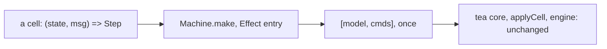

# 0578: In next/ and our tooling, a tea cell answers a pipeable Step (Step.stay, Step.to, Step.run), never the [model, cmds] tuple, through our local tea patch, with the sweep of the return sites after it lands



**What this decides:** what a tea cell hands back. A cell answers a `Step`, a small pipeable
value, and the Effect entry's `Machine.make` turns each `Step` into tea's tuple once.

## Context

- Owner ruling, 2026-11-15, locked. The ask is demlik issue 962:
  <https://github.com/kamp-us/demlik/issues/962>.
- The tuple reads badly at a glance. `[s, []]` and `[{ ...s }, [a, b]]` look alike, and the model
  and its Cmds are told apart only by brackets. A `Step` names each answer.
- The issue checked its sketches against tea 0.25.0 and effect 4.1.3, with a fake of the Effect
  entry's `make`: a missing Msg handler is still a compile error, a Cmd not in the machine's `cmds`
  is refused at `Step.run`, a wrong model shape is refused at `Step.to`, and the same steps gave
  the same models and Cmds on 12 of 12 traces against the tuple form.
- [0569](0569-tea-msgs-are-keyed-on-tag.md) is the local patch of tea on 0.27.0 that keys a Msg,
  a Cmd and the state table on `_tag` ahead of demlik issue 949. This record adds one more change
  to that same patch. Our patch rules ([patch upstream locally](../docs/direction/patch-upstream-locally.md),
  [0054](0054-read-upstream-before-patching-it.md)) hold as written, and the bump that takes the
  release deletes the patch.
- [0567](0567-a-tagged-value-is-matched.md) says a tagged value is matched by its union's own
  matcher, inside `update` too. [0046](0046-one-tea-machine-per-file.md) shapes the machine's file,
  and its rules hold: this changes what a handler returns, not where it lives.
- [0572](0572-pre-release-shape-change-wipes-data.md): a cell's answer is never saved, so this
  change touches no stored shape and needs no wipe.

## Decision

**In `next/` and our tooling, a tea cell answers a `Step`, never the `[model, cmds]` tuple (owner,
2026-11-15).**

Before, a cell from issue 962's upload machine. The state is read by hand and every answer is a
tuple:

```ts
const giveUp = (file: string): Cell => [
  { _tag: "failed", file },
  [notify({ text: `Could not upload ${file}` })],
];

upload_ok: (s, m) =>
  s._tag !== "uploading"
    ? [s, []]
    : [
        { _tag: "done", url: m.value.url },
        [notify({ text: "Uploaded" }), log({ line: `uploaded ${s.file}` })],
      ],

timer: (s, m) => {
  if (s._tag !== "waiting" || m.at < s.retryAt) {
    return [s, []];
  }
  return [{ _tag: "uploading", file: s.file, tries: s.tries + 1 }, [upload({ file: s.file })]];
},
```

After, a sketch (not on main). The state is matched with the Model union's own matcher
([0567](0567-a-tagged-value-is-matched.md)), and each answer says what it is:

```ts
const giveUp = (file: string) =>
  Step.to(Model.failed({ file })).pipe(Step.run(notify({ text: `Could not upload ${file}` })));

upload_ok: (s, m) =>
  Model.match(s, {
    uploading: (s) =>
      Step.to(Model.done({ url: m.value.url })).pipe(
        Step.run(notify({ text: "Uploaded" })),
        Step.run(log({ line: `uploaded ${s.file}` })),
      ),
    orElse: () => Step.stay,
  }),

timer: (s, m) =>
  Model.match(s, {
    waiting: (s) =>
      m.at < s.retryAt
        ? Step.stay
        : Step.to(Model.uploading({ file: s.file, tries: s.tries + 1 })).pipe(
            Step.run(upload({ file: s.file })),
          ),
    orElse: () => Step.stay,
  }),
```

The types of `Step`, a sketch from issue 962 (the names inside are not final):

```ts
// What a cell answers. `stay` holds no model, so it cannot say "stay" and hand back a changed one:
// tea fills in the model it gave the cell.
type Step<Model, Cmd> = Stay | To<Model, Cmd>;

declare const Step: {
  readonly stay: Stay;                                              // nothing changes
  readonly to: <Model>(model: Model) => To<Model, never>;          // move to this model
  readonly run: {                                                   // dual: data-first or piped
    <Cmd>(cmd: Cmd): <Model, C>(self: To<Model, C>) => To<Model, C | Cmd>;
    <Model, C, Cmd>(self: To<Model, C>, cmd: Cmd): To<Model, C | Cmd>;
  };
};

// Machine.make turns a Step into tea's tuple, once. Cmds keep pipe order, as gen_statem's actions do.
// Stay    -> [modelTheCellWasGiven, []]
// To      -> [model, cmds]
```

Rules:

- **`Step.stay`** holds no model. **`Step.to(model)`** moves to a model. **`Step.run(cmd)`** is a
  `dual` combinator, piped after `to`, that adds one Cmd. Cmds run in the order they are piped.
- **The patch.** The change joins our local tea patch on 0.27.0
  (`patches/@demlik__tea@0.27.0.patch`, [0569](0569-tea-msgs-are-keyed-on-tag.md)). The Effect
  entry's `Machine.make` turns each `Step` into the tuple once. tea's core, `applyCell` and the
  engine are unchanged. Demlik issue 962 carries our diff, as
  [0060](0060-upstream-issue-carries-the-patch.md) says.
- **Matching.** The state is matched with the Model union's own matcher
  ([0567](0567-a-tagged-value-is-matched.md)). Once demlik issue 949's state table keys on `_tag`
  ([0569](0569-tea-msgs-are-keyed-on-tag.md)), tea's table does that match, and each state's row
  holds only the cells that matter.
- **The sweep comes after the patch lands,** as its own slices: about 500 to 650 return sites in 35
  machine files. The lead orders the slices against open work.

**Binding constraints:**

- No new cell returns the tuple once the patch is in. A cell may still answer it while the sweep
  runs, and the sweep removes the last of them.
- No helper that wraps or converts between `Step` and the tuple is written in our code.

## Consequences

- Every machine file in `next/` and our tooling changes, in slices after the patch. Today's version
  is untouched.
- These pages show the tuple and change with the sweep, not here: the decision examples in
  [0046](0046-one-tea-machine-per-file.md) (its 2026-11-10 amendment, already set aside by 0567) and
  [0567](0567-a-tagged-value-is-matched.md), and the pattern doc
  [`.patterns/effect-tagged-value-is-matched.md`](../.patterns/effect-tagged-value-is-matched.md),
  whose sketch returns a cell through `stay` and `finish`. Each gets a one-line pointer here and its
  edit in the sweep.
- **Not decided here, left to the plan:**
  - A per-machine `Step.typed<Model, Cmd>()`. `Step.to(model)` takes its model type from its
    argument, so a typo in a spread inside a helper can slip through. A typed form brings the check
    back.
  - `Step.resolve(step, model)` for the 43 parents that take a child's answer apart. `applyCell`
    still gives the tuple.
- Nothing is proven on our own machines yet. The 12 of 12 traces are the issue's, on a made-up
  upload machine.
