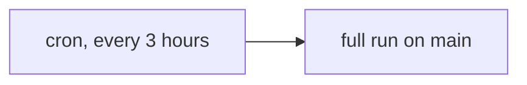
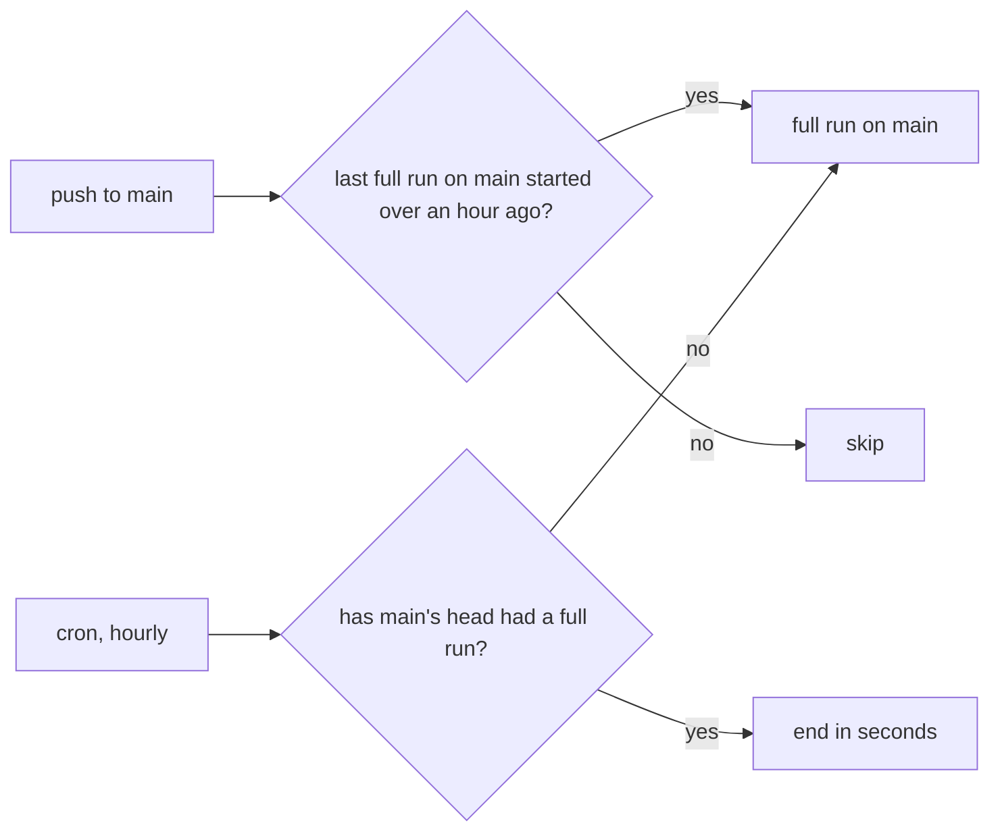

# 0581: Main's full run starts on a push to main if none started in the last hour and on an hourly catch-up, never on a 3-hour clock, and a law that can run on a stand-in runs on every pull request

**What this decides:** when the full run on main starts, and which laws run on every pull request.

**Before ([0534](0534-the-merge-line-runs-changed-tests-a-schedule-runs-all.md)):**



**After:**



```yaml
# a sketch of scheduled.yaml's triggers; the workflow change is its own pull request
on:
  push: { branches: [main] }
  schedule: [{ cron: "17 * * * *" }]   # minute 17, as before
  workflow_dispatch:
concurrency: { group: scheduled, queue: max }   # unchanged
```

One line to see: the clock stops deciding. A push asks for a run, a gap of an hour limits it, and
the hourly cron only catches a head nobody ran.

## Context

[0534](0534-the-merge-line-runs-changed-tests-a-schedule-runs-all.md) put the full run on a 3-hour
cron. A break could sit on main for almost 3 hours, and a run could start on a head that had just
been tested. The owner ruled on 2026-11-15 that a push starts the run, with a limit, and that an
hourly cron only fills the gaps. The same day he settled where laws run, after
[0536](0536-real-resource-tests-run-only-on-the-schedule.md) moved every real-resource law off the
merge line and left stand-in laws unsaid. The in-memory layers are ticket 1070, and
[0538](0538-kampus-vitest-holds-the-test-primitives.md)'s `lawsOn` is the runner that applies one law
to a stand-in and to the real layer.

## Decision

**A push to main starts a full run when the last one started over an hour ago. An hourly cron starts
one only when main's head has had none. A law that can run on a stand-in runs on every pull request.**

### A. When main's full run starts

- **On every push to main,** a small gate job asks the GitHub API when the last full run on main
  started. Over an hour ago: it starts the full run. Otherwise it skips.
- **Hourly catch-up cron** replaces `17 */3 * * *` and keeps the minute-past-the-hour offset
  (`17 * * * *`). It starts a full run only if main's head has had none. Otherwise it ends in seconds.
- **Bounds:** at most one full run an hour on main, and one run at a time. The concurrency rules in
  `scheduled.yaml` stay: `group: scheduled`, `queue: max`.
- **Hand-started branch runs** (`workflow_dispatch` on a branch) are unchanged.
- **The one-hour gap is a setting** ([0069](0069-choices-are-settings.md)). It is set in
  `.github/workflows/scheduled.yaml`, as one named value the gate job reads, 60 minutes to start,
  beside the cron line. Changing it is an edit of that file, not a decision.

### B. Where laws run

- **Laws that need the real thing stay off the pull request check and the merge line.**
  [0536](0536-real-resource-tests-run-only-on-the-schedule.md) stands.
- **Every law that can run on a stand-in** (an in-memory layer) **runs on every pull request.** A
  real layer's run of the same law stays on the full run (`lawsOn`, 0538).
- **A new `.integration.` law says in its plan why no stand-in will do.** The plan and tests skills
  carry this line.

**Binding constraints:**

- No full run on main starts within an hour of the last one, except by hand.
- A pull request or merge queue run starts no law that drives a real resource.

## Consequences

- A break on main shows within about an hour of a push, not 3, and a quiet main costs one cheap cron
  run an hour.
- The sev skill's "3-hour run" is now the full run, started by a push or the hourly cron. Its text
  and the other files that say "3-hour" point here.
- Amends [0534](0534-the-merge-line-runs-changed-tests-a-schedule-runs-all.md) in part (its
  schedule line) and [0536](0536-real-resource-tests-run-only-on-the-schedule.md) in part (its
  "3-hour schedule" wording, and the stand-in rule above). Both carry a dated Amendments line.
- The work that gives more laws a stand-in is ticket 1070.
- **Not decided here:** whether an affected slow law runs in the pull request check. That rule is
  not ruled.
