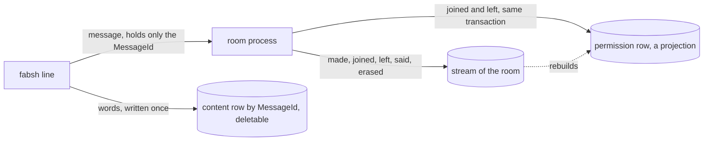

# 0583: In next/, a room is one process with one stream of events, its words live apart in a deletable content row, and a restart keeps an agent member



```ts
// A sketch, next/. One stream per room, past-tense events, no room numbers.
{ _tag: "made",   room, name: "bug-17", via: "line", from: null }
{ _tag: "joined", room, member }
{ _tag: "said",   room, message: MessageId, from: member, to, targets, answers }
{ _tag: "erased", room, message: MessageId, reason }
// words: a content row keyed by MessageId, never in the entry
```

**What this decides:** the six calls of the proposed note
[the records a room keeps](https://github.com/kamp-us/tea-fabrika/blob/fabrikalfa/room-records/docs/direction/the-records-a-room-keeps.md)
(pull request [1323](https://github.com/kamp-us/tea-fabrika/pull/1323)): what a room records, where
its words live, and what process writes it.

## Context

Step 8 of [Tier 1's build order](../docs/plan/tier-1.md#the-build-order) asks for R8's shape before
any talk line is saved. Calls 1 to 5 are owner rulings of 2026-11-15. **Call 6 was settled by
research, which the owner was shown and may override.** The note is on that pull request's branch
only, so it is linked there and not edited here. The doubts it marks open on these six calls are
settled by the sources below.

## Decision

**A room is one process that writes one stream of past-tense events, and the words of a message
are kept apart from the ledger.**

1. **One stream per room,** with the events `made`, `joined`, `left`, `said` and `erased`, in the
   house style for events ([0259](0259-each-event-brings-its-write.md)). A room has no message
   numbers; the data points at a MessageId.
2. **A message's words live in a deletable content row keyed by its id, never in the ledger
   entry.** This is the user-generated-content case, and a leaked key is reason enough. The ledger
   stays append only and its sealed stretches stay whole
   ([0206](0206-sealed-ledger-stretches-keep-one-order.md)). See
   [an agent run keeps its content](../docs/direction/an-agent-run-keeps-its-content.md).
3. **The message that carries a line to a room holds only the MessageId,** so the words are written
   once. A pipe's chunks can carry an id the same way
   ([0109](0109-a-pipe-is-saved-program-mail.md)).
4. **A room of two has no direct mark.** `made.via` records how it came to be.
5. **An agent member stays a member across a restart until it leaves or is dismissed.** This matches
   the rule that a restarted process keeps the member of the life it replaces, in the Amendments of
   [0531](0531-a-start-carries-its-member-down.md).
6. **The room's process,** in four parts:
   - **(a) One process per room.** ejabberd runs each chat room as its own Erlang process
     ([mod_muc_room](https://github.com/processone/ejabberd/blob/master/src/mod_muc_room.erl)), and
     Discord runs each of its servers, called a guild, as its own Elixir process
     ([How Discord Scaled Elixir to 5,000,000 Concurrent Users](https://discord.com/blog/how-discord-scaled-elixir-to-5-000-000-concurrent-users)).
     Discord is cited as an architecture example only.
   - **(b) The room process writes every room event,** and who spoke is a field in the event, as
     Matrix's `sender` ([events](https://spec.matrix.org/v1.16/client-server-api/)) and IRC's nick
     prefix ([modern IRC](https://modern.ircdocs.horse/)) are.
   - **(c) The permission row is a projection of `joined` and `left`,** like Zanzibar's relation
     tuple ([paper](https://research.google/pubs/zanzibar-googles-consistent-global-authorization-system/))
     and Unix's `/etc/group` ([group(5)](https://man7.org/linux/man-pages/man5/group.5.html)). It is
     written in the same transaction as the event and can be rebuilt from the room's stream, so it
     is not a second fact ([0526](0526-one-rebac-permission-system.md)).
   - **(d) `join` is a fabsh built-in that sends a message to the room's inbox,** like IRC's `JOIN`
     to the server ([modern IRC](https://modern.ircdocs.horse/)). No join program holds data
     ([0159](0159-fabsh-pipes-summon-join-first.md)).

**Binding constraints**

- No room event carries a number of its own, and no entry holds a message's words.
- The permission row is never written without its event, and never read as the history.

## Consequences

- Deleting words leaves the fact that something was said, who said it and when.
- A room of two made by an `@` line is told apart by `via`, which goes stale less than a mark.
- Not decided here: the verb's final word, two agents with one name in a room, how a room of two is
  named, and the screen.

## Amendments

- 2026-11-15: the doubts on calls 1 to 6 in the note's table are settled by the rulings and sources
  above. The note stays on its own pull request's branch, which this decision does not edit.
- 2026-11-15: the source in call 6(a) is restored. The owner ruled that the product may be named,
  so Discord and its engineering post are cited again.
