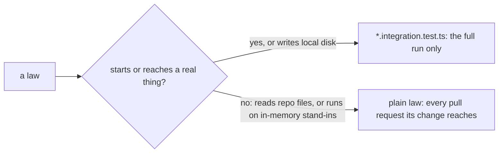

# 0584: A test's kind follows what it uses, never its name, and every plain law, tooling included, runs on the pull request its change reaches

**What this decides:** what makes a test an `.integration.` test, and which laws a pull request runs.



```ts
// A sketch: the same question, asked by code, both ways.
plain.test.ts        // may not import a real-thing starter
x.integration.test.ts // must reach one, or it is a plain law with the wrong name
```

## Context

On 2026-11-15 main broke three times from pull requests whose laws ran only in the full run: the
`.agents/` mirror law in `next/apps/fabrika/src/exam/edge-comment.integration.test.ts`, which only
reads `.oxlintrc.json`; `.github/ci/related.test.ts`, a tooling law
([0539](0539-the-merge-line-runs-no-tooling-tests.md) keeps every tooling law off the merge line);
and the quota laws, which do need a real instance. [0581](0581-main-full-run-starts-on-push-and-hourly.md)
had ruled that a law that can run on a stand-in runs on every pull request, but a file's name, not
what it uses, still decided where it ran. The owner then ruled the definition below, after research
into how Google sizes tests (Software Engineering at Google, chapter 11, "test size": small runs in
one process, medium on one machine, large on many). Ticket 1073 builds it; its plan is
`docs/plan/quests/pr-check-file-laws-PLAN.md`.

## Decision

**A test's kind follows what it uses. A law that starts or reaches a real thing is an
`.integration.` law and runs only in the full run; every other law is plain and runs on every pull
request whose change reaches it, whatever it is called.**

- **A real thing** is a real instance, workerd, Electron or a browser, a child process, a real
  signal, a port, or the network.
- **A law that writes to local disk is `.integration.` too:** a SQLite file or a temp folder. In
  Google's sizes a small test may not touch the file system and a test that uses local disk is
  medium, and medium and up are `.integration.` here. It moves to plain when an in-memory stand-in
  takes the disk's place (ticket 1070).
- **A plain law** reads the repository's files or runs on in-memory stand-ins.
- **Tooling laws follow the same rule.** A plain tooling law runs on the pull request its change
  reaches, picked by Vitest's `--changed`, as next/'s plain laws are. A tooling law that starts a
  process is an `.integration.` law and stays on the full run.
- **Code holds the name both ways, where it can tell:** a lint rule fails a plain test that imports
  or calls a real-thing starter, and an `.integration.` file that uses none. What code cannot tell
  (a real thing reached through a helper's helper, or inside a dependency) is named in the rule's
  docs and left to review. Each direction blocks only once its false alarms are measured at zero on
  main ([0523](0523-advice-rules-block-where-clean.md)).
- **Where a law can do without its real thing,** it gets a stand-in and comes back to the pull
  request (0581).

**Binding constraints:**

- No pull request or merge queue run starts a law that reaches a real thing
  ([0536](0536-real-resource-tests-run-only-on-the-schedule.md) stands).
- A file's `.integration.` name is earned by what it uses: a law that reaches no real thing does not
  keep it.

## Consequences

- Amends [0539](0539-the-merge-line-runs-no-tooling-tests.md) in part: plain tooling laws run on
  the pull request their change reaches, and only tooling laws that start a process stay off the
  merge line. The full run still runs the whole tooling project.
- Amends [0544](0544-every-reviewed-pull-request-is-armed.md) in part: a break only the full run can
  see is now one only a real thing can show. A plain law's break is caught before the merge.
- Amends [0536](0536-real-resource-tests-run-only-on-the-schedule.md) in part: its "real resource"
  is read through this definition.
- The pull request check runs more laws, so it costs more runner time; the plan sizes it against
  [0541](0541-ci-speed-has-a-goal-and-a-daily-check.md)'s goal, and the daily speed job watches it.
- The disk rule keeps 0536's and experiment 292's count of a SQLite file and temp files as real,
  and it keeps the slowest laws off the pull request, within
  [0541](0541-ci-speed-has-a-goal-and-a-daily-check.md)'s limit.
