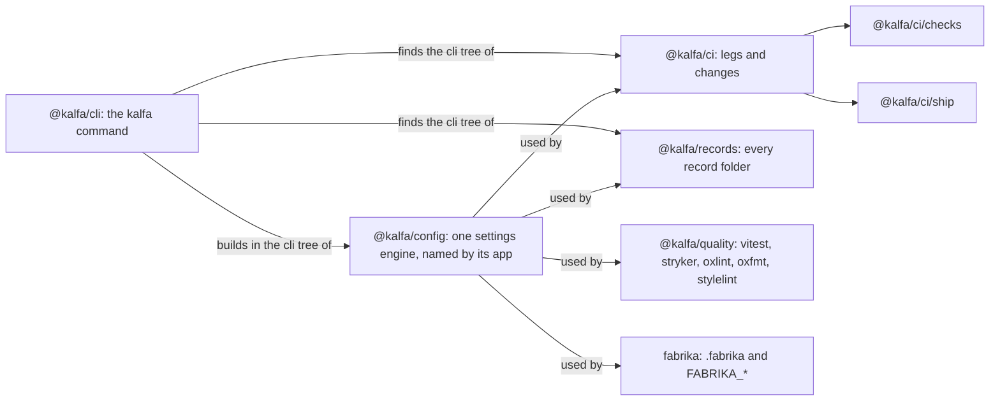

# 0585: Our tooling is five @kalfa packages grouped by domain, config, ci, records, quality and a thin cli, reached through one kalfa command, never one small package per tool, its settings never take a FABRIKA_ name, and every record folder moves under one .kalfa/ folder



```text
# A sketch of the layout.
kalfa/
  cli/        @kalfa/cli        the one kalfa command; finds each dependency's ./cli tree
  config/     @kalfa/config     settings engine: .<app>/<app>.toml, <APP>_<SECTION>_<KEY>, --section.key
  ci/         @kalfa/ci         from .github/ci: legs, changes
                @kalfa/ci/checks  leakgrep, loosening, governance, sizecap, skillscheck,
                                  plants, pin, redact, unlisted, movecheck
                @kalfa/ci/ship    today's land.ts and pr/
  records/    @kalfa/records    find, list, next, show, resolve; field rows; frontmatter Schemas
  quality/    @kalfa/quality    testing, linting and formatting, one subpath per tool
                @kalfa/quality/vitest   0557's test toolbox
                @kalfa/quality/stryker  plants and mutation
                @kalfa/quality/oxlint   from oxlint-plugins/
                @kalfa/quality/oxfmt, @kalfa/quality/stylelint

.kalfa/
  kalfa.toml    [records] says where each folder is
  decisions/  glossary/  patterns/  runbooks/  experiments/  direction/  field/
```

**What this decides:** how many tooling packages there are and what each holds, how a person or a
tool calls them, that tooling settings carry no fabrika name, where the record folders go, what
stays where it is, and when the builds land.

## Context

[0556](0556-kalfa-holds-our-tooling-packages.md) made `@kalfa` our npm scope for tooling and infra
and `kalfa/` its folder. It left open whether the tooling that exists today (`oxlint-plugins/`,
`.github/ci` and `.agents`) moves in. [0557](0557-kalfa-vitest-is-the-test-toolbox.md) named the
first package, `@kalfa/vitest`. [0600](0600-kalfa-quality-holds-test-lint-format.md) later put
testing, linting and formatting in one package, `@kalfa/quality`, with one subpath per tool, in
place of `@kalfa/vitest` and `@kalfa/oxlint`.

On 2026-11-15 the owner ruled on the rest: which packages, what each holds, the one command that
calls them, how tooling is configured, where the record folders go, and the order the builds land
in. This amends 0556 in part: it settles the first item under its "Not decided here".

It also amends in part three decisions that name a record folder's path:
[0001](0001-decisions-live-in-the-repo.md) (`.decisions/`),
[0005](0005-patterns-and-decisions-are-visual.md) (`.patterns/`) and
[0571](0571-runbooks-live-in-top-level-runbooks.md) (`.runbooks/`). Only the folder each names
moves under `.kalfa/`, when the move is built.

It builds on these, which it cites and does not change:
[0113](0113-no-shell-or-python-scripts.md) (no shell or Python script; ports to TypeScript and
Effect), [0231](0231-ledger-and-codehost-are-separate.md) (no direct `gh` call; the code side goes
through the code host service), [0086](0086-settings-are-declared-once.md) (how a setting is
declared and read) and [0159](0159-fabsh-pipes-summon-join-first.md) (fabrika is built inside
fabrika, so the step runner's job goes to fabrika).

[0601](0601-program-make-with-optional-pipes.md) adds small libraries of one domain each beside the
tooling packages: `@kalfa/program`, `@kalfa/ledger` and `@kalfa/transport`. They are not tooling,
so the count below does not include them.

## Decision

**Our tooling is five `@kalfa` packages, grouped by domain. A tool goes in the package for its
domain and is exported by subpath, never made into a small package of its own.**

### The five packages

- **`@kalfa/config`** (`kalfa/config/`): one settings engine, named by the app that uses it.
  - fabrika uses it for `.fabrika` and `FABRIKA_*`. Every `@kalfa` package uses it for `.kalfa`
    and `KALFA_*`.
  - The person file is `~/.<app>/<app>.toml` and the repo file is `.<app>/<app>.toml`. The
    environment name is `<APP>_<SECTION>_<KEY>`, and the flag is `--section.key`.
  - Each setting is declared once with a Schema. The reference page and the JSON Schemas are
    generated from the declarations. The order is the one fabrika has today (0086): flag,
    environment, repo file, person file, default.
  - There is no `kalfa.config.ts`. Settings are data in TOML, not code.
  - The known ways it follows: Effect's `ConfigProvider` is the reader, and naming the file by its
    app is how c12 (unjs) and cosmiconfig find a tool's config.
- **`@kalfa/ci`** (`kalfa/ci/`, from `.github/ci`).
  - The root export keeps the legs and the changed-paths code.
  - **`@kalfa/ci/checks`** holds leakgrep, loosening, governance, sizecap, skillscheck, plants,
    pin, redact, unlisted and movecheck. A shell or Python check becomes TypeScript and Effect as it
    moves (0113).
  - **`@kalfa/ci/ship`** is today's `land.ts` and `pr/`, named for its job: check, leak check,
    merge main, sign, push, open the pull request, queue, arm.
    - GitHub stays the only real code host. The direct `gh` calls in `land.ts` move behind the code
      host service (0231).
    - It refuses to merge unless leakgrep passed in the same run.
    - It refuses to arm while the pull request's text is still draft text.
- **`@kalfa/records`** (`kalfa/records/`): every record folder: decisions, patterns, glossary,
  runbooks, experiments, direction notes and field rows.
  - It holds the commands `records.ts` has today (`list`, `next`, `find`, `resolve`), adds `show`,
    and takes in `fieldfile` and `fieldrow`, the field-row writers.
  - Each kind's frontmatter is a Schema. The checks on records live here; `field-check` moves in.
- **`@kalfa/quality`** (0600): testing, linting and formatting, with one subpath per tool.
  - The subpaths are `/vitest` (0557's test toolbox), `/stryker`, `/oxlint` (from
    `oxlint-plugins/`), `/oxfmt` and `/stylelint`. A new tool in this domain is a new subpath. The
    package root holds only pieces two or more subpaths share. Each tool is an optional peer
    dependency, and no subpath imports another tool's subpath.
  - It is shaped to publish: its own README and tests, and no repo path baked in. A value that is
    ours becomes a setting.
  - It stays `"private": true` until the owner says publish (0556). Changesets come only then.
- **`@kalfa/cli`** (`kalfa/cli/`): a thin package that gives the one `kalfa` command. Its shape is
  the next section.

### One `kalfa` command

**Each package that has commands exports its command tree as `./cli`, and `kalfa` finds those
trees at start from the project's own dependencies.**

```jsonc
// kalfa/records/package.json, a sketch: the field that makes a package a kalfa command.
{ "name": "@kalfa/records", "exports": { "./cli": "./src/cli.ts" }, "kalfa": { "cli": "./cli" } }
```

```text
# A sketch: a project that installs only @kalfa/cli and @kalfa/records.
$ kalfa --help
  records   (found in package.json dependencies)
  config    (built in)
  help      (built in)
  version   (built in)
```

- **A tree is an `effect/cli` `Command`,** the way `next/apps/fabrika/cli.ts` already builds the
  `fabrika` command.
- **Discovery, step by step:**
  1. On start, `kalfa` reads the dependencies in the project's own `package.json`. It never scans
     `node_modules`; ESLint dropped that in v9 because it was slow and surprising.
  2. It keeps the `@kalfa/*` packages whose `package.json` has `"kalfa": { "cli": "./cli" }`.
  3. It imports each one's exported `effect/cli` `Command` and adds it with
     `Command.withSubcommands`.
  4. It adds the built-ins: `help`, `version` and `config`.
- So a project that installs only `@kalfa/cli` and `@kalfa/records` gets `kalfa records ...` and the
  built-ins, and nothing else.
- **The known ways it follows:** oclif's plugins, which a project lists in its `package.json`, and
  the subcommands of cargo, git and gh, where an installed piece adds a verb to one command.
- **No manifest now.** If the load time of `--help` ever matters, an oclif-style manifest of
  command names comes then.
- **`ship` stays inside `@kalfa/ci`,** as `kalfa ci ship`, never a package of its own.
- **The command shape:**

```text
kalfa records decisions find|list|next|show|resolve
kalfa records field write
kalfa ci ship run|arm
kalfa ci checks <name>
kalfa config get|set
```

- **Skills, scripts and CI call `kalfa ...`,** never a file path or a `.ts` script.

### No FABRIKA_ name in tooling

**A tooling setting never takes a `FABRIKA_` name or a `~/.fabrika` path.** fabrika is the product;
our tooling naming itself after it is a leak of one into the other.

- The first case: `FABRIKA_LEAK_WORDS` becomes `KALFA_LEAK_WORDS`, and `~/.fabrika/leak-words`
  becomes `~/.kalfa/leak-words`.
- That file is private. No agent reads or prints it; a plan or a test names it only by its path.

### Every record folder under `.kalfa/`

**Every record folder moves under one `.kalfa/` folder, the way GitHub's files live under
`.github/`.** The names stay the same, `field` and `direction` included.

```text
# before                        # after
.decisions/                     .kalfa/decisions/
.glossary/                      .kalfa/glossary/
.patterns/                      .kalfa/patterns/
.runbooks/                      .kalfa/runbooks/
experiments/                    .kalfa/experiments/
docs/direction/                 .kalfa/direction/
field/                          .kalfa/field/
                                .kalfa/kalfa.toml
```

- **`docs/` keeps only documentation of what fabrika is.** `docs/plan` stays where it is for now.
- **Each move is a `git mv`,** so history follows.
- **No tool hard-codes a record path.** Tools, skills, scripts and CI call `kalfa records ...`.
- **Where each folder is lives in `[records]` settings in `.kalfa/kalfa.toml`,** so a later move
  touches one file.

```toml
# A sketch of .kalfa/kalfa.toml. The key names are the records plan's to pick.
[records]
decisions = ".kalfa/decisions"
field = ".kalfa/field"
```

- **Markdown links in prose keep real paths,** because a link must click on GitHub. The `records`
  command rewrites those links during the move. No find-and-replace script does it.
- **`.ignore` and the CI path filters follow the move.**

### What stays where it is

- **Skill prose stays in `.agents/skills/`.**
- **The step runner does not move:** `chain`, `drive`, `box`, `quest`, `flow`, `mutbox` and the
  agent runners. fabrika itself takes that job over (0159), so it gets fixes only.

### When it lands

- **Plans start now.** Builds land at the tail of the sev0 list, in this order: config, with
  `@kalfa/quality`'s `/stryker` beside it, then ci (with checks, ship and the leak-words move), then
  records, then quality's `/vitest`, then its `/oxlint`.
- **The move under `.kalfa/` builds at the sev0's tail too, after `@kalfa/records` exists,** since
  the move is done by its command.
- **A build that moves `oxlint-plugins/` or `.github/ci` waits** until the Effect-check and
  anti-slop sweeps are past the folders it touches. A path move reruns every check on every moved
  file.

**Binding constraints:**

- There are five `@kalfa` tooling packages. A new tool is a subpath of the package for its domain,
  never a sixth small package, unless a later decision adds one. The small libraries of
  [0601](0601-program-make-with-optional-pipes.md) are not tooling and are not counted.
- A package's commands are its `./cli` export, an `effect/cli` `Command`, named by its
  `kalfa.cli` field. `kalfa` loads only the project's own dependencies that carry that field,
  never a scan of `node_modules`, and `help`, `version` and `config` are always there.
- Skills, scripts and CI call `kalfa ...`, never a tooling file path or a `.ts` script.
- No tooling setting, environment name or path takes `FABRIKA_` or `~/.fabrika`.
- No tool, skill, script or CI file hard-codes a record folder's path; it asks `kalfa records`.
  Prose links are the one exception, and `records` keeps them true.
- No `kalfa.config.ts`. Tooling settings are TOML read by `@kalfa/config`.
- `@kalfa/ci/ship` never merges without a leakgrep pass in the same run, and never arms a pull
  request whose text is draft text.

## Consequences

These are the lead's reading of what follows from the ruling. They are not the owner's words.

- **Each package gets its own plan,** in the build order above. The `@kalfa/config` plan is the
  first. It carries its own `./cli` tree (`kalfa config get|set`), and its first users include the
  `[records]` settings.
- **The leak-words move belongs to the ci plan,** since leakgrep moves into `@kalfa/ci/checks`.
  Every test that sets `FABRIKA_LEAK_WORDS` today changes with it.
- **The record move belongs to the records plan.** It renames many paths at once, so it waits for
  the sweeps like any path move, and every skill and script that names a record folder moves to
  `kalfa records` first.
- **Skill commands change as each package lands.** A skill that runs `node .../records.ts` or
  `sh .../leakgrep.sh` today runs `kalfa ...` once that command exists.
- **The cost.** `@kalfa/config` makes the engine general before a second app is real, and the
  record move touches nearly every prose link once. Both are paid once. Discovery costs one
  read of `package.json` and one import per kalfa dependency at every start.
- **The discovery laws** go in the plan that carries `@kalfa/cli`: a dependency without the
  `kalfa.cli` field adds nothing, a package that is not a dependency is never loaded, and the
  built-ins are always there.
- **Today's version** (`packages/`, `programs/`, `apps/`) is not covered, as 0556's scope line says
  ([0217](0217-next-grows-beside-today.md)).

**Not decided here:**

- The `[records]` key names and the exact output of `kalfa records decisions show`.
- When `@kalfa/quality` is published.
- Where `docs/plan` goes later.
- Where `.agents/` lives once the step runner's job moves into fabrika.

## Records

- `.glossary/TERMS.md`: the `kalfa` row gains the five packages, the `kalfa` command and the
  `.kalfa/` folder. No new word is coined: `ship` keeps its glossary meaning, the one merge
  authority.
